Fana’Briques 2011, la grande exposition de LEGO à la française, réalisée par une grande équipe et c’est tout à son honneur, des choses encore plus époustouflantes et merveilleuses cette année. Un nombre impressionnant de visiteurs !

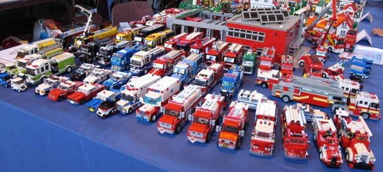

Cette année beaucoup de changement à Fana’Briques !

Une ouverture dès le vendredi soir : une nocturne !  
Avec la diffusion d’un brickfilm réalisé par toute une équipe de passionnés stop motion, des mois et des mois de préparation pour arriver au résultat final, un film d’une demi heure !  
Un grand succès car dès ce premier jour plus de 1000 spectateurs !

Le samedi, le grand week-end commence, des animations LEGO énormes, une mosaique géante qui a demandé des milliers de mains et 2 jours complets de travail pour une fresque sur le thème pompier :

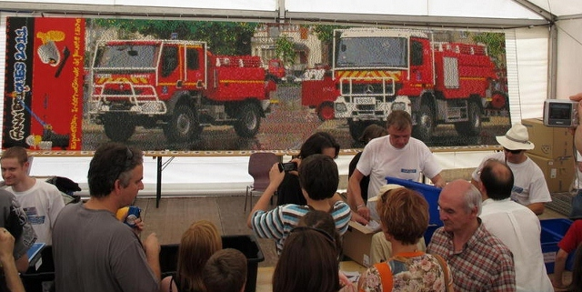

**Une fresque géante à Fana’briques en 2011**

De multiples jeux pour le public , les célèbres terrains de basket , le jeu des contes réalisé par Daniela :

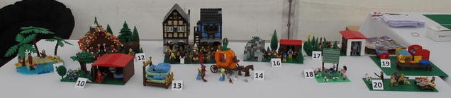

La fusée géante LEGO qui s’est aussi déclinée en une animation pyramide :

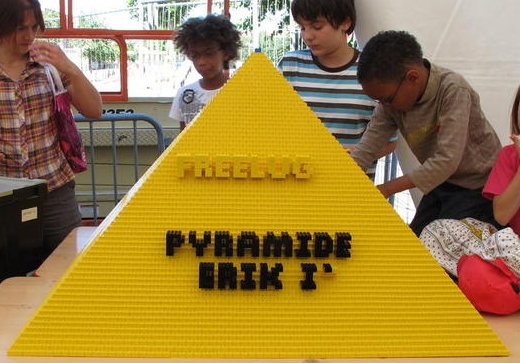

Des réalisations à couper le souffle : la cathédrale de Cologne à l’échelle Minifig , + d’1 million de pièces , quelques 2 années de travail :

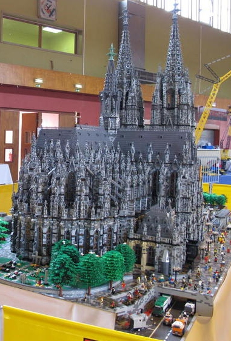

Des villes énormes, des robots extraordinaires , des grues géantes hautes comme le ciel !  
Des centaines de créations dans tout les domaines :

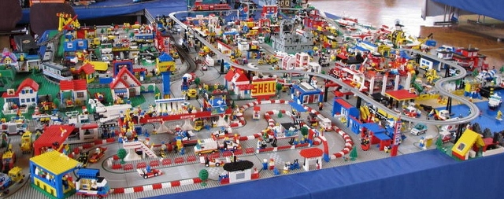

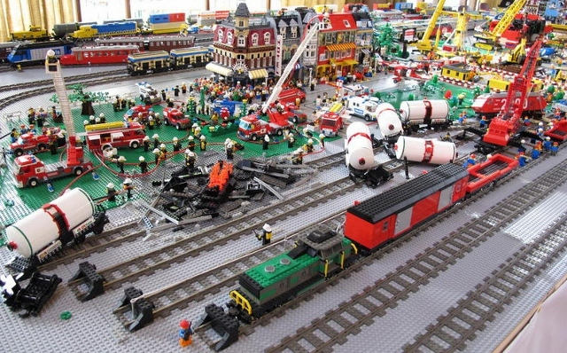

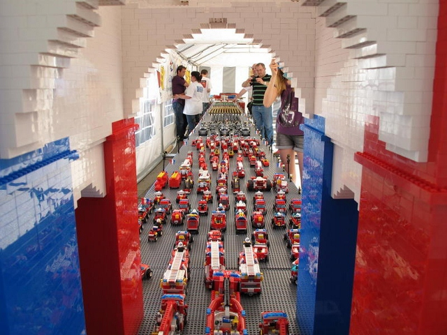

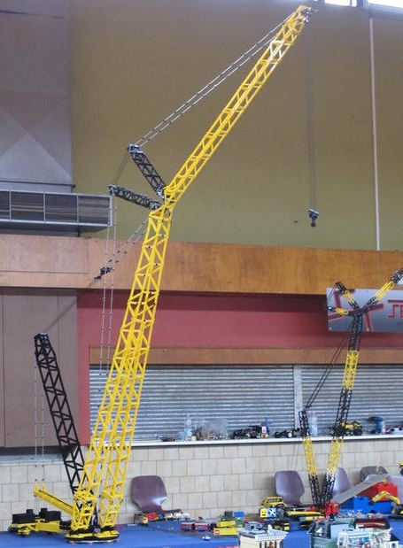

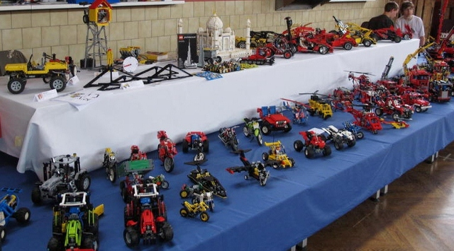

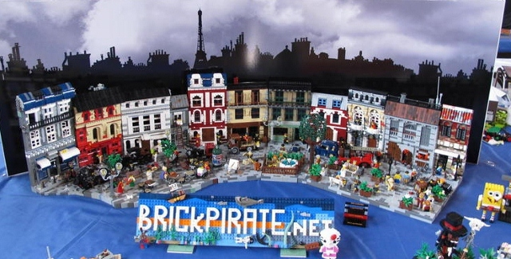

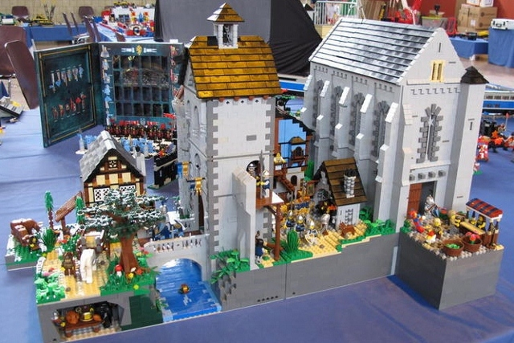

La première apparition de la ville dans les nuages, le thème SteamPunk :

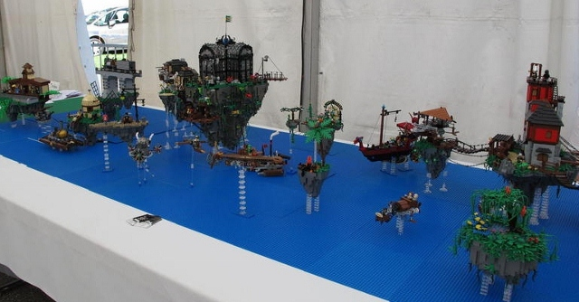

Galerie photos des adhérents et autres :  
**–** [Galerie Brickerik](http://photos.freelug.org/main.php/v/brickerik/expositions/2011/Fanabriques/)  
**–** [Galerie Sixstuds](http://photos.freelug.org/main.php/v/6studs/Expos/FB+2011/)  
**–** [Galerie SystemDbrick](http://photos.freelug.org/main.php/v/f1tvf/expositions/fana2011/)  
**–** [Galerie Philo](http://photos.freelug.org/main.php/v/philo/fanab2011/)

Fana’briques ? Nous y retournons tous en 2012 !
