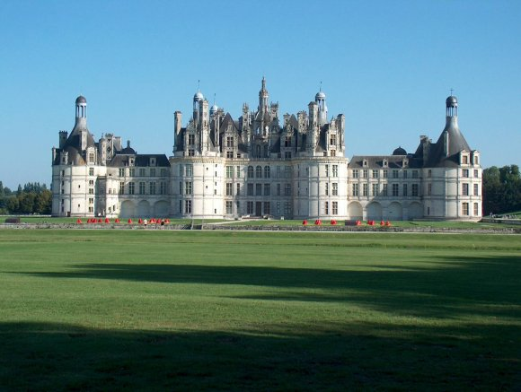
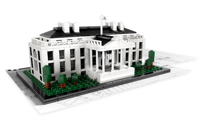

Nouveau concours de créations pour la [Rencontre Estivale FreeLUG édition 2011](/articles/1265/) !

En suivant les sets de la [gamme Architecture](http://www.brickset.com/browse/themes/?theme=Architecture), reproduisez un château réel que l’on trouve dans les Pays de la Loire, à vous de dénicher la perle rare.

**Château de Chambord**

Source de la photo - [http://www.all-free-photos.com/](http://www.all-free-photos.com/)

Pas de limite de pièces ni de taille si ce n’est qu’il doit de rester dans les proportions qui existe actuellement dans ces sets.

Pour exemple, cela varie de 57 à 815 pièces, et il y a principalement que des petites pièces (beaucoup de plates et peu de briques) et dans des couleurs simples (noir, blanc, gris, tan, etc.).

**La Maison Blanche**

La maison blanche fait par exemple 18 tenons de large pour 28 tenons de long.

Il faudra respecter le concept de la bordure lisse noir.

Vous pouvez ramener plusieurs créations (et c’est vivement conseillé !) mais qu’une seule pourra être présentée pour le concours.

Voici les critères :  
**–** reproduction fidèle (il faut que l’on reconnaisse le château) : 4 points  
**–** technique de construction et pièces utilisées : 3 points  
**–** originalité : 3 points

Soit un total sur 10 points.

Un jury sera nommé le jour même, des sets Architecture sont à gagner !

A vos briques !
