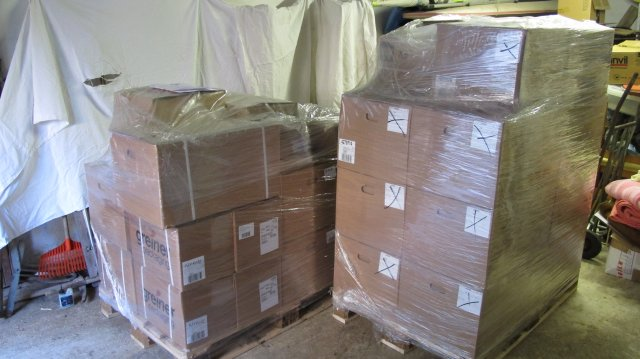
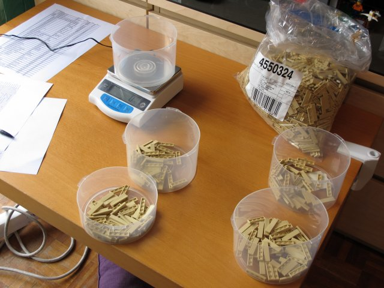
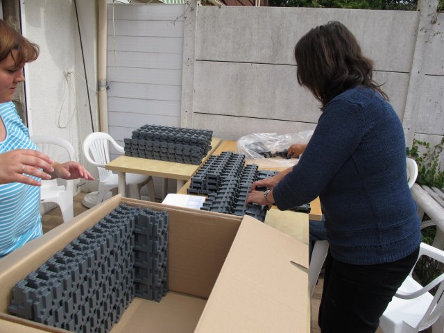

En guise d’introduction, quelques chiffres :  
**–** plus de 200 000 pièces dont environ 2000 plaques de base ;  
**–** deux palettes, pour 500 kg de briques ;  
**–** 30 cartons ;  
**–** 74 participants ;  
**–** 1400 lots ;  
**–** et 10 heures pour trier à 10 personnes

## Première séance

Cette fois-ci, c’est Jérémy qui nous accueillait pour la séance tri.

La journée débuta à 9 h, pour s’achever à 21h, avec une pause repas d’une heure à midi.

Avec une telle commande, il fallait de l’organisation. Nous nous sommes répartis en trois équipes de tri :  
**–** une pour les petites pièces, avec l’aide de la balance compteuse à précision 0,01g achetée par l’association,

**–** les deux autres pour les pièces de plus grande taille avec un comptage exclusivement manuel !

Jérémy a également préparé des étiquettes pour chaque lot, permettant l’identification et le pointage plus rapide des lots.

Une journée faite avec plaisir et dans la bonne humeur !

## Seconde séance

Pierre, Jérémy et Erik se sont retrouvés un dimanche supplémentaire pour préparer les commandes individuelles, compter les plaques de base et réaliser le dispatch entre REF, lots pour Rhônes-Alpes, lots à envoyer par la poste, et le restant sur Paris.

## Quelques chiffres

Quelques données pour illustrer ce que représentait cette commande :  
**–** 2277 plaques (dont 560 de routes) pour un équivalent de 2031 plaques 32x32, soit de quoi recouvrir 225 modules 3x3, soit environ 126m². Avec les plaques blanches, on pourrait reproduire une base Hoth de 15m² ;  
**–** 199600 pièces (hors plaques de base) ;  
**–** 1300 rails droits, soit 160 m de rails ;  
**–** la pièce la plus commandée : Plate 1 x 2, Dark red avec 11600 exemplaires ;  
**–** la pièce la moins commandée : Technic Liftarm 1 x 15 Thick, White avec 500 exemplaires ;  
**–** la pièce la plus commandée par une personne : Brick 1 x 2, Black avec 4500 exemplaires ;  
**–** équivalent brick : 91000 bricks 1x1  
**–** équivalent plate : 160000 plates 1x1  
**–** équivalent tile : 30000 tiles 1x1

On s’attend également à voir apparaitre en exposition un immeuble avec 1000 fenêtres 1x4x6 :)

Pour finir, en cumulant le temps passé, c’est plus de 150 heures qui ont été nécessaires pour trier cette commande, soit plus d’un mois de travail à temps complet pour une personne, le tout réalisé bénévolement sur notre temps libre...

C’est sans compter le temps passé à enregistrer les voeux de chaque participant, traiter les bons de commande, la préparation des colis pour les envois (près de 100kg de colis à envoyer...), et les insomnies du trésorier :o)

Du coup, étant donné le volume atteint par cette commande, nos règles d’accès au LUGBulk évolueront très probablement pour la commande suivante.

**Galeries photos :**  
**–** [http://photos.freelug.org/main.php/...](http://photos.freelug.org/main.php/v/FreeLUG/Promotions_speciales/lugbulk2011/)

**Précédents bulk**  
**–** [LUGBULK de février 2010](/articles/1151/)  
**–** [LUGBULK de juin 2010](/articles/1198/)
