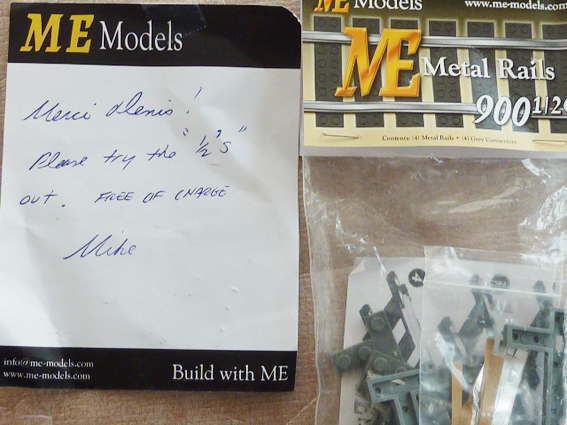
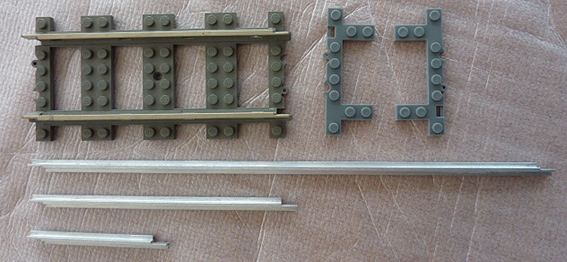
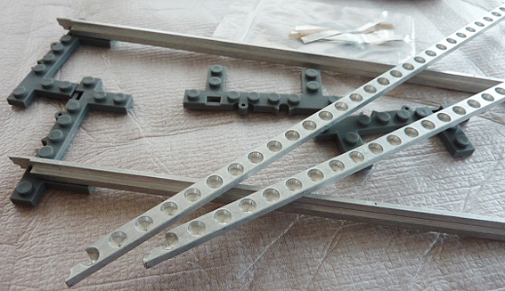
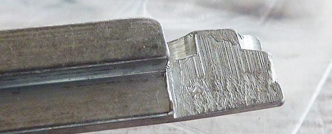
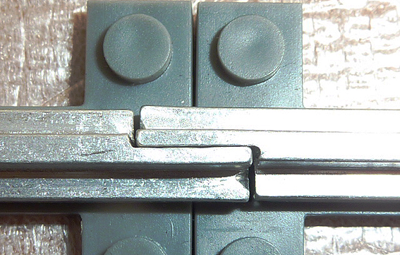
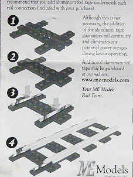
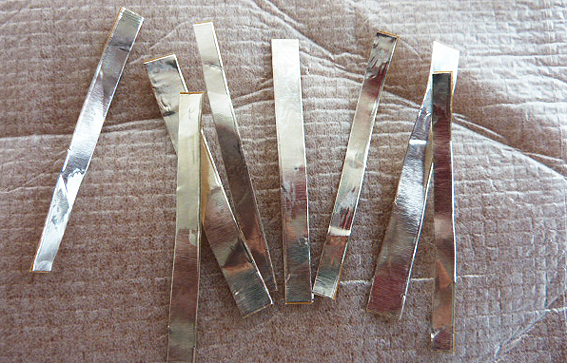
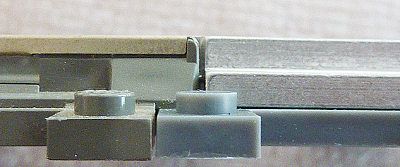
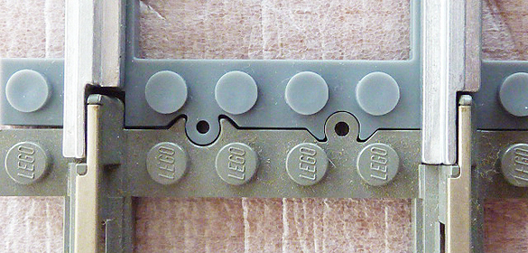
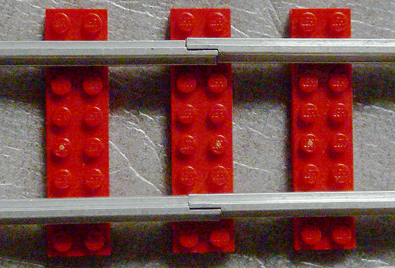

LEGO arrête de fabriquer des ’rails’ 9V ! Catastrophe. Certains se jettent sur les dernières boites en vente sur le shop, et après ?

Il reste l’occasion et maintenant depuis quelques mois les voies « ME Models ». Qu’en est-il exactement ?

Le fabriquant américain ’ME Models’ mets sur le marché un ensemble de sets de voies compatibles LEGO 9V et RC.

Que valent-ils exactement ?

Faut-il acheter ces ensembles de voies ou continuer de chercher des ’rails’ 9V LEGO qui sont devenus plus chers ?

Donc, curieux, j’achète quelques sets que je reçois assez rapidement. Première bonne surprise, le vendeur m’a mis en plus un set de demi-rails et accompagné d’un petit mot.

Cela est très commercial... mais fait aussi très plaisir.

**Le set de rails ME Models.**

Il faut bien parler d’un set car à la différence du ’rail’ LEGO qui est une seule pièce, ME Models propose en fait un ensemble de pièces traverses + rails pour faire un tronçon de voie.

Typiquement, un set est composé de :  
**–** x paires de rails de fabrication ME  
**–** x paires d’extrémités de raccord de voie de fabrication ME.  
**–** x fois n traverses (les sets sont vendus au choix avec ou sans traverses) qui sont des plates LEGO 2x8.

Ce set existe en différentes longueurs de coupon de rails. L’unité de mesure est la longueur d’une voie LEGO :  
**–** normal = un ’rail’ LEGO. (ME900G)  
**–** double : Double (ME900-2G)  
**–** quadruple : Quad (ME900-4G)  
**–** moitié : Half (ME900-5G)

Pour l’instant, uniquement des voies droites sont disponibles en deux couleurs au choix :  
**–** gris : Gray (suffixe G)  
**–** marron : Brown (suffixe B)

## Le concept de base

L’idée de départ est très simple comme toutes les bonnes idées : pouvoir emboiter les rails sur les tenons LEGO et ainsi faire une voie. On ajoute à cela la pièce ad hoc de jonction de bout de chaque tronçon de voie et le tour est joué. Trop facile !

En fait c’est un retour aux sources : les premières voies LEGO 4,5V et 12V étaient sur ce principe et étaient de la même façon commercialisés en différents sets.

## Les rails

Le coupon de rail est à base d’un simple profilé d’aluminium en T. Le socle est percé de trous non débouchant permettant l’emboitement sur des pièces LEGO. L’emboitement est très solide car l’aluminium n’a pas l’élasticité de l’ABS et le diamètre des trous est très serrant sur les tenons.

Chaque extrémité de rails est usiné à moitié pour permettre l’emboitement longitudinal ainsi que ’si possible’ la continuité électrique (je reviendrai sur ce point).

En examinant visuellement de près cet usinage [^1] : il n’est pas de bonne qualité pour ne pas dire plus. Mais la question reste posée de savoir si cette non qualité apparente de la surface pourrait-elle être en fait une tentative de créer de la rugosité pour la continuité électrique ?

Car la continuité électrique est un problème.

La rigidité de l’aluminium ne permet pas facilement de donner une légère courbure au bout des rails pour assurer un fort contact de jonction. Donc le contact est approximatif voir aléatoire sans l’usage d’éclisses ou de jonctions vissés comme le font les modélistes.

Pour pallier à ce problème, chaque set et livré avec un jeu de bande autocollante aluminium à mettre sur les embouts de connexion avant le clipsage des rails. Montage à usage unique... (ME Models vend séparément des sachets de ces bandes sur son site !)

Là aussi, leur découpage semble très artisanal.

Dernier point en ce qui concerne la partie électrique : les connecteurs d’alimentation électrique 9V du boitier régulateur LEGO ne se montent pas sur les rails ME Models.

## Les jonctions

Elles sont selon le constructeur en ABS. A l’examen visuel on a plus l’impression d’une pièce en ’mauvais plastique’ qu’une pièce en ABS signé LEGO.

Les emboitements entre ces pièces elles-mêmes et entre ces pièces et un embout de voie LEGO sont plutôt bons mais pas finement ajustés.

Longitudinalement, le raccord est bon en terme de niveau vertical y compris avec les voies LEGO.

Notez qu’en fait, ces jonction ne sont pas indispensables et que le montage d’une voie avec des rails ME Models peut se faire entièrement par exemple sur des plates 2x8 rouges. Votre imagination fera le reste et c’est là où les courbes ME Models manquent.

## Quel bilan ?

Il est dommage que quitte à faire un set de voie custom, ME Models n’ait pas utilisé un profil de rail Vignole, vu le public qui potentiellement peut acheter ce type de set (cela existe et les profils en aluminium, laiton, acier inox ou maillechort se trouvent très facilement sur le marché du modélisme).

Et pour revenir aux deux questions initiales que peut-on dire ?

Au bout du compte et vu le prix de vente, la qualité de fabrication de ce set est juste correcte, sans plus.

Toujours compte tenu de son prix de vente actuel, je pense qu’il est préférable de continuer d’acheter des ’rails’ 9V LEGO que l’on peut trouver à environ 3 Euros pièces (pour les droits et beaucoup moins pour les courbes) plutôt que le set ME Models de même dimension de rails.

A 3 Euros pièce le ’rail’ droit, un mètre de voie LEGO va couter 24 Euros. Pour faire le même mètre en voie ME et dans le cas le plus favorable, cela vous reviendra à environ 26 USD. Ce qui en fonction de la variation de change actuelle fera une moyenne à 20 Euros. Cette différence de prix vaut le coup pour avoir des voies LEGO vu la différence de qualité. Mais bon, ce point de vue n’engage que moi.

Par contre, pour ceux qui ne bricolent pas ou qui refusent de couper/coller le moindre morceau d’ABS sortant de chez LEGO, les sets des longueurs 1/2, double ou quad sont intéressant vu que ces longueurs n’existent pas en LEGO d’origine.

La pièce de jonction de voie en marron peut aussi être intéressante pour les fan de vieilles voies et voulant une jonction de type LEGO.

Personnellement pour ce que je cherche à faire en train LEGO, je ne vais pas me précipiter sur ces sets de voies. En cas de besoin, je vais continuer de faire mes propres voies.

Je changerai surement d’avis si ME Models commercialisait pas trop cher uniquement des coupons de rails (Vignole) et en plus grande longueur : une LGV pour tous quoi !

Pour les AFOL pas bricoleurs, ces sets sont sans aucun doute une solution acceptable pour des voies métalliques à l’écartement LEGO et prêtes à l’emploi dans le cadre d’un usage domestique.

Le site de ME Models : [http://www.me-models.com/store/index](http://www.me-models.com/store/index).

CDHD

[^1]: D’ailleurs, vu l’état de la surface s’agit-il vraiment d’un usinage avec un outil coupant ou d’un coup de presse coupante ?
