Généralement, lorsque l’on parle de train à grande vitesse, on oublie souvent la voie. En effet, la très grande vitesse avec un train n’est possible que sur une voie construite spécialement pour la grande vitesse.  
Un TGV d’aujourd’hui sur une voie classique, ne va pas beaucoup plus vite que les 200 Km/H du Capitole en 1967 entre entre les Aubrais et Vierzon.

Ce constat ne fait pas exception pour les trains en LEGO.  
Ce premier article va vous parler de la construction de la première voie LGV pour les trains LEGO : la LGV V.1

_Nota : on notera LGV pour Ligne à Grande Vitesse._

## Première grande vitesse

Les premiers tests de vitesse avec des trains LEGO sont faits avec le TGV de Xavier à [Claix en 2005](/articles/453/) sur une ligne droite de 13 mètres

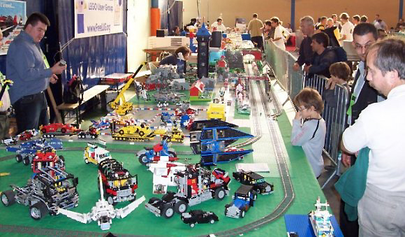

**La "grande ligne droite de 13m" à l’exposition de Claix en 2005.**

puis un 4511 à [Saint-Rambert en 2007](/articles/683/) sur une ligne droite de 19 mètres.

Ces deux lignes droites sont faites uniquement avec des rails LEGO 9V.

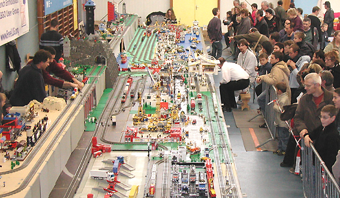

Outre le fait d’une voie pas assez longue, il est clairement apparu que si l’on voulait aller très vite, il fallait aussi pour les trains en LEGO une vraie LGV car les voies LEGO avec :  
**–** leurs 8 sections par mètre,  
**–** leurs jonctions imparfaites,  
**–** l’écartement des rails un peu trop généreux,  
apportent beaucoup de perte d’efficacité en vitesse pure.

## Première LGV

Ce constat a conduit à essayer de construire une première LGV spécifique pour [Fana’briques 2008](/articles/786/). Les principales caractéristiques retenues pour cette LGV pour trains LEGO sont :  
**–** des tronçons de voies d’une longueur d’un module standard (soit environ 76,6 cm),  
**–** des rails ad hoc d’un seul morceau par tronçon de voie,  
**–** un système de jonction (éclisse) des tronçons très précis,  
**–** une ligne droite d’au moins 30 mètres.

Après quelques recherches sur internet, le matériel choisi est :  
**–** pour les rails : rail en aluminium (pour des raisons de budget, mais existe aussi en laiton, inox ou maillechort) code 250,  
**–** pour les éclisses : éclisses en laiton avec serrage par vis.

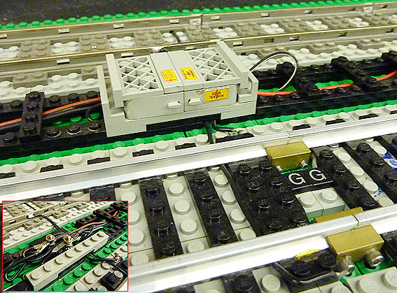

Pour cette première version, les rails sont collés sur des plates de 1x8 noires (la couleur noire est un choix lié à la disponibilité et au prix de cette plate 1x8) ce qui impose d’enlever 2 tenons sur chaque plate pour le passage des rails. Il faut parfaitement dégraisser l’aluminium ainsi que la plate pour un bon collage.

Le positionnement du rail sur la plate se fait avec un gabarit en LEGO (une plate 1x10 plus un peu de bande collante alu pour ’faire la cote’).

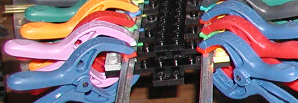

La colle utilisée est de la colle Pattex - "Résist’A Tout". (Avec la technologie FLEXTEC©, cette colle est suffisamment flexible pour unir presque tous les types de matériaux rapides ou souples tels que le métal, le verre, le caoutchouc, le cuir... Ultra puissante, elle résiste à toutes sortes de vibrations, aux intempéries et à l’humidité).

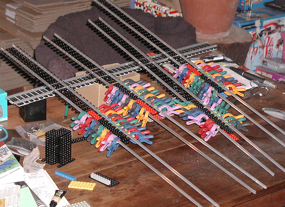

18 mètres de ligne droite sont ainsi réalisés pour Fana’briques 2008, ce qui représente tout de même 24 tronçons et 960 traverses.

## Fana’briques 2008 : la première sortie de la LGV-V1

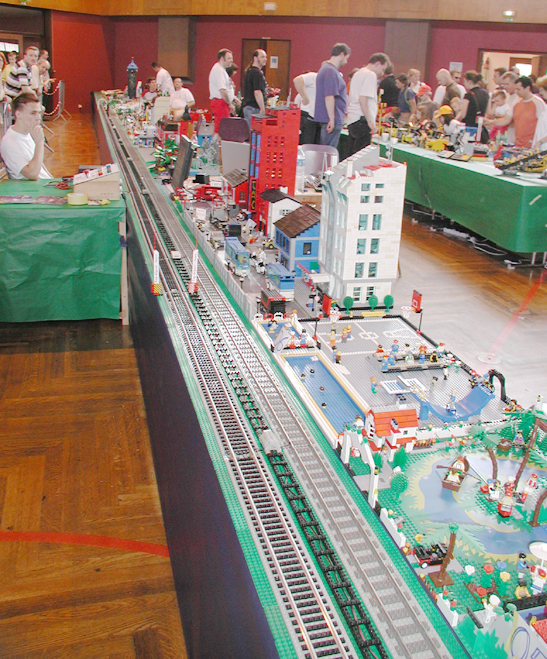

La première sortie de cette LGV tient bien ses promesses et permet un roulement des trains nettement meilleur que sur les rails LEGO.

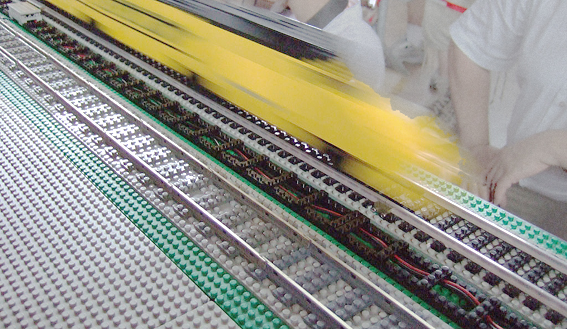

## Saint-Rambert 2009 : la deuxième sortie de la LGV-V1

La deuxième sortie de cette LGV a lieu à [Saint-Rambert 2009](/articles/1023/). Lors de cette cession, tous les records de vitesse sont battus suite à une forte et saine émulation entre Rhônalpins et Alsaciens (mais aussi grâce à une alimentation électrique optimisée pour cette LGV et les trains y circulant...).

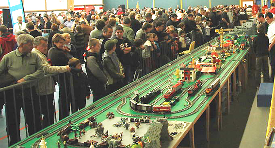

Tout n’est pas encore parfait et certains points posent questions, n’est-ce pas messieurs ?

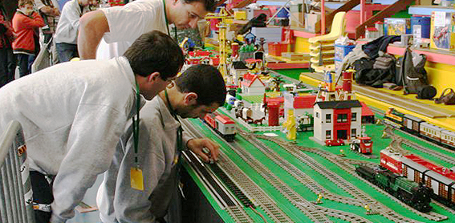

Mais en même temps cela permet de faire la critique de cette LGV devenue V1 pour penser à une LGV V2 y compris avec des courbes...

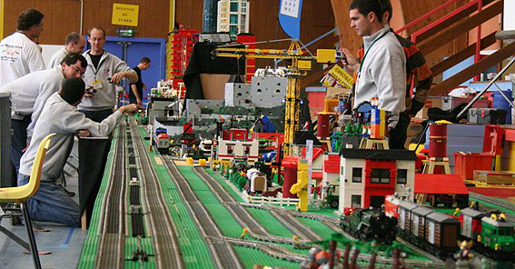

Après les discussions de Saint-Rambert, puis pas mal d’échanges de mails, une LGV V2 va être construite pour Fana’briques 2010. Les points retenus sont :  
**–** des tronçons de voies un petit peu plus longs (128 tenon au lieux de 96) ,  
**–** trouver un système de traverse plus ‘réaliste’ vis-à-vis d’une LGV réelle,  
**–** faire des courbes de grand rayon,  
**–** faire des courbes avec clothoïde en début et fin de courbes,  
**–** faire des courbes en dévers,  
**–** trouver des éclisses plus facile à monter.

Le cahier des charges étant fait pour cette LGV V.2, il n’y à plus qu’à la construire.  
Ce sera l’objet du prochain article : construction de la LGV V.2

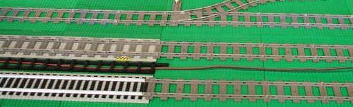

Denis - cdhd
