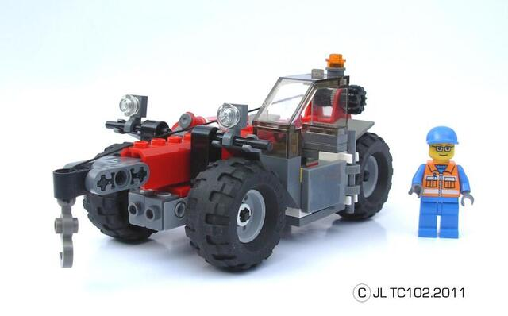
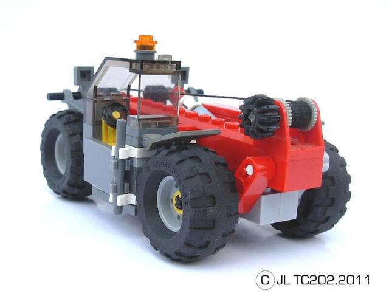
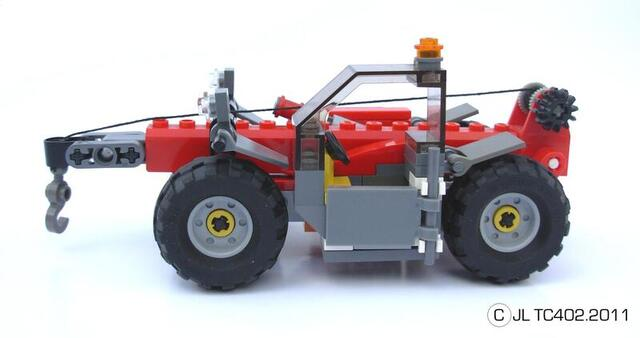
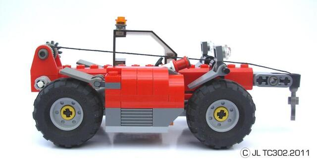
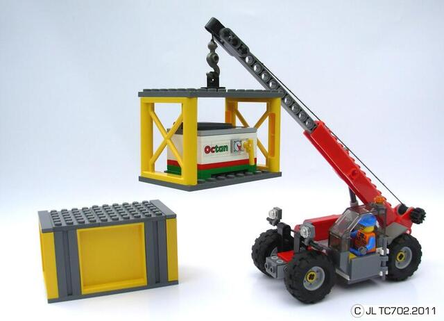

Bonjour,

Dans ce second article, je vais vous présenter une autre création toujours à l’échelle des minifigurines et dans la gamme CITY, une grue télescopique rouge.

On connaît de nombreuses grues télescopiques en LEGO, en version "Technic" principalement. A ma connaissance, il en existe peu dans la gamme City mis à part les grues portuaires et ferroviaires.

Voilà la (petite) bête. Simple, facile à construire, peu gourmande en briques et résistante, elle apporte une aide non négligeable pour bâtir la ville.

**Vue générale grue télescopique**

**Vue arrière grue télescopique**

Le système est très simple, le bras télescopique est solidement fixé au châssis.

**vue face 2 grue télescopique**

La cabine du conducteur est assez grande pour faire rentrer le personnage, il est à son aise et peut s’accouder à la portière. L’élément qui fait la portière est un élément que j’utilise souvent, il peut en effet avoir de nombreuses applications intéressantes.

**vue de face 1 grue télescopique**

Le vérin qui soutient le bras est bien dissimulé et ne prend pas beaucoup de place. Enfin voilà une dernière image avec la grue en action qui soulève un groupe électrogène Octan. A noter aussi que l’on peut éventuellement passer de la grue en chargeur télescopique en remplaçant le crochet par un godet par exemple.

**La grue télescopique en action**

A bientôt pour une autre création. N’hésitez pas à laisser un petit commentaire.

Julien
