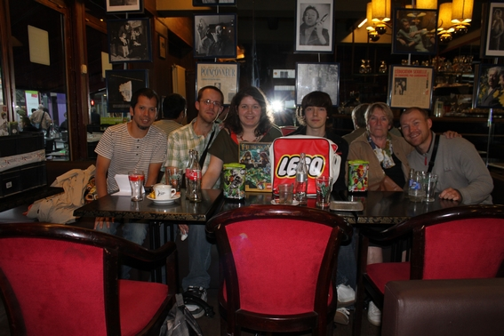
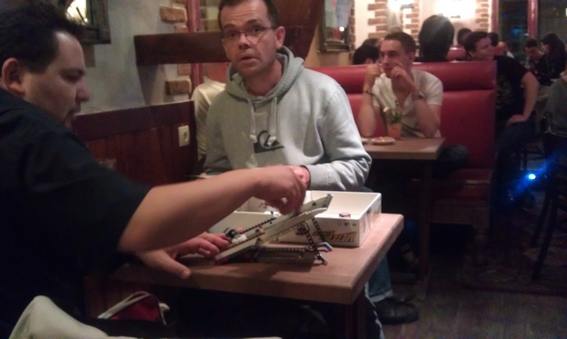
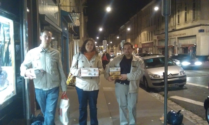

C’est à deux mois de l’exposition que nous atteignons enfin l’objectif réaliser un restolego avec quelques fans ou nouveaux fans. Une soirée certainement imparfaite mais qui a le mérite d’avoir eu lieu et ne demande qu’à être perfectible.

Tout au long de la soirée de 17 h à 2h, 8 personnes ont eu l’occasion d’échanger. Nous avons même eu l’honneur de la visite de Jicé (78). C’est une soirée très encourageante avec des personnes venant de différents horizons (Bionicle, Castle, City, divers), de personnes issues de FreeLUG, Fanabriques, festibriques, brickpirate...

Ce fut l’occasion de parler de l’organisation de l’[exposition du 26 et 27 novembre](https://www.freelug.org/spip.php?article1351), de consulter des livres, de parler des commandes groupées, des nouveautés, de regarder quelques photos...

Une dizaine d’exposants sont désormais inscrits en espérant que se soit que le début d’une longue liste. Il est encore temps de s’inscrire même si vous pensez avoir peu de chose, l’important c’est de participer.

Tous les renseignements sur [www.expolorraine.com](https://www.expolorraine.com/) ou 06 29 07 81 32
