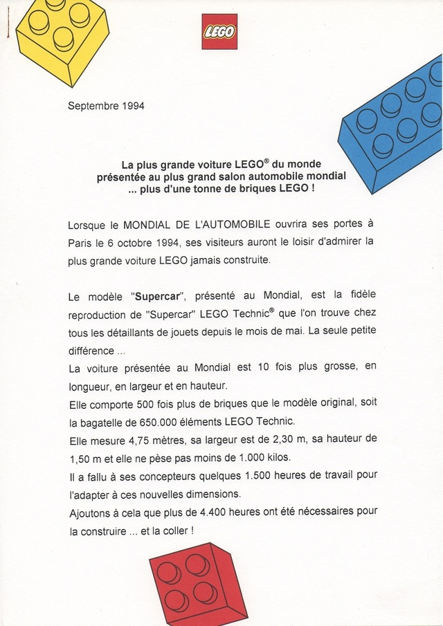
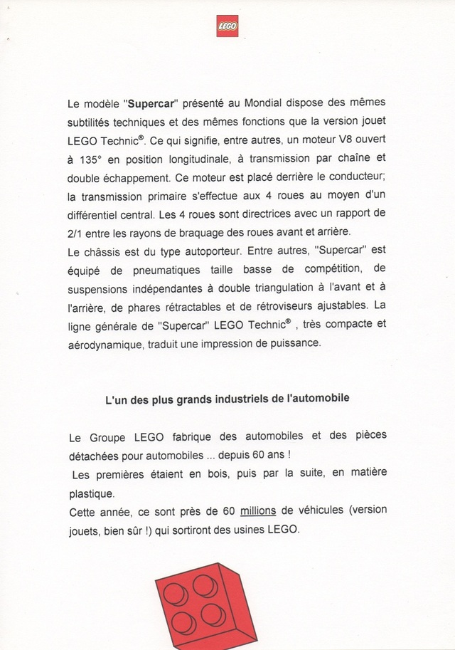
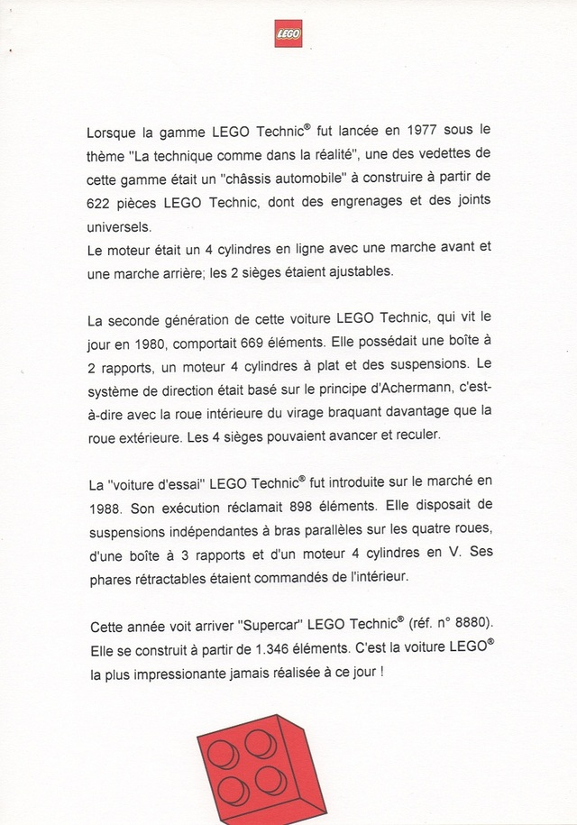
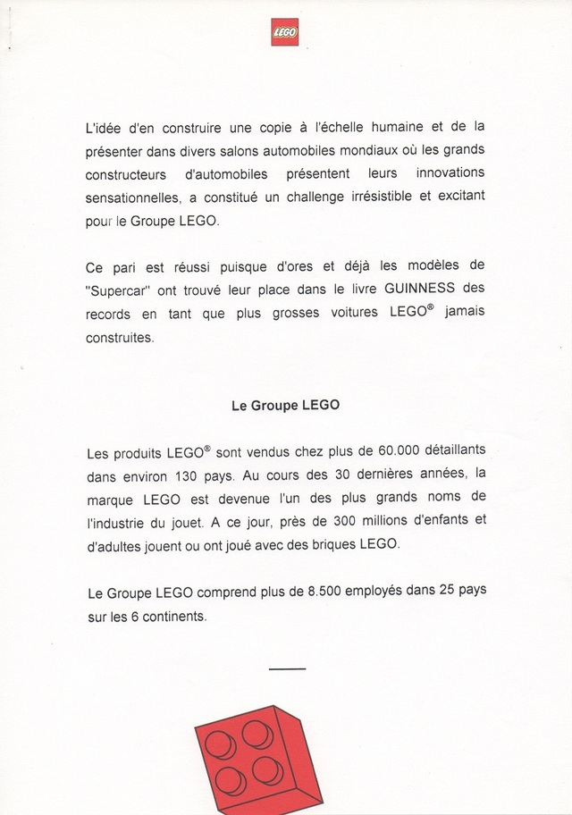
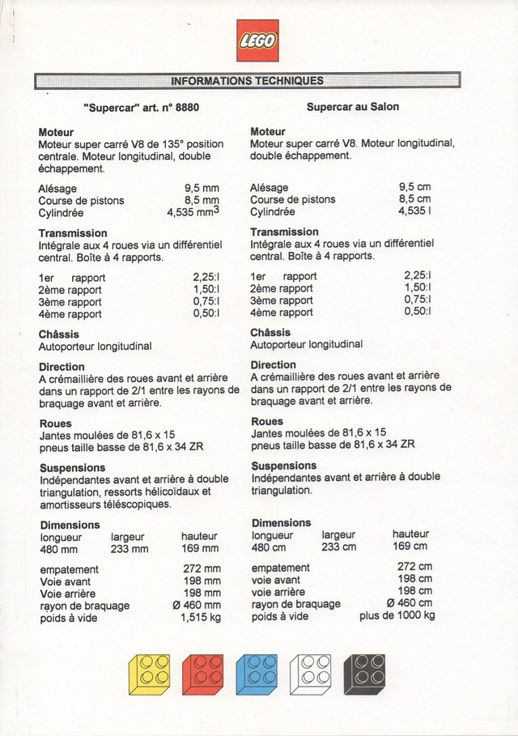
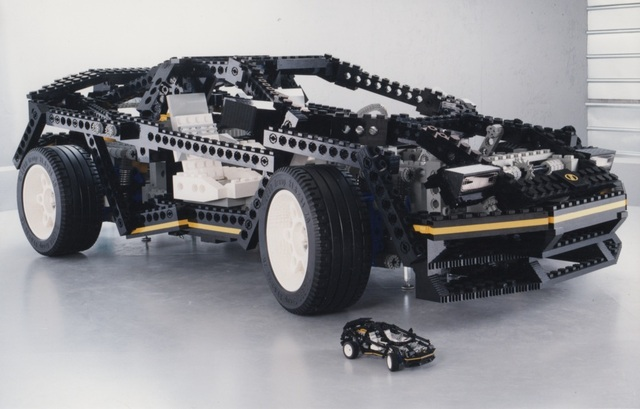
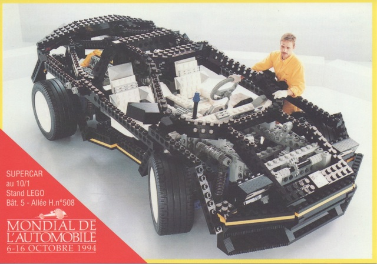

Lors du mondial de l’automobile 1994, LEGO présente un set grandeur nature. Il s’agit de la Super Car 8880. J’avais pu me procurer à l’époque le dossier de presse de LEGO. Je l’ai retrouvé récemment et j’ai voulu le partager avec vous tous.

Voici le dossier :

Le dossier de presse se compose d’une pochette cartonnée qui comporte un dossier de 4 pages

un descriptif technique qui compare le set au modèle taille réelle

une photo avec le set et la version taille réelle

et une carte postale qui reprend la photo de la couverture et qui montre le montage.

Cette réalisation m’avait marqué à l’époque, pour sa ressemblance avec celle du set, sa taille impressionnante, le tout réalisé en briques de base. Seules les roues (pneus et jantes) ne sont pas en briques LEGO.

J’ai mis les scans des documents dans [ma galerie](http://photos.freelug.org/main.php/v/Bug_s/divers/8880/)
