Le lundi 24 octobre 2011, la France établissait le nouveau record de la tour LEGO la plus haute du monde. FreeLUG était évidemment dans les coulisses.

## Qui fournit les briques ?

LEGO Danemark (le pays d’où viennent nos petites briques) propose à la location de ses antennes nationales cette animation particulière.

Les briques, près d’un million, arrivent par semi-remorque.

## Qui construit la tour ?

Les visiteurs participent en construisant des modules de 25 briques de haut sur un guide composé de plates collées, indiquant où placer les parois de la tour.

Les ateliers sont situés dans des tentes, ici jaunes à toit rouge.

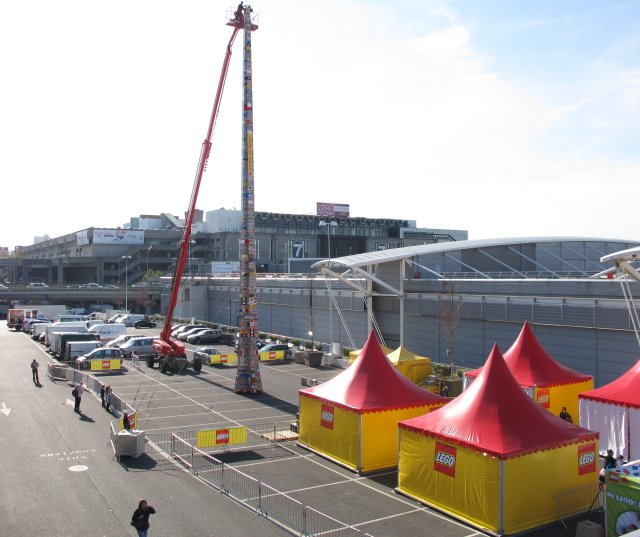

**Le village pour la construction de la tour**

A la base de la tour, les modules sont cruciformes. A chaque module, la taille rétrécit pour finir en carré au sommet.

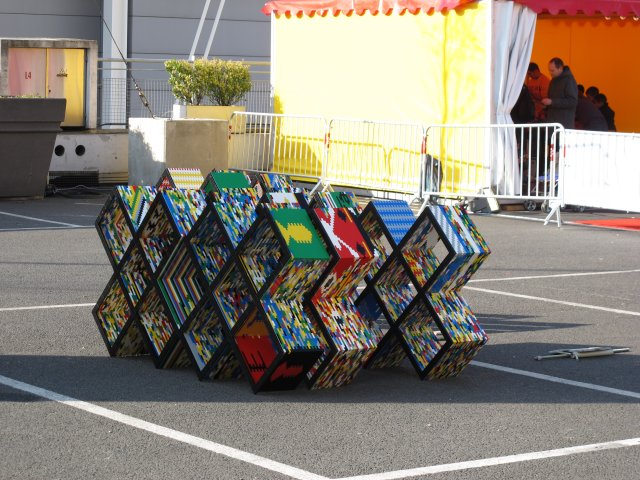

**Modules en attente**

Pour assurer la solidité, les briques doivent être nécessairement croisées. Ce qui rend difficile la réalisation de lettres par exemple. Exception est faite pour les modules portant l’inscription _PARIS 2011_ dont les parois sont construites par les deux assembleurs LEGO venus du Danemark.

Car évidemment, pas question pour le public d’aller construire la tour à 30 mètres du sol !

C’est donc deux experts de chez LEGO qui s’assurent de la conformité des modules et qui vont les empiler, aidés d’une nacelle.

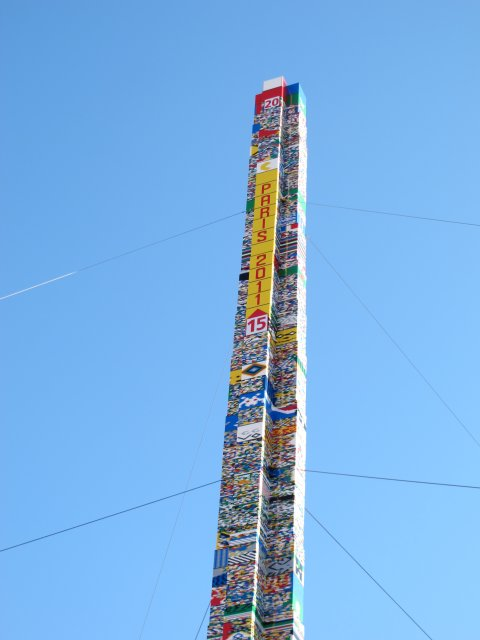

**Différents motifs composent la tour**

Quant aux motifs des modules, libre court à l’imagination des participants. Les enfants en général assemblent sans chercher à faire des motifs, tandis que d’autres réalisent toute sorte de choses. Par exemple, sur la tour à Paris, on pouvait voir :  
**–** de nombreux drapeaux de pays ;  
**–** des smileys ;  
**–** un pacman poursuivant un fantôme ;  
**–** un logo Apple ;  
**–** un NXT ;  
**–** un logo des trains LEGO 9V ;  
**–** un logo LEGO (évidemment)...

Chaque participant repartait avec un diplôme.

## Et pour la solidité ?

Chaque module est emboité à coups de marteau.

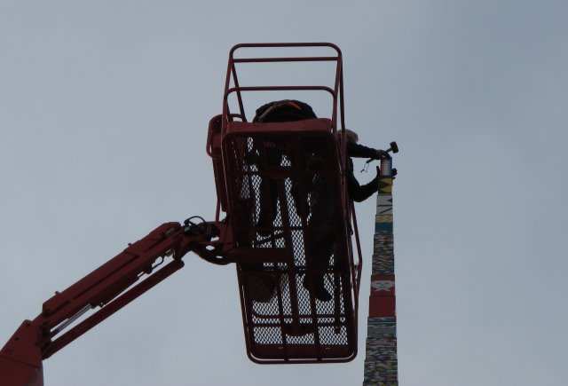

**Fixation des modules à coups de marteau**

A hauteur régulière, une plaque métallique équipée de crochets est glissée dans un module.

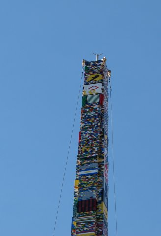

**Pièce metallique de fixation des câbles**

A ces crochets, quatre câbles reliés à des blocs de béton au sol permettent de s’assurer que la tour ne basculera pas, par exemple à cause du vent.

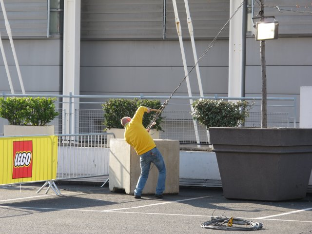

**Un petit tour de manivelle pour tendre le câble fixé au bloc de béton**

Les derniers éléments de la tour sont glissés sur une tige métallique et un chapeau, serré à l’aide d’un gros écrou papillon vient couvrir et fixer le sommet de la structure. 20 câbles ont été utilisés pour la tour de Paris.

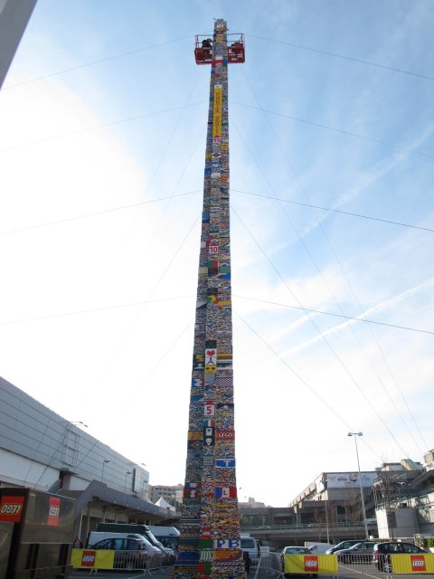

**De nombreux câbles de maintien**

Au sol, la tour repose sur un tablier, et un périmètre de sécurité est établi tout autour.

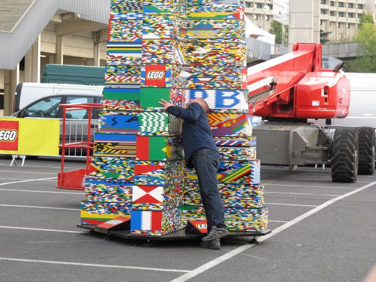

**Dernier coup d’oeil de contrôle avant la pose des derniers modules**

## Comment mesure-t-on la hauteur de la tour ?

Un mètre enrouleur est relié à un gros poids LEGO. L’enrouleur est fixé au sommet de la tour, et le poids est lâché jusqu’au pied de la tour.

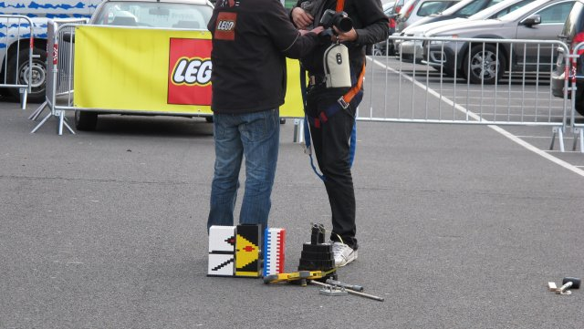

**Les derniers modules, et le poids reliés au mètre-enrouleur**

Il ne reste plus qu’à lire la valeur !

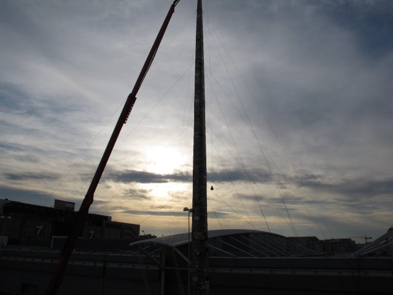

**Descente du poids, sur fond de soleil couchant**

## Qui a posé la dernière brique ?

La dernière brique, une 2x4 jaune portant en inscription la hauteur de la tour, a été posé par Kai, le NinjaGo !

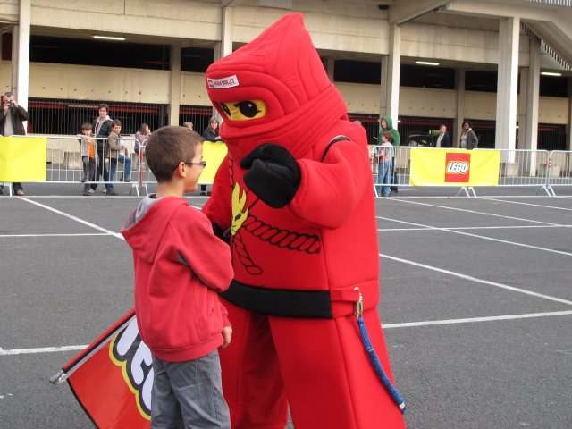

**Kai, le NinjaGo qui va placer la dernière brique au sommet de la tour**

Bon à vrai dire, comme toute minifig LEGO qui se respecte, ses mains ne lui ont pas permis de la fixer sur la tour ;)

## Quelques chiffres pour la tour de Paris

Quatre jours (plus une soirée en exclusivité pour 300 membres du LEGO Club) ont été nécessaires pour assembler les modules. Ceci dit, le public était vraiment actif, et le rythme plus rapide que prévu. La cadence a donc été volontairement réduite pour tenir jusqu’au lundi 17h00.

La tour est constituée de plus de 500 000 briques 2x4. A 2,5g la brique, cela porte le poids à plus de 1,25 tonne, ce à quoi il faut ajouter les éléments métalliques et les plates servant de guide, et la tension exercée par les câbles de maintien.

La hauteur, 31,60 mètres est de 21cm plus élevée que le précédent record (31,39m). Cela correspond à un module supplémentaire.

En plus d’une partie du personnel de LEGO France, des organisateurs de Kidexpo et de deux journalistes, trois membres de FreeLUG ont eu la chance de pouvoir monter au sommet !

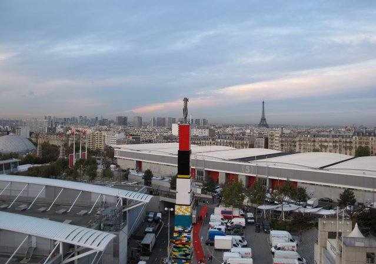

**Vue du sommet de la tour, sur fond de sa grande soeur Tour Eiffel, depuis la nacelle**

A 31,60m du sol, le vent souffle et avec le soleil couché, il fait froid !

[Toutes les photos](http://photos.freelug.org/main.php/v/brickerik/expositions/2011/Kidexpo/Tour/)
