Sur le stand LEGO de 16 m \* 2 m, nous étions 3 membres FreeLUG (Erik - notre président , Pascal et lesgoss) , Lydie notre spécialiste LEGO Star wars et un petit nouveau "Julien" pour sa première exposition , avec Julie (notre attaché de communication LEGO !) .

Le thème était de " la terre à la lune ".

La mise en place avec Erik en haut à gauche , Pascal au milieu en bas et lesgoss en haut à droite

[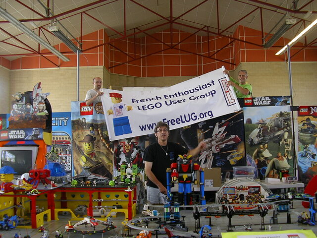](https://www.freelug.org/IMG/jpg/IMGP0438.jpg)

Et bien entendu , Julien en train de téléphoner à sa douce et tendre Julie...

[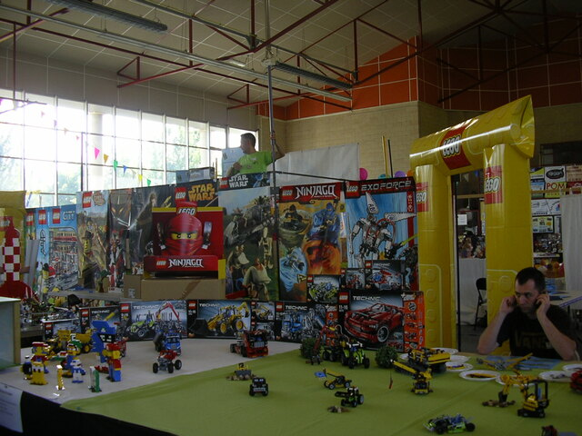](https://www.freelug.org/IMG/jpg/IMGP0435.jpg)

Notre Lydie spécialiste Star Wars...

[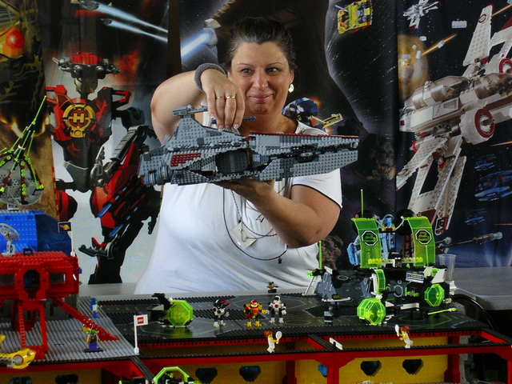](https://www.freelug.org/IMG/jpg/IMGP0723.jpg)

Notre "attachée commerciale", Julie qui a distribué des catalogues tout le week end pour le plus grand plaisir des enfants...

[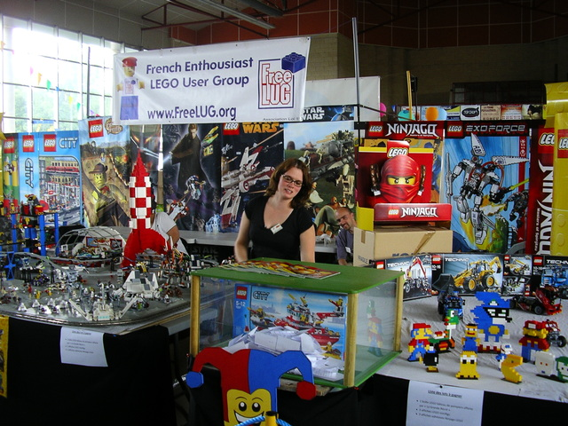](https://www.freelug.org/IMG/jpg/IMGP0730.jpg)

Notre équipe au complet, lesgoss, Julien, Julie, Pascal, Erik et Lydie...

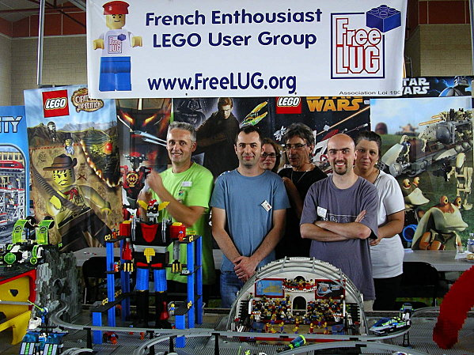

Mais aussi David qui nous a aidé à la mise en place...

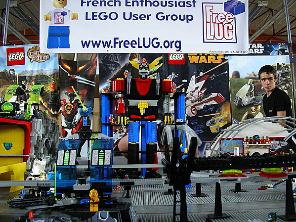

Ca commence à prendre forme coté Pascal et Lydie...

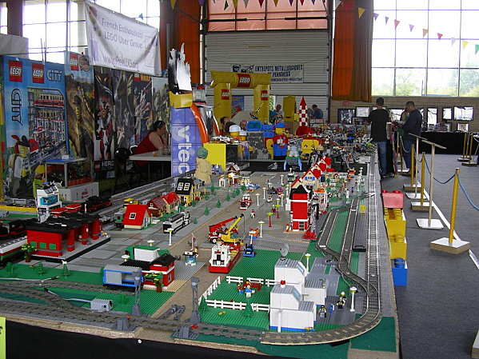

Coté Erik, avec son thème Steampunk qui en a bluffé plus d’un...

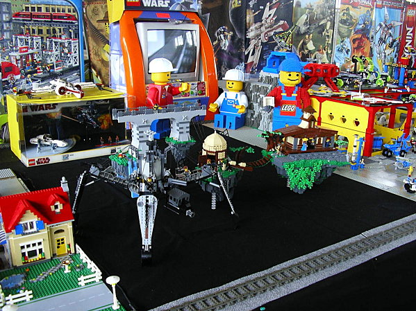

Coté lesgoss la base lunaire prend forme peu à peu...

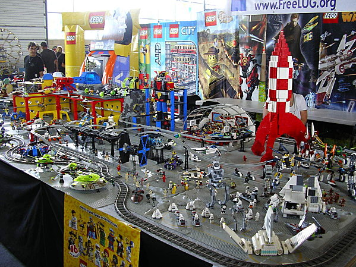

Coté Julien... on s’amuse à monter son dernier modèle acheté... quel veinard !

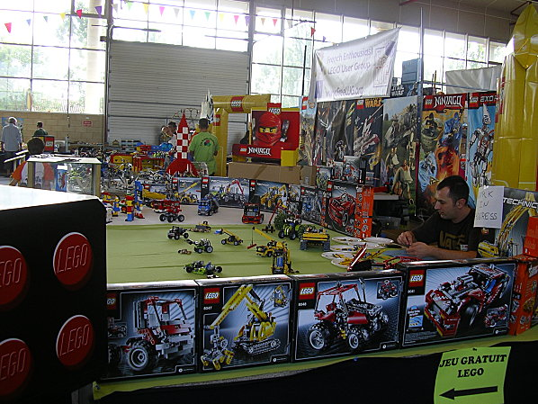

Vue d’ensemble...

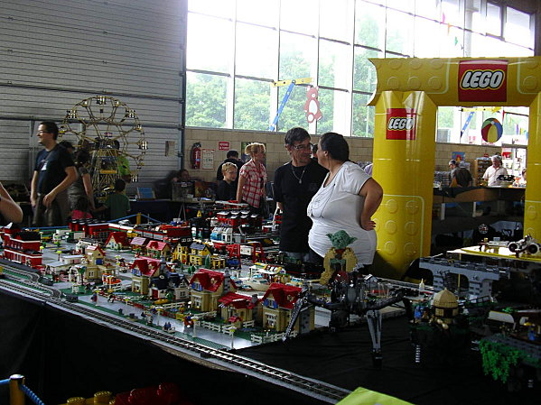

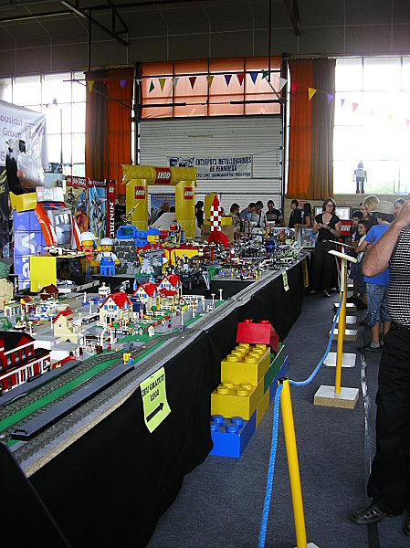

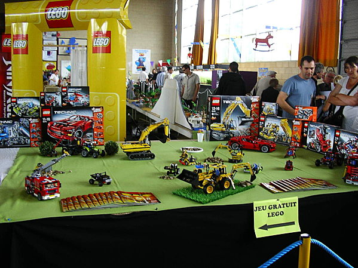

Merci aussi à Simon, notre plus jeune exposant avec ses créations personnelles qu’il nous a prêté pour le weekend

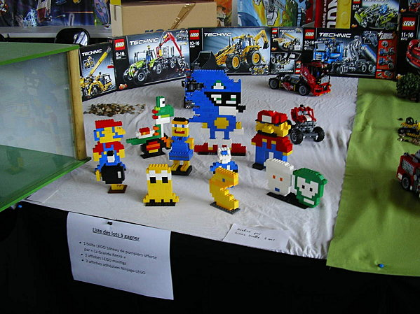

On avait même une animation " Pom-Pom Boys " !

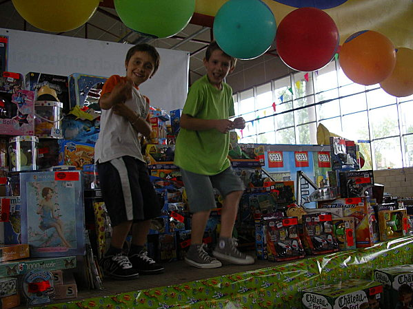

Un bon weekend , passé entre amis et avec nos chères petites briques...

Que du bonheur !
