En 2010, LEGO a organisé un sondage auprès des fans pour la création d’un set exclusif dans la gamme CITY. Trois thèmes étaient proposés mais il n’y a eu qu’un seul vainqueur.  
Je me suis attelé à la réalisation d’un set pour le CITY SQUARE, l’une des deux propositions non retenues lors du sondage.

Lors du sondage, les fans avaient donc le choix entre trois propositions : CITY SQUARE, CITY TRANSPORT ou CITY TRUC STOP.

[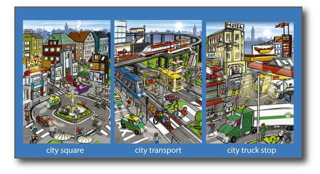](https://www.freelug.org/IMG/jpg/Sans_titre-4.jpg)

**Les propositions**

Ce fût finalement le CITY TRANSPORT qui remporta le vote. Voici d’ailleurs ci-dessous, le set réalisé par LEGO.

[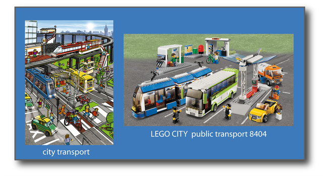](https://www.freelug.org/IMG/jpg/Sane-4.jpg)

**Le CITY PUBLIC TRANSPORT 8404**

L’objet de cet article est de vous présenter ce qu’aurait pu donner en set LEGO, l’une des deux autres propositions, à savoir le CITY SQUARE. J’ai essayé d’imaginer ce que LEGO aurait pu produire pour les fans.

[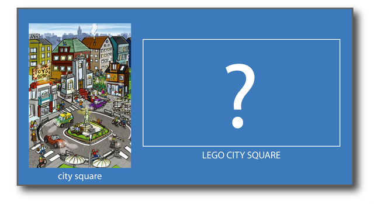](https://www.freelug.org/IMG/jpg/Sans_4.jpg)

**Que faire pour le CITY SQUARE ?**

Voici donc le résultat sans plus attendre.

[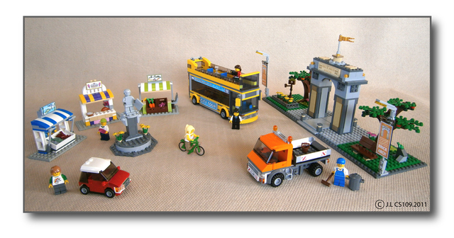](https://www.freelug.org/IMG/jpg/cs1.jpg)

**Le CITY SQUARE**

On se trouve donc dans un centre-ville touristique, historique et convivial avec un parc et un marché. L’ensemble se compose ainsi de différents éléments :  
**–** Un bus touristique avec vue panoramique  
**–** Un parc urbain avec un arc de triomphe  
**–** Un marché avec trois commerces  
**–** Une statue  
**–** Un véhicule municipal d’entretien  
**–** Une petite voiture citadine  
**–** Des minifigurines

Rentrons dans le détail de chacun de ces éléments.

## Le marché.

Le petit marché se compose de trois commerces, une poissonnerie, un marchand de fruits et légumes et un marchand de gâteaux. Les designs des étales sont variés et rappellent les véritables étales de marchés.

[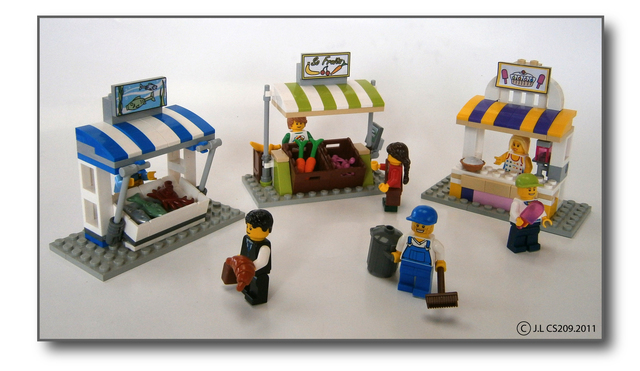](https://www.freelug.org/IMG/jpg/cs21.jpg)

**Le marché traditionnel**

[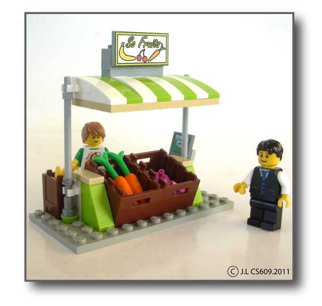](https://www.freelug.org/IMG/jpg/CS6.jpg)

**Etale de fruits et légumes**

[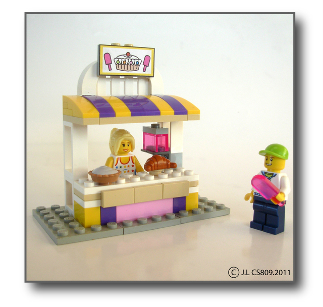](https://www.freelug.org/IMG/jpg/CS8.jpg)

**La petite confiserie**

## Le véhicule municipal.

Ce véhicule orange permet à l’employé communal de nettoyer les rues et d’embellir la ville en plantant des fleurs dans le parc. La benne du véhicule est basculante. Ce véhicule est un clin d’oeil à la présence d’un petit camion de nettoyage dans le set CITY PUBLIC TRANSPORT 8404.

[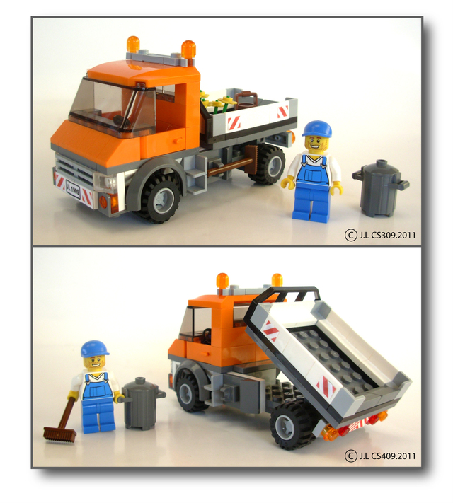](https://www.freelug.org/IMG/jpg/CS3.jpg)

**Le véhicule communal**

## Le parc urbain.

Le parc urbain se compose d’un arc de triomphe et de deux espaces verts sur les côtés.

Tout d’abord, l’arc de triomphe. C’est un monument à la gloire de la brique. Il se nomme d’ailleurs The Arch Brick et une date bien connue des fans de LEGO y est inscrite en caractère romain : 1958. L’arc de triomphe est de construction assez simple et ne consomme pas trop d’éléments. Il s’agit ici de réaliser un set CITY et non pas un set ARCHITECTURE.

[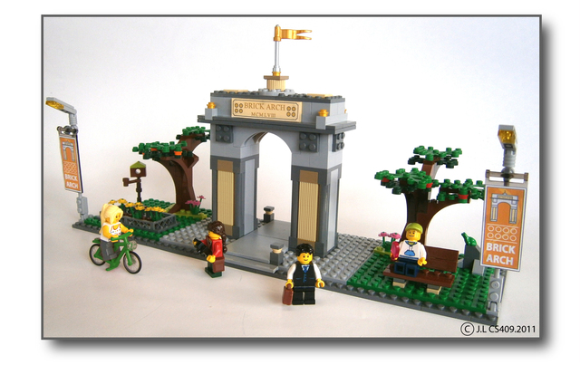](https://www.freelug.org/IMG/jpg/CS44.jpg)

**Le parc urbain vue générale**

[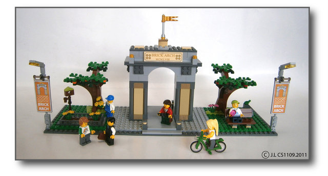](https://www.freelug.org/IMG/jpg/CS11.jpg)

**Le parc urbain vue de face**

[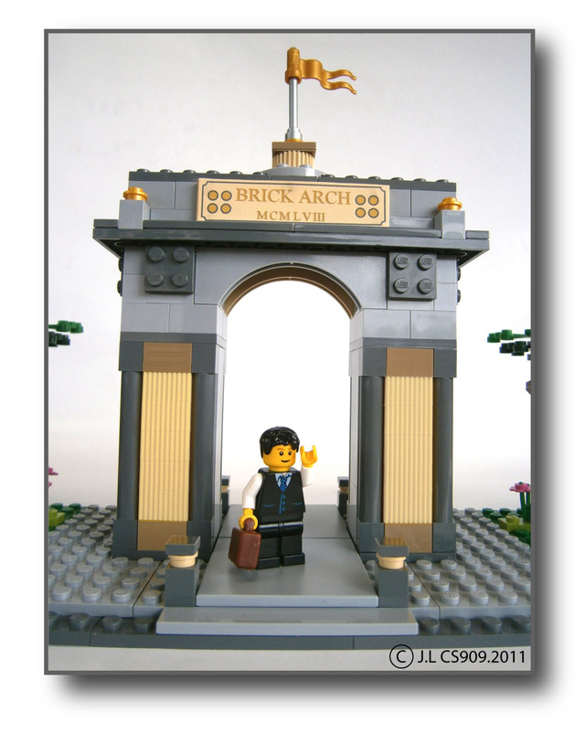](https://www.freelug.org/IMG/jpg/CS9.jpg)

**L’arc de triomphe**

Ensuite, le premier espace vert se compose d’un arbre, d’un banc public, d’un petit rocher avec sa grenouille et d’un lampadaire. A noter que le lampadaire est le même que celui couramment utilisé par LEGO pour accompagner ses sets CITY. J’ai rajouté seulement deux éléments pour y fixer une bannière.

Enfin, le second espace vert, se compose d’un arbre, d’un parterre de fleur et d’une cabane pour oiseaux avec sa mangeoire.

[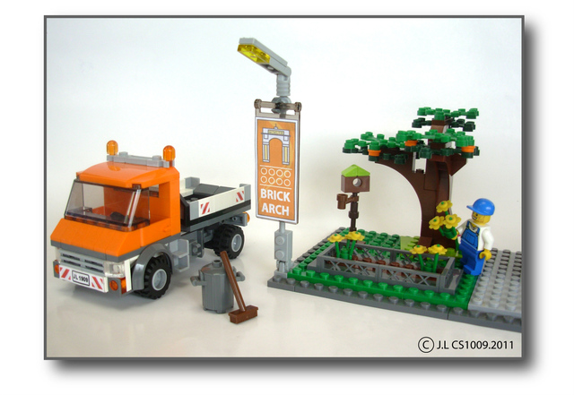](https://www.freelug.org/IMG/jpg/CS10.jpg)

**Le jardinier plante les fleurs**

## Le bus touristique.

J’ai retenu la couleur jaune pour le bus afin de rappeler la couleur que LEGO a utilisé pour réaliser un bus dans le [set 7641 commercialisé en 2009](http://www.brickset.com/detail/?Set=7641-1). La partie supérieure du bus est amovible pour jouer aussi à l’intérieur.

[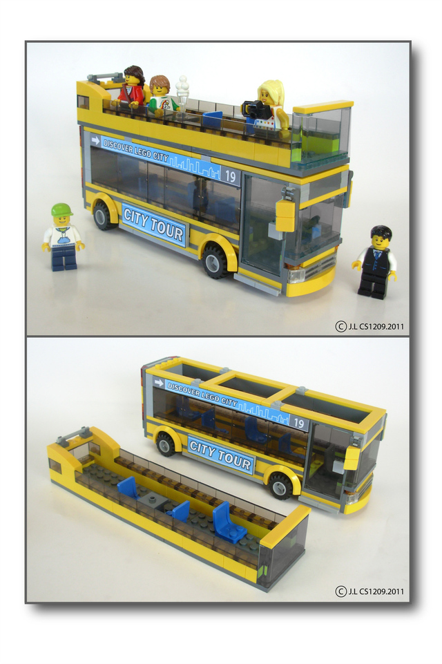](https://www.freelug.org/IMG/jpg/xx.jpg)

**Le bus touristique**

Une petite statuette vient renforcer l’image historique et touristique de LEGO CITY. Il serait possible d’ajouter sur la plaque que tient la statue, une date symbolique, 1978, pour marquer la sortie des premières figurines en LEGO.

[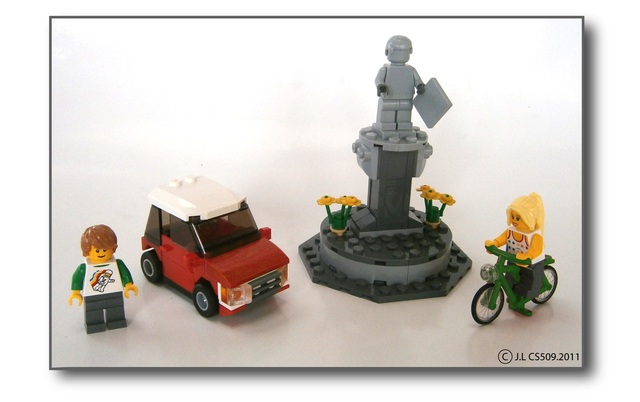](https://www.freelug.org/IMG/jpg/CS54.jpg)

**La voiture citadine et la statue**

Les minifigurines sont nombreuses et peuvent avoir plusieurs vocations dans ce set. Le chauffeur de bus est aussi homme d’affaire et les touristes sont aussi vendeurs au marché de LEGO CITY.

**Etale de fruits et légumes**

**Le CITY SQUARE**

Voilà, cet article touche à sa fin. J’espère que ce set vous a intéressé. Il est fort probable que je m’attaque bientôt à la réalisation d’un truck stop, qui était l’autre proposition de LEGO lors du sondage. Hélas, ce n’est pas à l’ordre du jour. Il va donc falloir attendre. Mais rassurez-vous, bien d’autres constructions seront présentées en attendant...

N’hésitez pas à laisser un commentaire. A bientôt.

Julien
