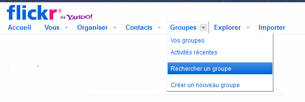

Bordolego : Salut à tous, je porte à votre attention la création d’un groupe FreeLUG Flickr.

FreeLUG : Euh, merci, mais qu’es aquo un groupe Flickr ?

B : Commençons par le début, Flickr. Flickr est un site Web de partage de photos et de vidéos gratuit, ou payant pour plus de fonctionnalités.

F : Peut tu préciser la ou les différences entre un compte gratuit et un compte payant ?

B :  
**–** pour le compte gratuit : Un utilisateur d’un compte gratuit peut envoyer 300 Mo par mois et 2 vidéos. Dans le cas où l’utilisateur envoie plus de 200 photos sur son compte, seules les 200 dernières photos seront accessibles, les autres lui seront cachées. Au bout de 90 jours d’inactivité, le compte sera supprimé.  
**–** pour le compte payant : Un compte payant, dénommé compte pro, coûte 24,95 $ par an et permet la suppression de la publicité, un espace de stockage illimité, l’obtention de statistiques, l’accès aux fichiers originaux.

F : il faut donc un compte payant ?

B : Non ! Un compte gratuit est largement suffisant pour la plupart d’entre nous !

F : Existe t-il une limite de durée pour les vidéos ?

B : Oui, la durée d’une vidéo est limitée à 90 secondes maximum.

F : Le site est-il simple d’utilisation et en français ?

B : Oui, Flickr est en français dans le texte, nos amis anglophobes n’auront donc aucun mal à s’y retrouver. De plus, il propose de nombreux outils d’aide, ainsi qu’une FAQ, afin que le débutant puisse télécharger et gérer facilement ses photos et vidéos.

F : Que propose de plus Flickr ?

B : Il permet à la personne qui télécharge une photo de la géolocaliser, d’y ajouter une description, de lui adjoindre des tags ou mot clés pour qu’elle soit référencée sur le net et donc plus facilement visible, et bien d’autres choses.

De plus, les autres membres de Flickr, peuvent interagir sur cette photo, soit en ajoutant un commentaire sous la photo, ou même en incluant une remarque sur la photo.  
Bref, il y a un tas de fonctionnalités à découvrir.

F : c’est pas mal, mais qu’est l’intérêt pour nous, il existe déjà une galerie propre au site FreeLUG ?

B : Effectivement nous possédons déjà une galerie photos. Ce groupe FreeLUG, car il s’agit bien d’un groupe, vient en complément, c’est un autre vecteur de communication pour les membres de l’association. De plus nous pourrions, peut être "toucher" plus de personnes extérieures à FreeLUG, en passant par ce site communautaire et international. On trouve déjà de nombreux groupes ou AFOL à travers le monde sur ce site.

F : Qui gère ce groupe ?

B : Pour l’instant moi, mais dès que suffisamment de membres m’auront rejoint (j’espère), j’aurais besoin d’un membre du conseil d’administration de FreeLUG comme co-administrateur, et il me faudra nommer aussi un modérateur. En effet, je suis le fondateur de ce groupe (possédant un compte pro, c’est plus facile pour moi), mais je souhaite que les membres de FreeLUG en fassent le leur.

F : Comment s’inscrire sur Flickr ? Et comment rejoindre le groupe FreeLUG ?

B : pour l’inscription à Flickr, direction le site avec ce lien : [http://www.flickr.com/](http://www.flickr.com/)  
et pour rejoindre l’aventure, une fois votre compte créé, dans l’onglet Groupe, cliquez sur rechercher un groupe et tapez Freelug.

Cliquez sur l’icône du groupe FreeLUG, puis cliquez sur rejoindre le groupe.  
C’est aussi simple que çà !

F : merci à toi Bordolego pour ces informations.

B : de rien, et si vous avez des questions ou besoin d’aide, n’hésitez pas à me contacter !
