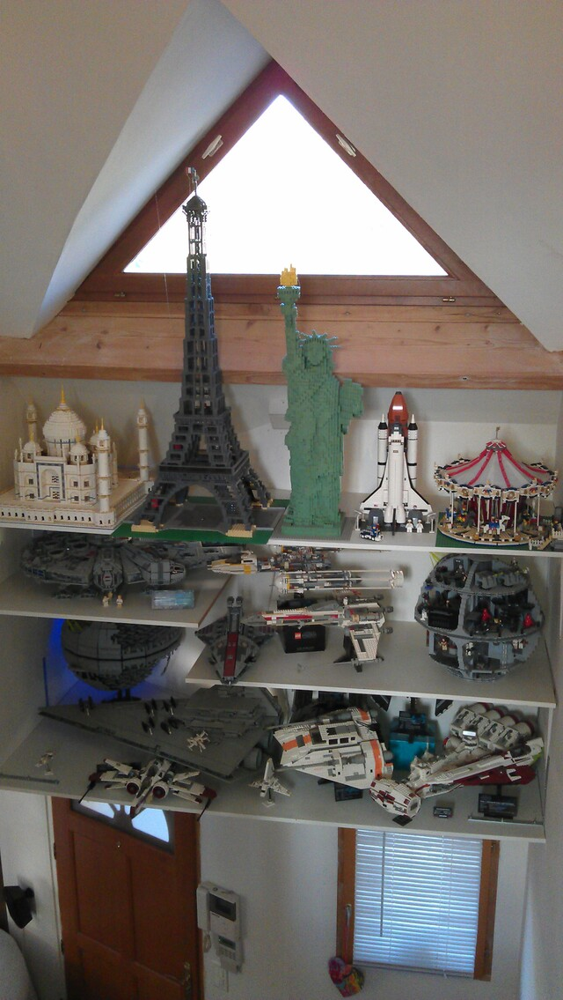
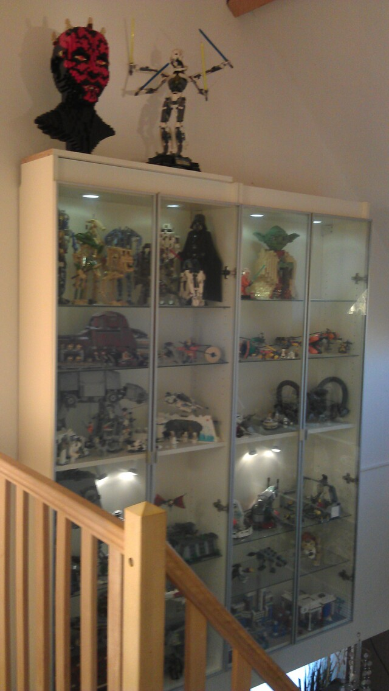
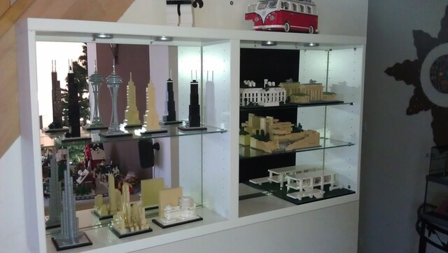
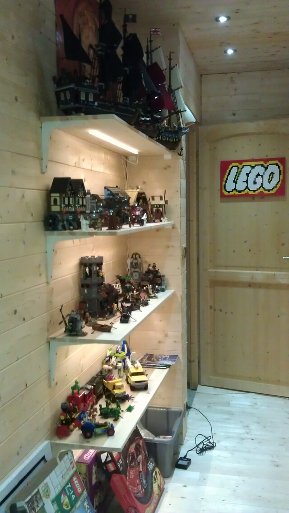
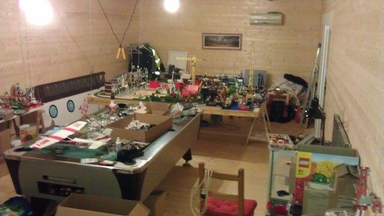
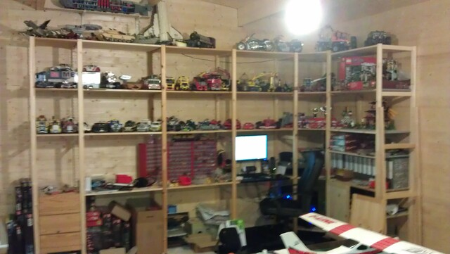
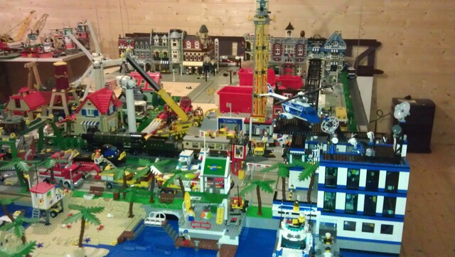
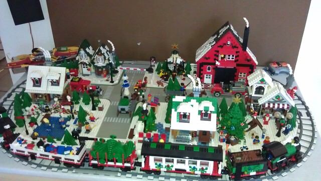
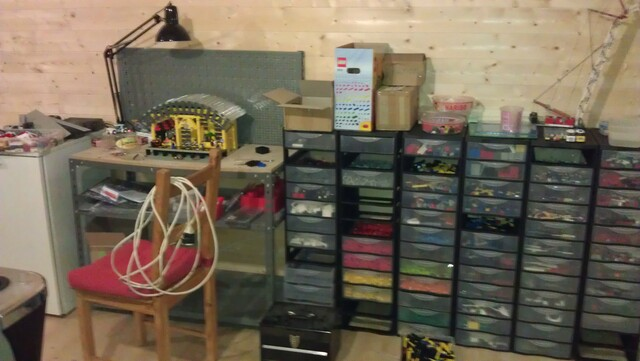

Bonjour, à tous,  
suis nouveau ici, et comme il se doit je me présente.

J’ai découvert cette association sur recommandation d’un vendeur de Bricklink, et illico j’y ai adhéré.

Donc je m’appelle Georg, 32ans, marié et deux enfants et suis du 91. Passionné de LEGO depuis ma première caserne de pompiers LEGO en 1983 ou 84.

Avec tout de même des pauses car très chers, puis une grande pause de 2005 à 2008 due aux déboires qu’on a eu avec un constructeur de maisons où au final j’ai fait un set LEGO à l’échelle 100:1, [notre maison](http://constructioncauchemar.over-blog.com/)

Puis depuis que j’ai mon espace perso pour ma passion, je m’y suis remis comme le montre ces quelques photos :  
de ma collection :

**Starwars et autres**

**Star wars**

Quelques scènes et objets Star Wars dans vitrines accrochés au mur de l’escalier

**Architecture**

Collection architecture

puis mon espace perso :

**Entrée espace lego**

Pirates des caraibes et toy story

**espace lego**

diaorama, ...

**Espace de travail**

Collection divers, technics etc

réalisation en cours d’un diorama Cityville :

**Diaorama Lego City**

Village de Noel en cours d’électrification (éclairage) :

**Noel**

Village de noel

Espace travail, électricité :

**espace elec et pièces**
