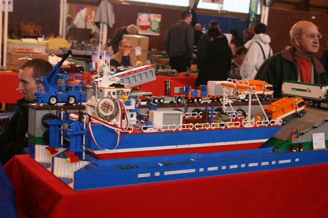
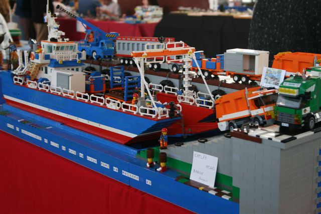
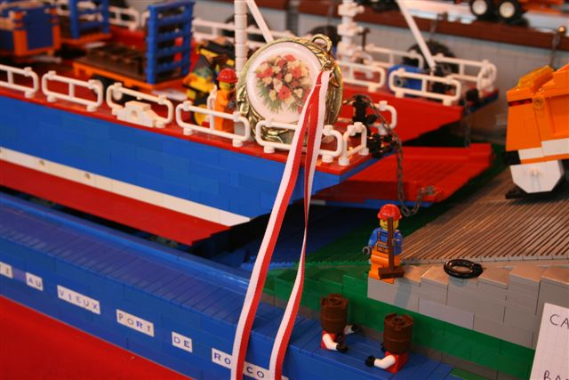

Cette année, j’ai de nouveau partagé le stand avec mes amis de la maquette de Saint Martin des Champs. J’ai représenté, en concours régional, ma barge animée bien connue de certains (voir photos).

_Ndlr : l’édition 2010 avait été annulée prématurément, suite à accident mortel section aéromodélisme._

A mes cotés, un petit jeune a exposé quelques modèles, a mis en concours un Technic du commerce, un camion bleu récemment sorti, je dois vous dire que son culot me gênait mais bon.

Le salon a été excellent, beaucoup de communication sur FreeLUG, beaucoup de personnes ont été intéressées par mon diorama, en particulier, le mécanisme de ma barge animée .

Pour ceux et celles qui ne savent pas de quoi il s’agit, j’ai reproduit les marées, le roulis, le tangage avec un système à base de Technic 9v.  
La barge, à base de briques de toutes sortes, est une reproduction fidèle du vrai bateau qui assure le fret entre Roscoff et l’Ile de Batz.

Dimanche, le jury a récompensé les participants aux concours : médaille de bronze pour moi et médaille d’argent pour le jeunôt, sans commentaire.

.....FLASH.......

Par mon président de la maquette, j’ai appris que le salon local ne fait plus obstacle à une représentation LEGO, surface 3mx1.60, pour ceux qui veulent concourir, c’est ici, dont acte pour 2012. UNE BONNE NOUVELLE !

Pour 2012, comme Laurent est absent , je présenterai un nouveau diorama marin évidemment.

......FLASH...............

[Galerie photos](http://photos.freelug.org/main.php/v/barr__/expositions/2011/crozon/)

_Jean-Marc_
