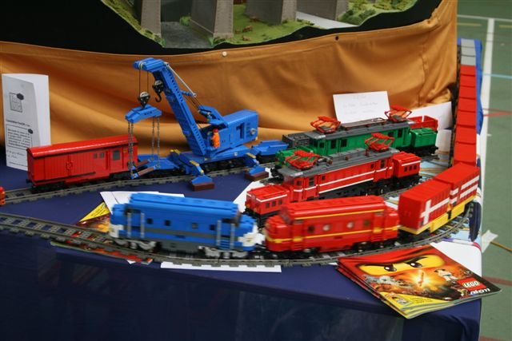
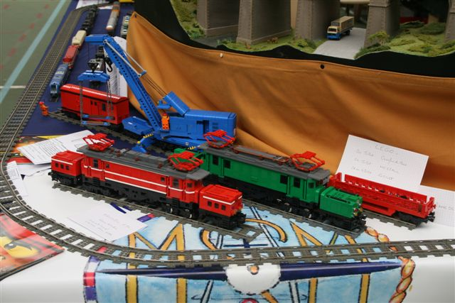
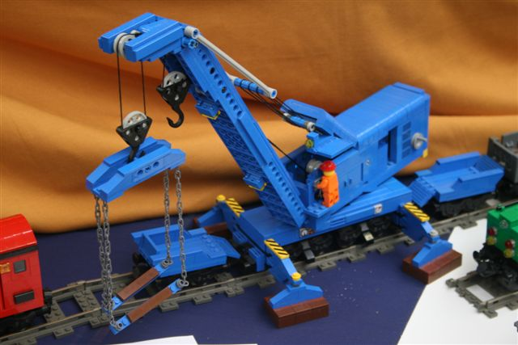

Le salon de Tréflez (Finistère nord) a organisé une nouvelle édition les 16 et 17 juillet 2011.

Ce salon n’était pas prévu dans mon planning mais la présence de Mickael, exposant naval, m’a fait changé d’avis, j’ai donc réussi à avoir une petite surface.

Mon petit stand se limitait à un simple circuit ferroviaire 9v en forme de L avec présentation de wagons conteneurs fabrication maison, rame de secours SNCF et locos-crocodiles allemande et autrichienne, inconnues du public, nous étions en pleine mode du train Maersk.

J’avais aussi présenté en avant-première un portique (prototype ) pour les 50 ans de la zone de Keriven.

Tout au long des 2 jours, le public s’est longtemps attardé sur mon stand qui était plus animé qu’ailleurs sauf trains HO.

Beaucoup de communication au sujet de FreeLUG et des briques à acheter.

FLASH..........

A la fin du salon, le président du club local m’a informé qu’il comptait créer sérieusement un grand espace pour la petite brique en 2013, bonne nouvelle !

..............FLASH.

En conclusion, que du positif !

Merci à la famille Le Berre venue en visiteurs.

[Galerie photos](http://photos.freelug.org/main.php/v/barr__/expositions/2011/treflez/)

_Jean-Marc_
