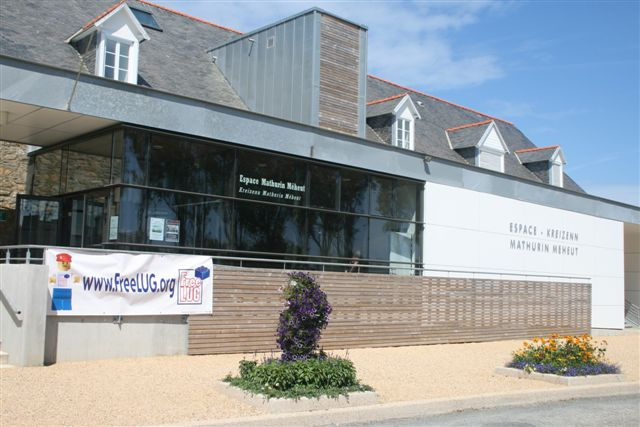
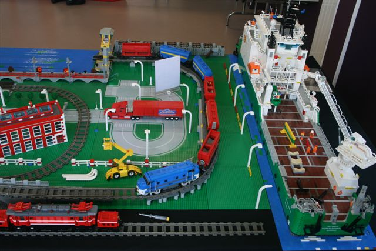
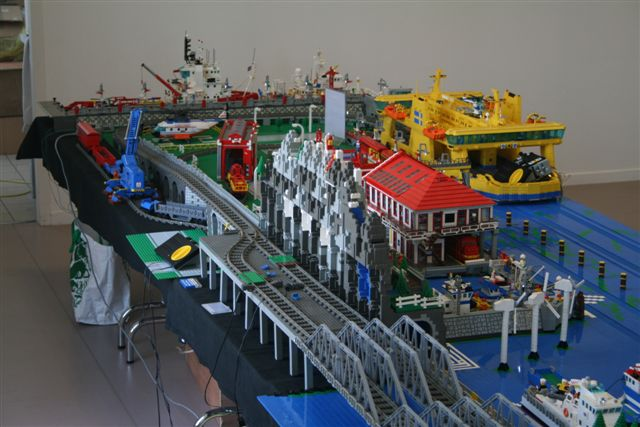
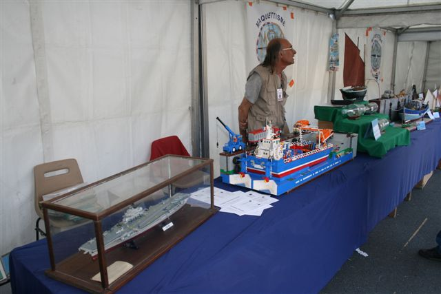
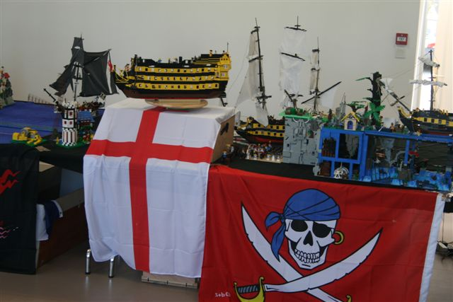
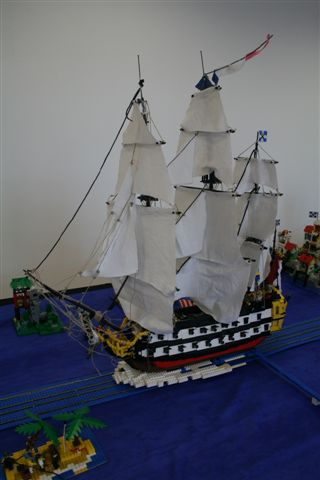
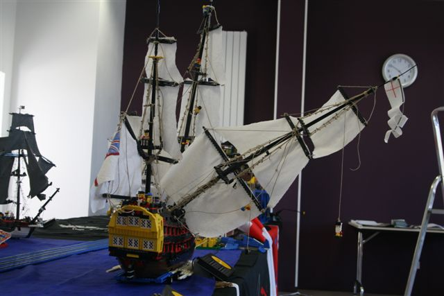

A l’invitation du comité d’organisation de la ville de Roscoff, Laurent , Bruno et moi-même, membres de FreeLUG, avons installé nos grands dioramas dans une magnifique salle municipale de la ville .

Comme nous étions dans la brochure officielle de la ville, il y a eu un problème de communication, entre le centre ville et la salle. Heureusement, grâce à nos banderoles situées à l’extérieur, beaucoup de personnes sont venues nous voir tout surpris et même revenues sur les 4 jours. Nous avions mis des pancartes avec LEGO un peu partout...

Quand il y avait peu de gens, nous pouvions réparer ou améliorer nos dioramas, surtout Laurent, à la recherche de la parfaite fiabilité.  
Il pensait à fond pour Cholet 2011.

Nos horaires étaient 10h/midi, repas au port, puis 14h / 18h.  
A 18H 15, nous partîmes pour MORLAIX voir nos collègues de la maquette au bord de l’eau et Mickael, exposant et maquettiste naval.  
Le lendemain, après notre journée, nous avons monté la barge animée de l’ile de Batz pour moi et un bateau de Laurent.

Le surlendemain, nous voyons les vieux gréements à quai surtout les grosses répliques de Saint Malo .

Nos LEGO à Morlaix, un tabac, paraît-il !

Dimanche après-midi, nous plions bagage avec le sentiment du devoir accompli, beaucoup de pub pour FreeLUG, mon salon 2012, des gens prêts à nous revoir.

FLASH... Par l’intermédiaire de mon club de la maquette, nous sommes invités pour Douarnenez 2012, je vais essayer d’avoir un stand FreeLUG marin... FLASH.

Prochaines manifestations, Carrefour Brest des 20 juillet, 5 et 6 août 2011.

_Jean-Marc_

* * *

## Terre et mer !

Peut-être avait-on pu remarquer ces jours-là dans les médias plus ou moins locaux, que Morlaix et Roscoff inauguraient depuis ce jeudi leur fête de la mer dans la droite lignée de Brest et de Douarnenez.

Pour cette occasion exceptionnelle, et à l’initiative de Jean-Marc, mes bateaux ont donc embarqué à bord du fourgon de mon père pour se rendre dans une salle flambant neuve de la petite cité corsaire de Roscoff, que la mairie avait aimablement mise à notre disposition.

De jeudi à dimanche, battant la mesure du temps fort de cette période legotique en Finistère, nos LEGO ont donc attiré un public plus humble mais plus intéressé que sur les précédentes expositions.

Jean-Marc avec son diorama train et ferry, et moi avec ma bataille navale et la scène de l’attaque du kraken, nous avons fait la promotion de l’asso, et séduit un public très souvent émerveillé. La plupart nous ont rendu visite après avoir vu nos pancartes indiquant le mot "LEGO", après avoir vu figurer notre expo sur le dépliant du festival, mais aussi en voyant la barge animée ainsi que mon vaisseau espagnol que le club des maquettistes de saint-Martin avait bien voulu accueillir sur leur stand des quais morlaisiens.

Nous avons très peu chômé, juste assez pour avoir le temps de noter les choses à rectifier, d’élaborer des idées pour les prochains salons, et de faire des bêtises sur le stand à Jean-Marc, et tout au long de l’exposition, ce furent de franches rigolades, des bons moments, et d’agréables rencontres, malgré la mauvaise communication qui s’est produite avec les médias locaux, qui ont tu la présence de nos LEGO durant toute la semaine, et nous ont privé des contacts avec la presse et les officiels, dont Martine qui a serré quelques mains à Morlaix.

Par conséquent, beaucoup de visiteurs ne savaient pas que nous fermions plus tôt le dimanche, et, chose incroyable, des flots de visiteurs toujours aussi fascinés, ont fait le tour de nos stands alors que nous étions en train de ranger. Les bateaux ont donc été photographiés à l’intérieur de leurs boîtes, ou en plein cours de démontage.

Festival de grande importance oblige, le public était extrêmement diversifié, et nous avons eu la chance de parler avec des Anglais, des Irlandais, des Italiens, des Néerlandais, des Allemands, et des Français de toutes les régions. Les flyers de FreeLUG sont donc partis dans toutes les directions, avec certainement quelques nouvelles adhésions à la clef.

De même, nos prochains évènements, de notre expo dans les galeries de Carrefour Brest la semaine suivante, au festival de la maquette de Saint-Martin en mai 2012, en passant par Cholet, ont servi de vecteurs pour prendre rendez-vous avec les gens prêts à suivre nos déplacements.

Jean-Marc a également pu faire l’abondante promotion de ses prochains dioramas. Et, clou du spectacle, ma bataille navale et mon kraken, enfin rendus fiables par quelques renforcements, ont été applaudis par quelques familles rendues très enthousiastes, de même que les trains de Jean-Marc, qui ont tourné sans aucun incident dans les mains des enfants... et des parents.

Bien sûr, je mets en ligne les vidéos que j’ai prises de mon stand, le bêtisier de Jean-Marc, avec la scène inédite de ma frégate Espada mouillant dans le port des ferrys, et une photo représentative de ce que fut ce festival : la Recouvrance et l’Etoile du Roy sur le même quai au port de Morlaix. Tout simplement magique. Et sur la galerie FreeLUG en plus.

L’aventure continue, bonne soirée à tous !

_LaurentB & Bruno_

* * *

[Galerie Photos](http://photos.freelug.org/main.php/v/barr__/expositions/2011/fetes_mer/)

**Vidéo de la bataille navale :**

[Vidéo de la publication d’origine](https://www.youtube.com/embed/7uDwBnksssI)

**Vidéos du kraken :**

[Vidéo de la publication d’origine](https://www.youtube.com/embed/mVVGJhk8PEY)

[Vidéo de la publication d’origine](https://www.youtube.com/embed/V1Z86DOEIOY)

[Vidéo de la publication d’origine](https://www.youtube.com/embed/75uxrh9p1tc)
