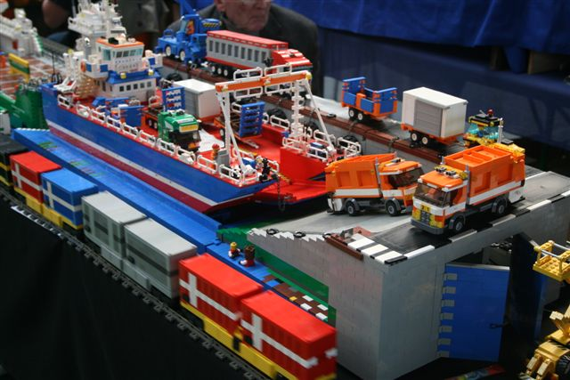
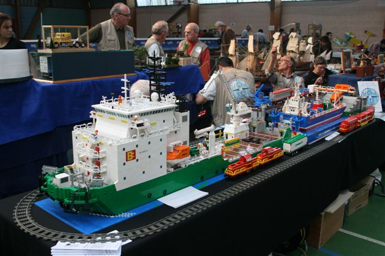
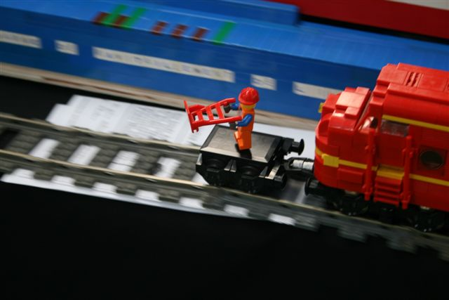

Pour cette nouvelle édition, le stand FreeLUG a obtenu 3m de tables x0.80, une surface suffisante pour exposer le Bourbon Entreprise, gros bateau vert et blanc de la compagnie française, la barge animée de l’ile de Batz et tout autour, un circuit ferroviaire avec train de conteneurs, rien de tel pour capter le public.

Dès mon installation, des épouses d’exposants m’ont vu en disant : "on t’a vu à la télé !!!" ah bon... et moi, je n’ai encore rien vu.

Tout au long du salon, plus de 1000 visiteurs ont attentivement regardé mes créations.

Mes bulletins FreeLUG accompagnés d’infos, comme d’habitude, sont partis comme des petits pains.

J’ai rencontré des passionnés, j’ignore s’ils ont adhéré par la suite...

En conclusion, bon weekend agréable

[Galerie photos](http://photos.freelug.org/main.php/v/barr__/expositions/2011/ploulech/)

_Jean-Marc_
