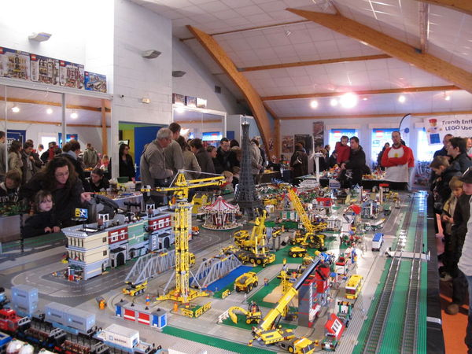
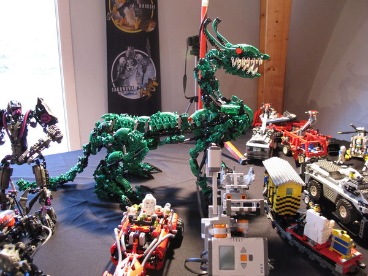
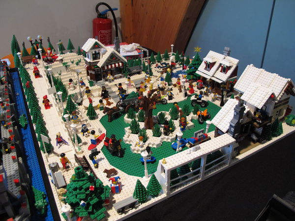
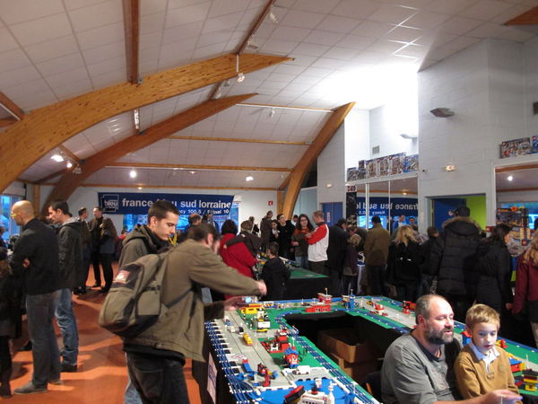
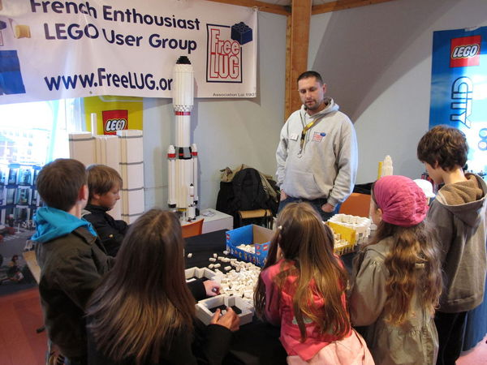

Cette seconde édition a été une réussite, puisque les exposants (pour moitié des Lorrains) et les visiteurs ont répondu présents pour ces deux jours d’exposition.

Face à l’affluence, 1200 visiteurs, nous changerons probablement de salle l’année prochaine car trop étroite désormais.

Nous franchissons une nouvelle étape avec un nouveau challenge et un thème pour 2012 : "Médiéval et Fantastique" ce qui n’empêche pas de retrouver les thèmes conventionnels City, jeux, StarWars...

La capacité d’accueil sera doublée voir triplée en fonction du nombre d’exposants. Date prévue 17-18 Novembre 2012 Complex sportif 4 rue Lasalle 54390 FROUARD.

* * *

_Le mot d’Erik_

Le week-end a mal débuté pour nous, avec une panne de l’alternateur de la voiture à 100km de Nancy, ce qui a imposé à Samuel de venir nous chercher...

A part ce contre temps, une chouette seconde édition, avec plus d’exposants, mais aussi beaucoup plus de visiteurs, plus de 1100 sur le week-end, la salle était alors remplie aux heures de forte affluence.

Un tas de choses exposées, du City, du Technic, du Bionicle, du seventies (par Thierry ;) ) un diorama Noel et moyen age, et de notre côté nous avions amené l’animation de la fusée.

## Galeries photos

[Photos d’Erik](http://photos.freelug.org/main.php/v/brickerik/expositions/2011/Saizerais/)
