Ce nouvel article est le premier d’une longue série où je vous présenterai quelques unes de mes créations, en particulier des véhicules CITY de toutes tailles et de tous types. Cette première série est consacrée aux véhicules utilitaires...

## Les véhicules d’intervention rapide de la police en milieu difficile.

Les gangsters sont partout et la police de LEGO CITY doit se doter de moyens performants pour stopper les bandits.

[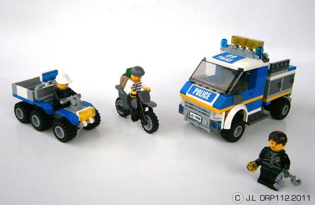](https://www.freelug.org/IMG/jpg/orp11.jpg)

**Les véhicules d’intervention rapide en milieu diffcile**

L’ensemble se compose ici de trois véhicules, à savoir un petit camion de police, une moto avec le fugitif et un quad rallongé avec une benne arrière.

[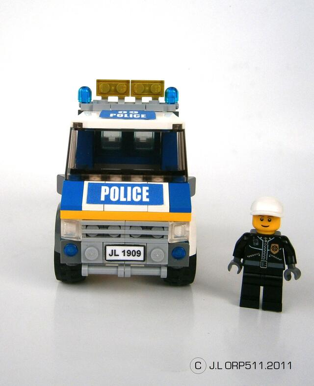](https://www.freelug.org/IMG/jpg/orp55.jpg)

Le petit camion de police est tout-terrain et sa carrure fait de lui un véhicule redoutable et redouté...

[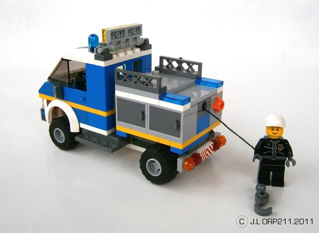](https://www.freelug.org/IMG/jpg/orp33.jpg)

Il dispose de nombreux équipements dont un crochet à friction à l’arrière du véhicule pour déplacer des éléments encombrant de la chaussée ou pour attraper un fugitif à moto par exemple. Outre ce crochet, le camion permet de ranger des menottes, une lampe torche, des talkies-walkies. L’ensemble ne dispose pas de cellule pour y enfermer le prisonnier, mais il trouvera une place assise dans la benne du quad, menottes aux poignets évidemment.

## Le petit camion de pompier forestier.

[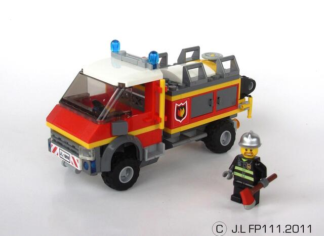](https://www.freelug.org/IMG/jpg/fp111.jpg)

**le petit camion de pompier forestier**

Ce patrouilleur forestier reprend les lignes d’un petit camion utilitaire avec des roues tout-terrain et tout le nécessaire pour une intervention rapide en forêt.

[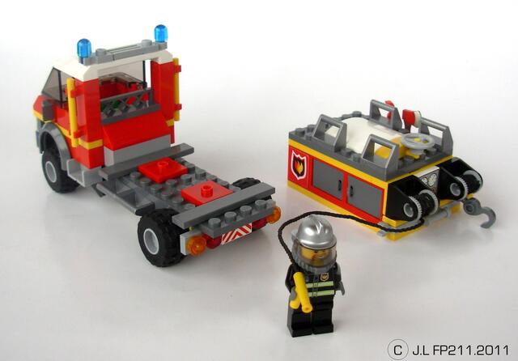](https://www.freelug.org/IMG/jpg/fp22.jpg)

**Le camion forestier vue arrière**

La partie arrière du véhicule est détachable. Les accessoires sont nombreux. On recense une citerne à eau qui peut s’ouvrir, une lance à eau, un crochet, l’équipement du pompier pour se protéger lors de son intervention et de nombreux outils. c’est un véhicule solide, facile à construire, peu gourmand en brique et très fonctionnel.

[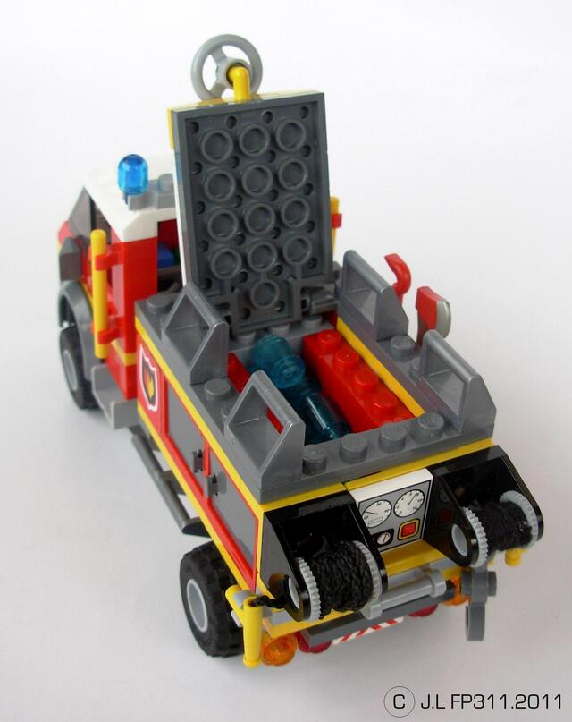](https://www.freelug.org/IMG/jpg/fp33.jpg)

**Le camion forestier/vue sur la citerne**

## Le transporteur de marchandise.

[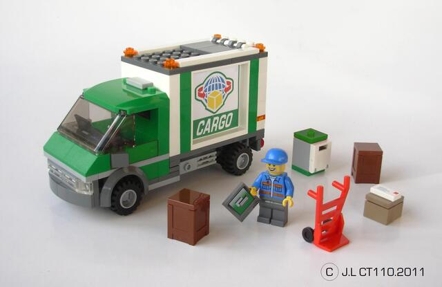](https://www.freelug.org/IMG/jpg/ct11-2.jpg)

**Le transporteur de marchandise**

Ce petit camion de transport trouve son originalité dans sa conception modulaire avec deux blocs, le châssis du camion et le container détachable.

[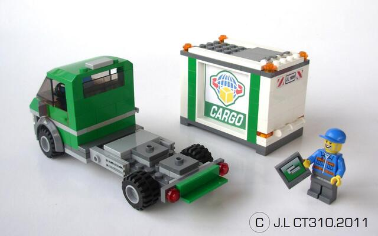](https://www.freelug.org/IMG/jpg/ct33.jpg)

**Le transporteur de marchandise / vue arrière 1**

Ce transporteur de marchandise reprend les couleurs du thème CITY CARGO (vert, blanc et gris). L’ensemble regorge de petits accessoires à savoir des colis de différentes tailles et de différentes sortes, un petit chariot pour livrer les grosses marchandises et le livreur possède même une tablette numérique pour livrer le bon colis au bon endroit et à la bonne personne.

[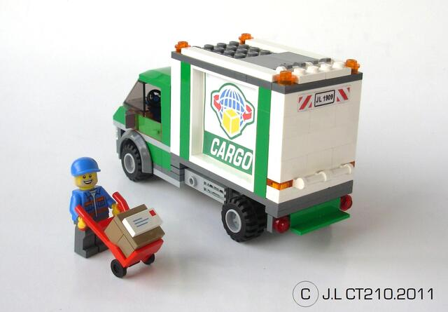](https://www.freelug.org/IMG/jpg/ct22.jpg)

**Le transporteur de marchandise / vue arrière 2**

Le container est de taille standard et est compatible avec les autres container de la gamme LEGO CITY. En outre, celui-ci peut s’ouvrir par l’arrière grâce à une porte basculante.

## Le camion postal.

Ce véhicule est la première version du transporteur de marchandise. Il fonctionne donc sur le même principe.

[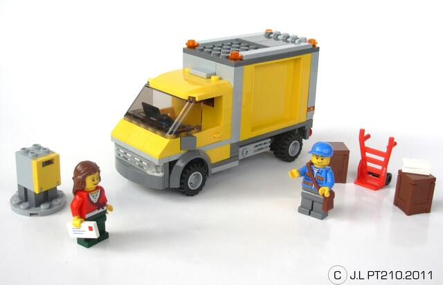](https://www.freelug.org/IMG/jpg/pt22.jpg)

**Le fourgon postal**

[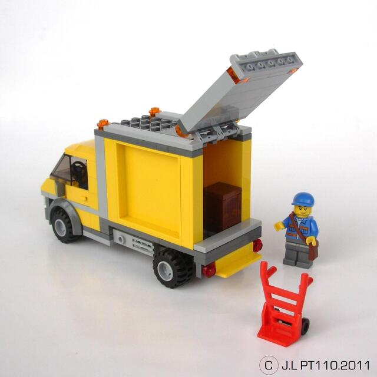](https://www.freelug.org/IMG/jpg/pt11.jpg)

**Le fourgon postal/vue arrière**

## Le véhicule du jardinier.

[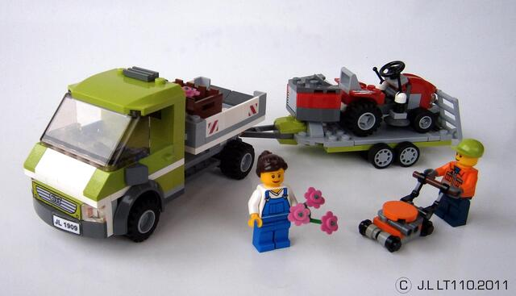](https://www.freelug.org/IMG/jpg/LT55.jpg)

**Le véhicule du jardinier et sa remorque**

L’ensemble se compose d’un véhicule avec une benne basculante et d’une remorque avec une tondeuse. Le véhicule contient de nombreux accessoires (pelle, balai, pioche, sceau, petite tondeuse et fleurs). La remorque permet de transporter la tondeuse autoportée.

[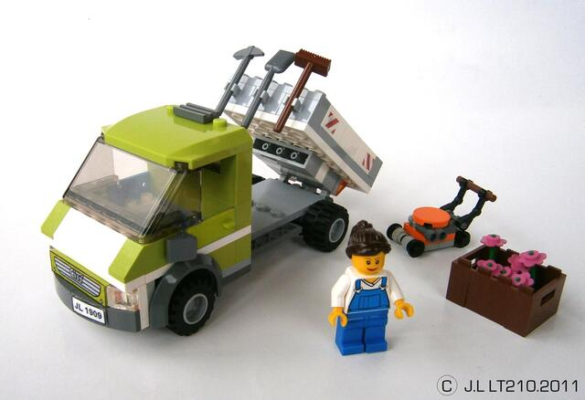](https://www.freelug.org/IMG/jpg/LT33.jpg)

**Le véhicule de jardinier**

[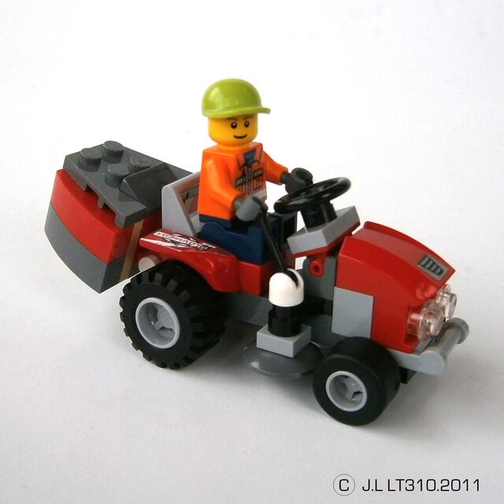](https://www.freelug.org/IMG/jpg/LT22-2.jpg)

**La tondeuse**

Voilà pour cet article consacré à cette première série de véhicules CITY "spécial petit utilitaire". La seconde série sera consacrée à des camions en tout genre et la troisième sera consacrée à des véhicules "spécial pompier". De quoi, je l’espère, vous mettre de l’eau à la bouche.

Bonne année 2012 !

N’hésitez pas à laisser un petit commentaire.

Julien
