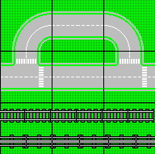
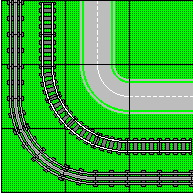
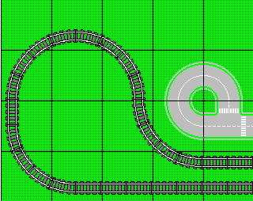
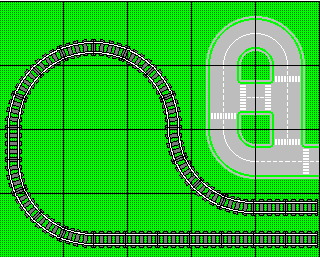
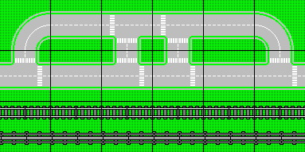
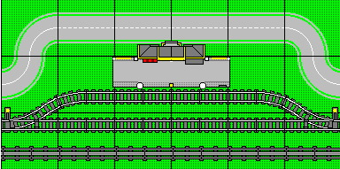

Suivant l’exemple des club de modélistes ferroviaires, la réalisation de modules permet d’organiser et de fédérer les créations de différents membres, avec pour objectif principal de faciliter l’installation des expositions.  
L’objet de cet article n’est pas de normaliser nos créations, puisque comme nous le répète notre ami Gaël : "ELTEP = En (briques) LEGO® tout est possible !", mais de proposer quelques exemples de modules de base permettant de guider nos adhérents dans la mise en place de leurs expositions.

## Qu’est ce qu’un module

Un module est un assemblage qui présente l’intérêt d’avoir des dimensions et des interfaces prédéterminées, afin de permettre une intégration rapide et aisée pour réaliser de belles expositions bien structurées.

Le module présente également l’avantage d’être un support pour chaque créateur, permettant de décomposer des structures ambitieuses en autant d’éléments susceptibles d’être pris en charge par différentes personnes. Chacun étant responsable de l’élaboration et de la mise en place de son module, il n’y a pas de mélange de pièces et chacun sait ce qu’il a à faire.

## L’expérience

Comme je le disais en introduction, la conception modulaire nous vient des modélistes ferroviaires qui ont discuté pendant de longues années avant de définir des normes qui sont maintenant utilisées sur le plan internationnal pour les grandes expositions.

Les principales contraintes qui ont été prises en compte par les ferrovipathes sont l’aspect dimensionnel pour le transport et l’aspect économique. Si dans l’univers des briques LEGO® l’aspect dimensionnel est moins problématique (pour nous tout se démonte et se remonte à loisir), l’aspect économique est également à prendre en compte. C’est ce critère qui va dimensionner le module de base, comme étant le module le plus économiquement acceptable pour répondre à notre soucis de présenter des réalisations quand même agréable à l’oeil, sur lesquels un budget modeste peut quand même s’exprimer (il faut savoir penser aux membres jeunes et aux moins fortunés d’entre nous !).

Les autres contraintes découlent des pratiques généralement constatées par des clubs plus anciens et beaucoup plus structurés que Freelug et aussi par notre retour d’expérience par rapport à nos premières expositions. Elles se déclinent en :  
**–** simplicité d’installation,  
**–** aisance dans l’exploitation,  
**–** protection des modèles,  
**–** attraction du public par le mouvement,  
**–** mise en valeur des différents niveaux d’animation,  
**–** capacité d’accueil des différents thèmes et gammes de produits (notamment pour les trains 9V et 12V)

## Les recommandations

Il découle donc de ces expériences que les présentations offrant les meilleurs compromis entre ces différentes contraintes sont soit la présentation réalisée sur un rectangle de tables avec une situation centrale réservée à l’exploitation, soit une présentation linéaire où l’exploitation s’effectue par l’arrière de l’alignement des tables. Dans les deux configurations, une barrière permet de maintenir à distance le public et évite les dégats et autres actes indésirables.

Nos amis LUG américains sont allés jusqu’à l’élaboration du mobilier adéquat : [Table modulaire de Ben Flekes](http://www.pnltc.org/toolspec_data/modular_table.html)

Les exemples de modules présentés ci-dessous reprennent les dimensions suggérées par nos amis américains. Après consultation de plusieurs autres sites, il semble en effet que le module de base de 3x3 plaques de bases de 32x32 (ou 2x2 plaques de bases de 48x48) s’affirme comme étant le standard utilisé par le plus grand nombre.

Pour les modules d’angle on pourra utiliser le modèle ci-dessous.

D’une manière générale l’animation des modèles attirant l’oeil du public, la voie ferrée sera mise en premier plan en utilisant la première travée longitudinale de plaques. On préférera mettre la voie 12V la plus à l’extérieur les commandes automatiques d’aiguille existant dans cette gamme permettront de libérer la voie la plus à l’intérieur pour le 9V où les éléments de voie sont commandés manuellement. Afin d’augmenter la variété dans la circulation des trains, on utilisera une voie double où chaque train circule dans un sens (en france les trains roulent à gauche). S’il n’est pas possible de réaliser deux boucles concentriques, il sera possible de mettre de parts et d’autres des voies deux modules de retournement, dans ce cas une seule tension (9 ou 12V) sera malheureusement utilisée.

Exemples de boucles de retournement. Evidemment compte tenu du dégagement des voies le module de retournement n’est pas à la dimension standard.

Nota : les voies seront positionnées à 4 tenons de part et d’autre d’une plaque 32x32, avec un entraxe de 8 tenons permettant le cas échéant de positionner un aiguillage pour passer d’une voie à l’autre (attention, tension unique et risques de court-circuit si les voies sont alimentées par deux sources différentes => pensez à isoler les réseaux). Eventuellement les plaques servant de support aux voies pourront être homises si aucun élément de décort ne vient s’y ajouter.

Les exemples ci-dessous illustrent les différentes possibilités. Ils ont été réalisés avec le logiciel [Track designer](http://www.ngltc.org/train_depot/td.htm).

Les deuxièmes et troisième travées seront consacrées aux routes, villes et autres réalisations.

D’un point de vue personnel, je suggère de réserver le monorail sur la troisième travée afin de faciliter également l’exploitation et de porter tout ce qui est haut en arrière plan pour facilier la vision. Mais ELTEP !

Je suggère également dans le cas où le mobilier mis à disposition s’y prête, d’assembler deux rangs de modules de base (donc 2 fois 3x3 plaques de 32x32) en surélevant le rang le plus à l’intérieur de 12 à 16 hauteurs d’une brique de base, afin de donner du relief. Une telle configuration permet également de faire circuler des trains sous la partie surélevée, de façon à constituer des remises cachées du public qui permettent de varier la composition des trains. La partie surélévée permet également de créer des tunels, de mettre en place des ponts sans avoir à élaborer des rampes (toujours délicates à négocier) et d’ajouter ainsi de l’attrait à nos présentations.

Bonne préparation d’expos à tous et à bientôt pour des illustrations par l’exemple...et n’oubliez pas : ELTEP !
