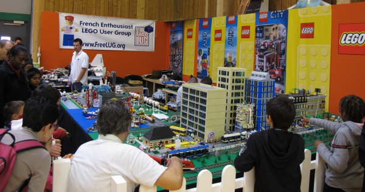
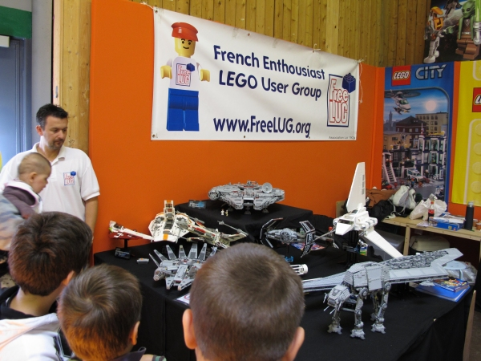
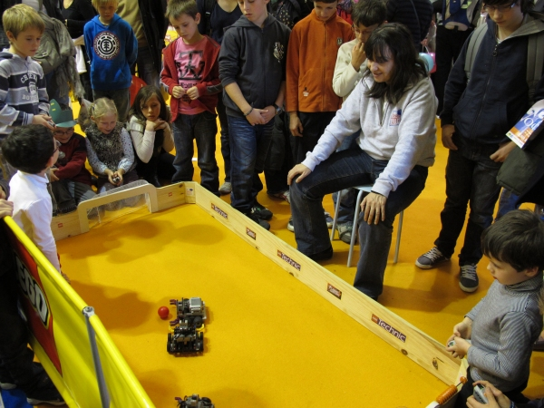
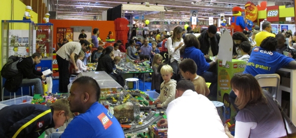
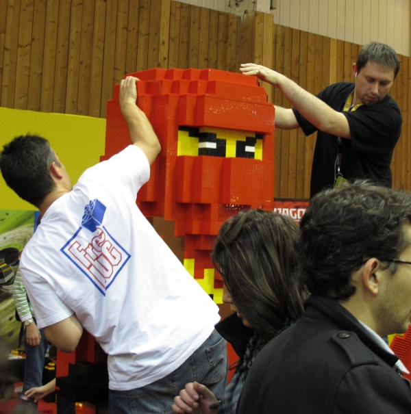
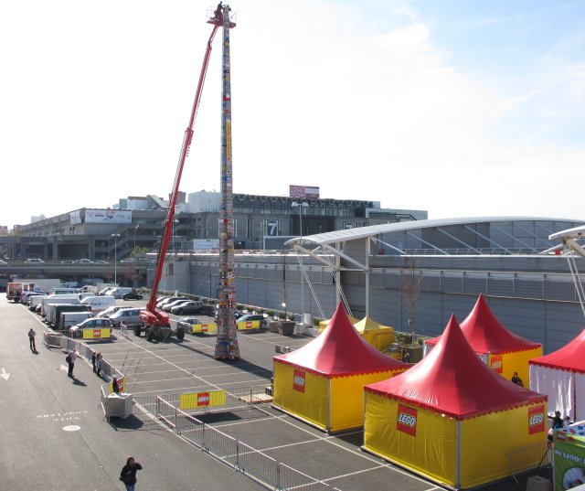

Depuis 2008, LEGO France nous convie à participer à Kidexpo, salon dédié à l’enfant et qui a accueilli cette année 120 000 visiteurs.

Comme les autres années, la grande partie du stand était occupé par un diorama City. Un espace présentait également une partie des sets StarWars UCS.

## Diorama City

Plusieurs personnes ont participé au diorama City.

Jérémy a réalisé une aire de lancement de fusées, pour présenter les sets officiels LEGO de la gamme.

Tof de son côté a ramené des éléments portuaires.

Jean-Claude et Julie sont venus avec leurs grands immeubles et une maison.

Jérémy proposait ses modulars.

Enfin, Erik a mis en oeuvre deux tramways (prêtés par Jérémy) automatisés circulant en va-et-vient entre les deux stations.

Le public quant à lui pouvait piloter deux trains grâce au système PFS.

## StarWars

Manu de son côté proposait une partie de la gamme StarWars UCS avec en éléments maîtres le faucon Millenium et le dernier de la gamme, le SSD.

## Techball

Enfin, nous animions de temps à autres des parties de Techball.

## Animations LEGO

De son côté, LEGO proposait sur son stand de nombreuses tables de construction, des arènes de combats de toupies NinjaGo, ainsi que la construction d’un Kai de deux mètres de haut.

Pour celui-ci, il fallut l’aide de nos experts puisque les animateurs LEGO avaient quelques difficultés à le construire.

Mais le point d’orgue de cette édition, c’était bien sûr la construction de la tour la plus haute du monde en briques LEGO, réalisée en extérieur, dans le parc des expositions.

**Le village pour la construction de la tour**

[Plus de détails sur la construction de la tour LEGO](/articles/1389/)

* * *

Notre participation à Kidexpo étant une collaboration avec LEGO France, c’est aussi l’occasion pour l’association de se voir attribuer du matériel.

Ainsi, pour la partie exposition, LEGO nous a offert quelques sets City ainsi que des éléments PFS (batteries, chargeurs, télécommandes) pour équiper les trains que les enfants pilotent.

A la fin du salon, nous avons également pu récupérer tout un tas de matériel dont LEGO se débarrassait, comme des tables de jeu qui font le tour des vitrines, une grande arche en medium, de la PLV...

Nous avons également fait le tour du hall pour récupérer des dizaines de mètres de tentures ignifugées qui partaient à la benne et qui nous serviront de nappes.

Voilà du matériel qui pourra équiper nos futures expositions.  
Encore un grand merci à Jean-Claude pour avoir ramené tout cela.

## Galeries photos

**–** [Galerie d’Erik](http://photos.freelug.org/main.php/v/brickerik/expositions/2011/Kidexpo/)  
**–** [Photos de la tour par DenisL](http://photos.freelug.org/main.php/v/dlaurencon/Expo/Kidexpo+2011/)
