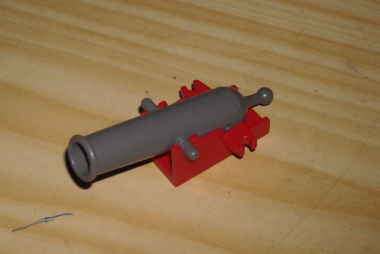
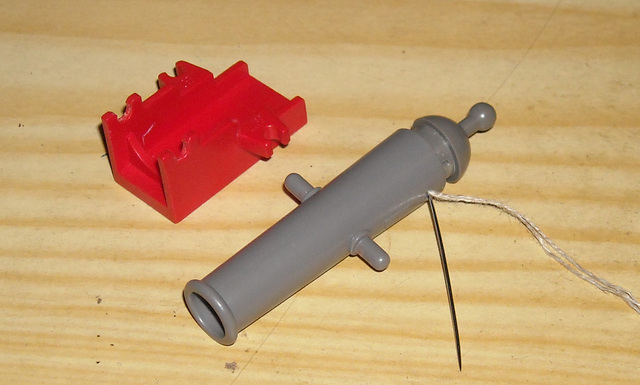
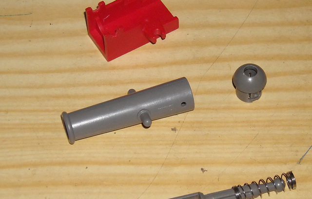
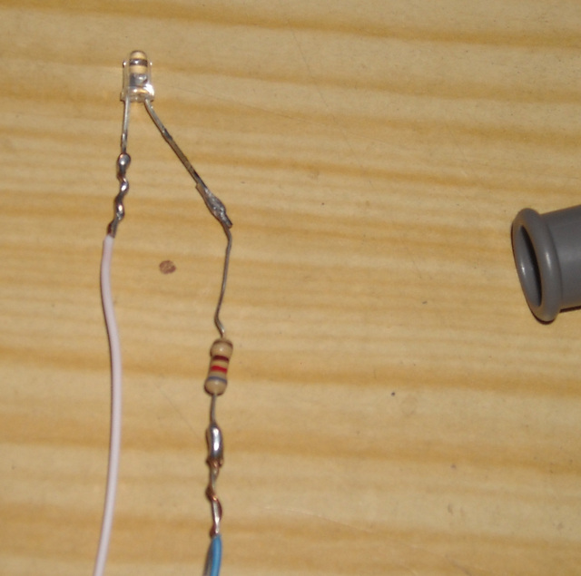
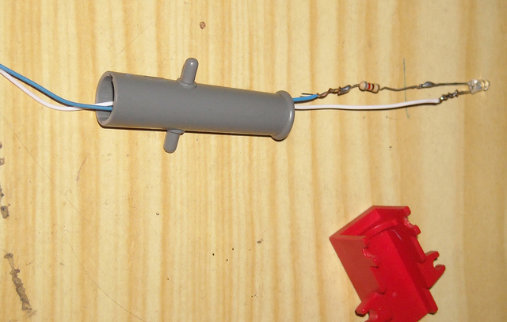
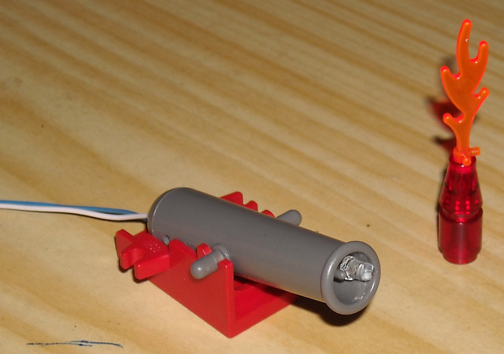
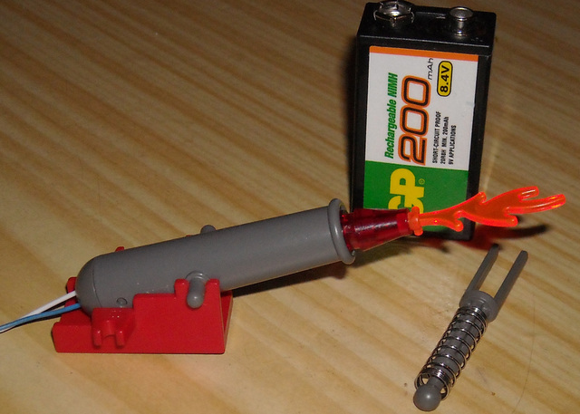

Branle-bas de combat, tout le monde sur le pont !

Ce petit article va vous exposer ma méthode toute simple pour installer de la lumière dans un canon LEGO, et animer ainsi vos bateaux pirates !

Alors, je vous entends déjà d’ici : dans quelle mesure est-ce encore jouer aux LEGO lorsque l’on planque de l’électronique à l’intérieur ? Eh bien écoutez, je suis moi-même ravi de pouvoir faire du 100% LEGO lorsque c’est possible, mais si c’est pour se faire plaisir aux yeux, quel mal y a-t-il si en plus aucun élément LEGO n’est esquinté au cours de la manipulation ! De plus, les éléments électroniques, en plus d’être des plus basiques, miniaturisent ici ce que les LEGO, en l’état actuel du catalogue des items, ne permettent pas de faire.

En partant des canons que l’on trouve sur tous les sets de bateaux pirates qui se respectent, je propose simplement de séparer chacun des éléments qui le constituent : affût, canon, culot et dispositif du ressort sont donc séparés.

Pour faire sauter le culot, je me sers de la tête d’une aiguille pour appuyer sur les deux minuscules pressoirs qui se trouvent de part et d’autre du tube, ainsi que d’un ongle pour tirer doucement sur le culot.

Une fois arrivé là, on peut mettre le dispositif du ressort à part ; le canon sera remonté sans lui, car on a besoin du trou qu’il occupe dans le culot.

C’est maintenant que ça devient plus technique. Une soudure rapide led (blanche ou rouge) + résistance (bleu, rouge, marron, or), permettra d’alimenter la lumière en 9v ; n’hésitez pas à mettre de l’adhésif sur les pattes de la led pour limiter les risques de faux-contact.

Pour insérer la led dans le canon, on fait passer les fils en premier, un par un, en entrant par la gueule.

Une fois cette étape terminée, et qui n’est pas la plus simple, le culot peut être remis en place en faisant passer les fils dans le trou qui servait au dispositif du ressort. Pendant ce temps, on assemble une flamme sur un ensemble cône et cylindre de couleur trans red ou trans orange, qui ira s’enfiler directement sur la led.

C’est bon ! Avec une pile 9v, le canon est prêt à cracher du feu ! Et en plus on se retrouve avec un ressort en plus. Bon, je referai un tutoriel quand j’aurai trouvé quoi faire avec le ressort...  
En fait, la principale difficulté de cette manipulation, ça sera de cacher les fils, parce que je vous rejoins sur ce point : les fils électriques dans les LEGO, c’est moche.

Bon allez, un petit bonus pour conclure cet article. Avec un peu de patience, quelques mètres de fils électriques en plus et quelques chenillards commandés sur internet, on peut en arriver à reconstituer un tir de batterie, un plus spectaculaire, avouez :

[Vidéo de la publication d’origine](https://www.youtube.com/v/PH2EDUXljYM?version=3&hl=fr_FR)

Voilà pour ce tutoriel, c’est un montage extrêmement basique, mais je tenais à partager l’idée pour enrichir les possibilités de moc en matière de pirates, j’espère qu’il vous aura plu !

A bientôt !

LaurentB
