Cette deuxième série présente des créations que j’ai réalisées il y a déjà un petit moment. Avant de présenter des camions plus récents, je vais tout d’abord commencer par des créations plus anciennes.

## Le camion de déneigement et le dépôt de sel

[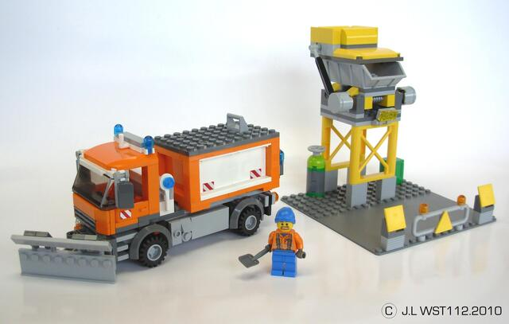](https://www.freelug.org/IMG/jpg/WST2.jpg)

**Le camion de déneigement et le dépôt de sel/vue générale**

L’hiver approche et il faut que les infrastructures routières de LEGO CITY soit opérationnelles. Voici donc un camion de déneigement avec une lame à l’avant pour évacuer la neige et un bac à l’arrière pour stocker et répandre le sel sur la route.

[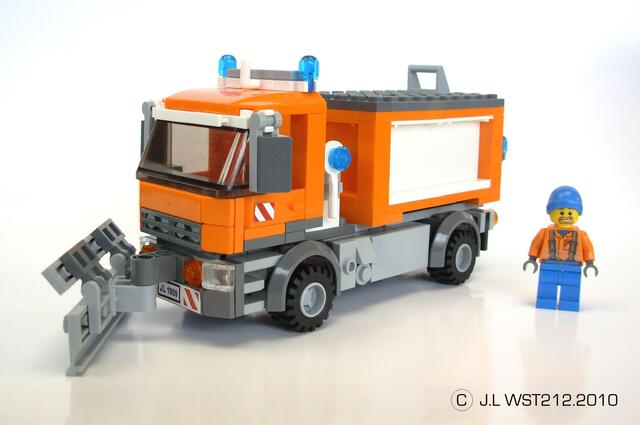](https://www.freelug.org/IMG/jpg/WST1.jpg)

**Le camion de déneigement**

[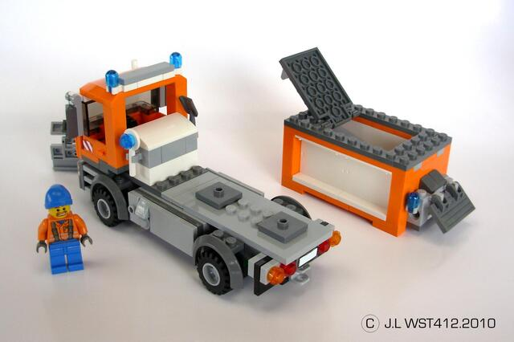](https://www.freelug.org/IMG/jpg/WST3.jpg)

**Le camion de déneigement/vue arrière**

Le dépôt permet de déverser le sel dans le bac du camion. Le bac supérieur du dépôt peut basculer et la présence d’un vérin sur le dépôt de sel permet de maintenir le bac supérieur dans une position fixe. Le sel est ensuite répandu sur la route par la petite ouverture en bas du bac. L’intérieur du bac possède un plan incliné pour faire descendre les petites briques.

[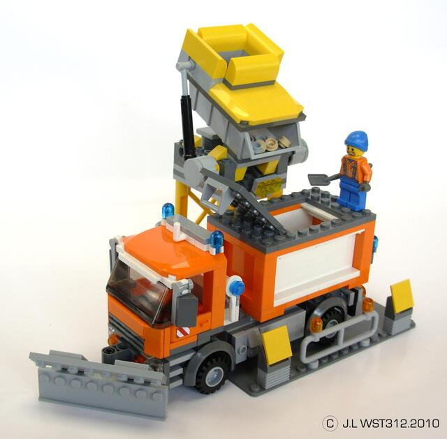](https://www.freelug.org/IMG/jpg/WST4.jpg)

**Le dépôt de sel en action**

Les accessoires sont nombreux : poubelle, pelle, balai, panneau signalétique, crochet à remorque (au cas où).

## Le camion à benne basculante

Depuis 1992 et le camion 6668, LEGO n’a pas réalisé de camion similaire avec une largeur de 6 tenons. Le modèle de 1992 possédait un fonctionnement intéressant avec la mise en place d’un élément spécifique pour le bras permettant de mouvoir la benne. A l’échelle des camions d’une largeur de 6 tenons, l’utilisation de cet élément s’est avéré peu concluant. Voici alors ci-dessous, ma version d’un camion à benne basculante.

[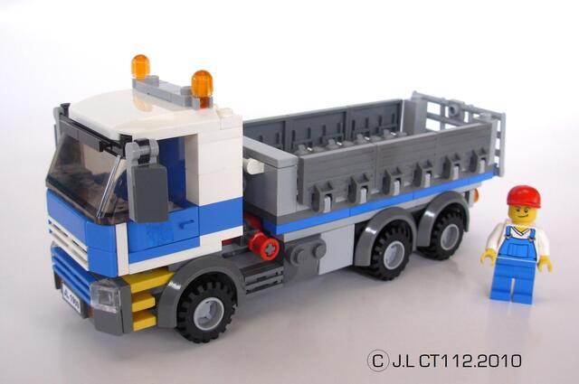](https://www.freelug.org/IMG/jpg/CT1.jpg)

**Le camion à benne basculante/vue générale**

Ce camion fonctionne manuellement. Il suffit de faire basculer le bras par la petite poignée présente sur le côté du véhicule. A l’échelle des camions de 8 tenons de large, on pourrait incorporer davantage de détails comme des vérins par exemple.

[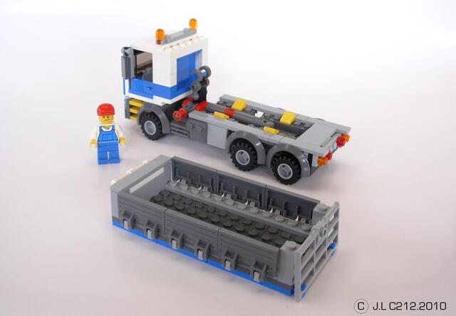](https://www.freelug.org/IMG/jpg/CT2.jpg)

**Vue arrière du camion**

Ci-dessous, le camion en action.

[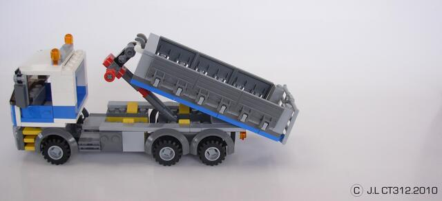](https://www.freelug.org/IMG/jpg/CT3.jpg)

**Le camion à benne basculante en action**

## Le porte container

Ce camion fonctionne sur le même principe. La benne a été remplacée par un container et la couleur de la cabine a été modifiée pour faire ressortir la couleur du container.

[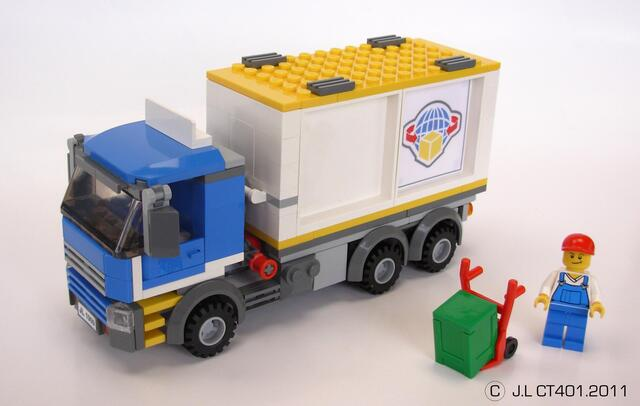](https://www.freelug.org/IMG/jpg/CT4.jpg)

**Le porte container/vue générale**

[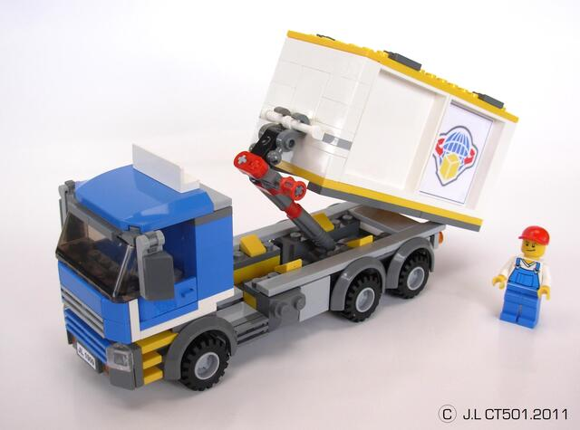](https://www.freelug.org/IMG/jpg/CT5.jpg)

**Le porte container en action**

## La toupie à béton

[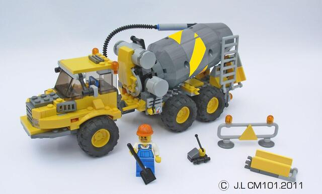](https://www.freelug.org/IMG/jpg/CM1.jpg)

**La toupie à béton**

La partie avant du camion reprend le même design que le camion de chantier LEGO 7631 sorti en 2009. J’ai modifié la partie arrière en installant une toupie rotative ainsi qu’en ajoutant des rampes pour le guidage du ciment. Le conducteur dispose également d’une télécommande pour simuler le fonctionnement de la toupie à distance. Le camion dispose aussi d’une pompe à eau pour nettoyer sa toupie, d’un pistolet pour la projection du ciment et de divers outils.

[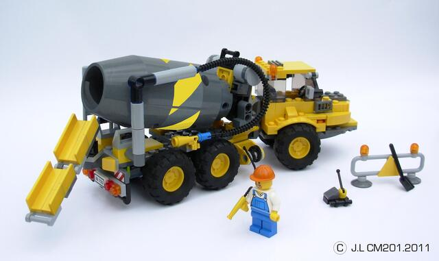](https://www.freelug.org/IMG/jpg/CM2.jpg)

**La toupie à béton/vue arrière**

## Le camion de transport et sa pelleteuse

[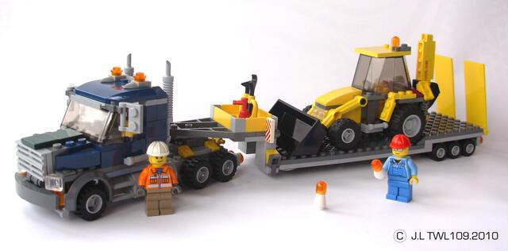](https://www.freelug.org/IMG/jpg/TWL1.jpg)

**Le camion de transport et sa pelleteuse**

Ce camion bleu foncé avec sa remorque permet le transport d’[une pelleteuse, qui fût l’objet de mon premier article sur FreeLUG](/articles/1310/). La remorque dispose d’une caisse pour les outils, de béquilles pour stabiliser la remorque et de rampes.

Voilà donc pour cette seconde série consacrée à quelques camions. La prochaine fois, je présenterai une série "spécial pompier". A suivre aussi prochainement, une série dédiée aux véhicules agricoles.

N’hésitez pas à laisser un commentaire.

Julien
