Depuis toujours j’ai été intéressé par la construction, mais jeune trop longtemps, j’ai loupé le virage des études d’architecte.

Mais _Gelo m’a sauver_ avec plein de briques et autres fenêtres à empiler pour faire des constructions improbables.

Ainsi au début l’on fait ce que l’on peut en empilant toutes les briques de la boite à chaussures...

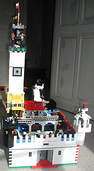

**Ma première tour, en 1998. La j’ai mis toutes mes briques...**

Ma première tour, en 1998. La j’ai mis toutes mes briques...

Quelques années plus tard, le stock grandissant et les rencontres AFOL aidant, les choses progressent :

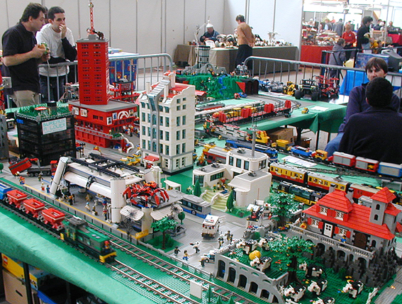

**Un petit début : St Etienne en 2005.**

Un petit début : St Etienne en 2005.

Pour finir avec le premier quartier des affaires dans le Méga module RA pour [Orléans en 2008](/articles/820/).

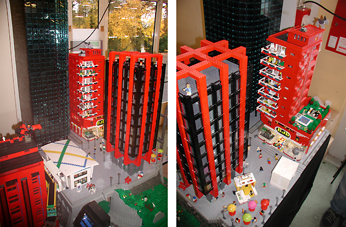

Ce quartier est un déclic pour moi : car accueillant un building orphelin (le rouge et noir au premier plan sur la photo) le temps de cette exposition, je me suis dit mais pourquoi ne pas essayer de concevoir un quartier des affaires pour pouvoir y accueillir tout ceux qui veulent y construire.

Trois expositions suivantes permettent de valider l’idée avec à chaque fois une partie des immeubles faite par des personnes différentes :

[Bourgoin 2009](/articles/881/)

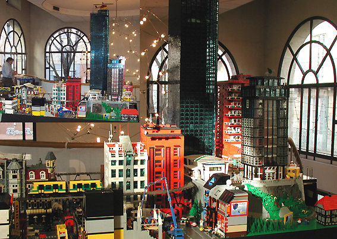

[Saint-Rambert 2009](/articles/1023/)

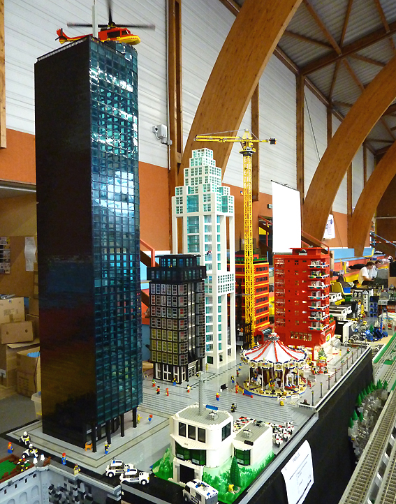

[Fana’briques 2010](/articles/1157/)

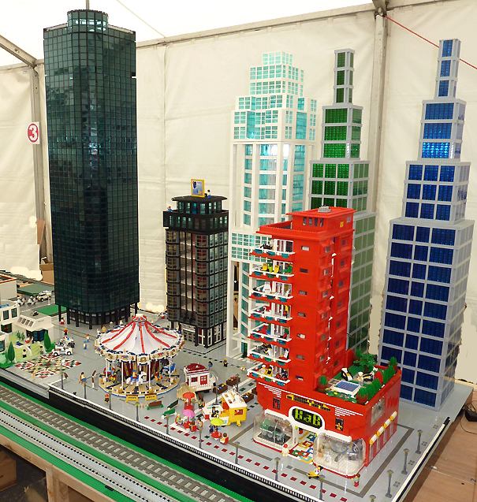

Et cela fonctionne mais pour l’instant nous sommes encore loin du [quartier de La Défense -](http://fr.wikipedia.org/wiki/La_D%C3%A9fense) avec ses 37 tours.

La solution pour y arriver pourrait être de se donner quelques règles de base puis de se lancer pour un super quartier (tiens, pourquoi pas pour Fana’briques 2012 ? )

## Tentative pour quelques règles de base.

L’environnement général est du type de celui du quartier de La Défense : des grattes ciel et une dalle. Cela veux dire qu’il n’y a pas de route pour les véhicules entre les tours.

Le principal avantage de ce premier principe est de pouvoir assez facilement rendre homogène l’ensemble via la dalle (non, on ne la cassera pas !).

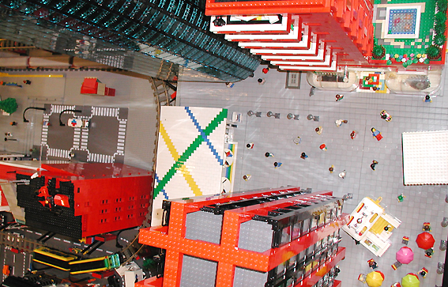

## La dalle.

La dalle est plate, mais rien n’interdit quelle soit plate, en pente ou avec des escaliers. Ce qui caractérise la dalle est sa couleur de fond : [Tile 2x2 Light Bluish Gray](http://www.bricklink.com/catalogItemIn.asp?P=3068b&colorID=86&in=A).

Le placage en tiles est fait sur chaque module par le constructeur du module.

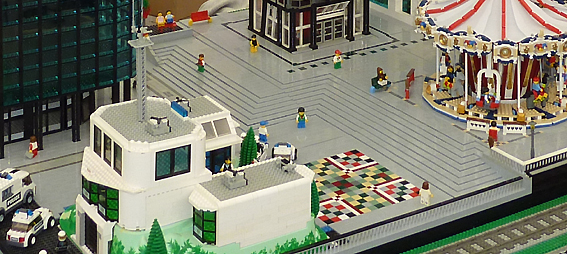

Il doit y avoir sous la dalle un espace de 3 briques minimum pour le passage des fils et autres systèmes selon le principe suivant :

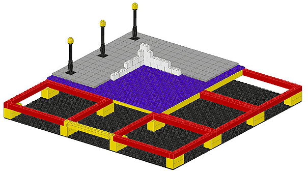

Ce qui du bas vers le haut donne l’empilage suivant :  
**–** une plaque de base : typiquement de 48x48 ;  
**–** deux briques de hauteur pour ménager un espace ;  
**–** une brique de hauteur pour faire les liaisons entre les briques de hauteur ;  
**–** et posée par dessus tout cela la plaque de base de votre construction.

## Les buildings, tours, gratte-ciels, etc.

On va dire que par définition (sauf exception : voir plus bas) un bâtiment du quartier des affaires fait verticalement au moins 9 étages de 7 briques (soit au moins 63 briques).

La hauteur maximum est fixé par la stabilité du bâtiment dans un environnement d’exposition : il doit être assez stable et solide pour ne pas présenter de danger pour les visiteurs : en fait il faut faire une construction anti-sismique...

Le module minimum du quartier des affaires est la plaque de base 48x48. Donc une tour de _type 1 module_ doit totalement s’inscrire sur cette plaque.

La base de l’immeuble doit être à 6 tenons de tous les bords de la plaque 48x48.

Cette espace de 6 tenons permet d’être sûr d’avoir un passage entre chaque module. Cet espace de raccordement pourra éventuellement être finalisé lors du montage de l’exposition en fonction des voisins.

Une tour peut reposer sur une plus grande base.

Par exemple, le module d’une tour type II sera sur 2 plaques et le module d’une tour de type IV sera sur quatre plaques 48x48 mais avec des fondations (la base de la tour) toujours à 6 tenons minima du bord externe des plaques.

La maximum pour le quartier des affaires FreeLUG est un module de type IV pour une construction.

## Exception aux tours.

En fait le quartier de La Défense n’est pas constitué uniquement de tours. On y trouve aussi des bâtiments très bas est des oeuvres d’art.

On pourra aussi y trouver un petit parc, des fontaines, un skatepark, des vendeurs ambulants, etc.

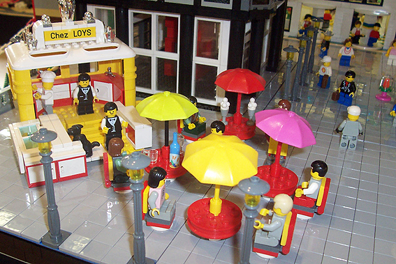

**Le bar Loys**

[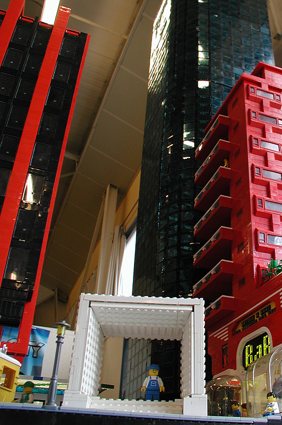](https://www.freelug.org/IMG/jpg/L_arche-de-jac.jpg)

**L’arche de Jac**

## Les dessous de la dalle ?

Sous la dalle, il peut y avoir beaucoup de choses : métro, parking, trains, RER, voies rapides, salles d’expo. Et aussi les égouts, les catacombes, des grottes, le Basilic, le centre de la terre...

## Oui, mais les tables ?

Le quartier des affaires est un concept qui peut être appliqué par tous sur des tables normales, mais avoir des propres tables xBàB facilite bien les choses.

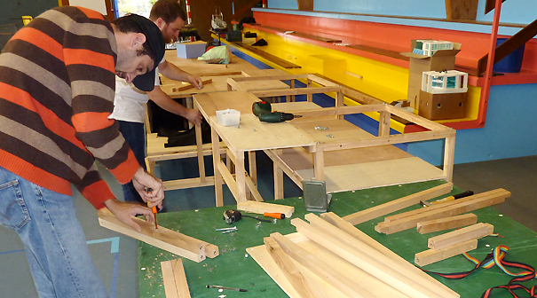

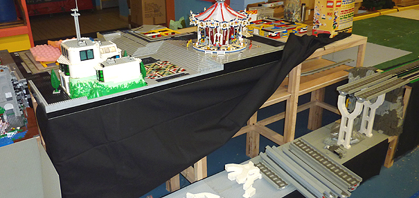

Cela permet de donner du relief en donnant libre court à son imagination uniquement limitée par le menuisier de service.  
(Nous avons des tables xBàB et un menuisier pour Fana’briques 2012)

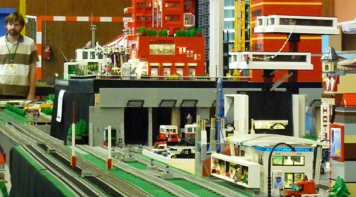

## En guise de conclusion

Voilà le cadre général planté et maintenant à vos briques.

Mais gardons à l’esprit qu’il ne s’agit pas dans ce concept de reproduire fidèlement la Défense (même si ce n’est pas interdit de faire telle ou telle tour de la Défense). Il s’agit de faire un grand quartier avec des grands immeubles et des gratte-ciels et tout ce qui va autour.

On peux aussi se souvenir du [concept BrickCiel](/articles/148/) qui peut facilement trouver sa place ici.

Le concept est de faire un quartier d’affaire d’affaire où la création doit primer sur la copie (à Quand le [Prix Pritzker](http://fr.wikipedia.org/wiki/Prix_Pritzker) ou le [Prix de Rome](http://fr.wikipedia.org/wiki/Prix_de_Rome) pour un Freelugien ?)

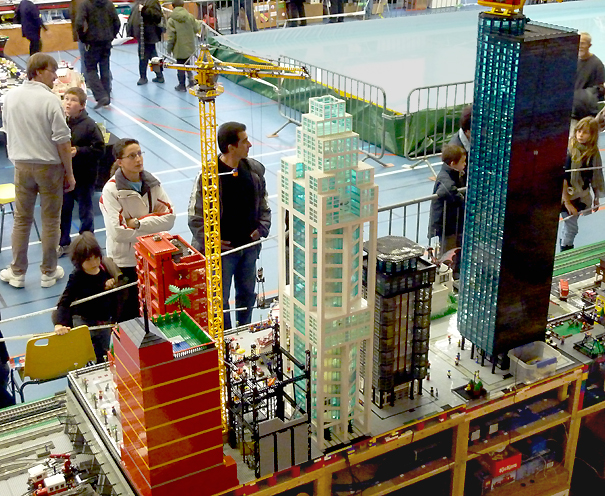
