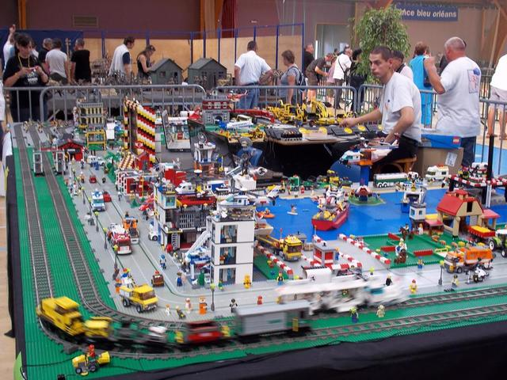

L’AGMR (Association Giennoise de Modèles Réduits) nous a sollicités pour exposer lors de leur deuxième salon du modélisme, qui se tenait les 10 et 11 septembre 2011.

C’était un week-end très agréable, un peu arrosé hélas mais avec beaucoup de visiteurs.

Remerciements :  
**–** au président de l’AGMR, Monsieur Dureville A.  
**–** à toute la famille Goberville  
**–** à Monsieur Kurys V.  
**–** au CA de FreeLUG  
**–** au JouéClub de Gien

Merci à tous,

David KURYS

[Galerie photos](http://photos.freelug.org/main.php/v/davidkurys/gien2011/)
