Le projet Brickciel est basé sur le concept d’un gratte-ciel, où chacun pourra construire un ou plusieurs étages qui s’emboiteront.  
Retrouvez ici les standards.

_[English version](http://brickerik.free.fr/brickciel/index.php?langue=en)_

Plusieurs tailles de modules peuvent exister.

**–** **Le module simple** (24x24) : module de base. Hauteur : 8 + 1/3

|  |  |
| --- | --- |
| [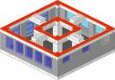](http://brickerik.free.fr/brickciel/images/mod_simple_03.jpg) | [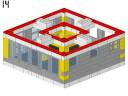](http://brickerik.free.fr/brickciel/brickciel14.JPG) |

Certaines spécificités sont à respecter pour assurer la solidité et la compatibilité de l’ensemble.

La notice en images est disponible [ici](http://brickerik.free.fr/brickciel/) ou [téléchargeable](http://brickerik.free.fr/brickciel/brickciel.dat) pour MLCad.

_Les couleurs sont données à titre indicatif._

-   un pilier 2x2 (ou plus) (en jaune dans la notice) dans chaque coin de l’étage afin d’assurer une certaine solidité à l’ensemble, qui pourra etre inclu avec le reste des facades ;
-   les parties en blanc sur la notice sont à respecter pour assurer un bon emboitement des modules ;
-   les parties grises représentent les facades et peuvent etre de n’importe quelle couleur ;
-   les murs exterieurs sont laissés à l’imagination du constructeur !! (voir notice pour des exemples...) ;
-   les pilier jaunes au centre. On doit retrouver ces piliers d’une façon ou d’une autre (seuls, inclus dans un mur) pour assurer une solidité à l’ensemble.

Deux tours peuvent être réalisée à partir de modules simples, et certains étages reliés par une passerelle. Les deux tours seront espacées de 8 tenons. Il est alors important que chaque module respecte la hauteur 8 + 1/3 (ou un multiple)

**–** **Variante du module simple à passerelle** et exemples de passerelles

|  |  |  |  |
| --- | --- | --- | --- |
| [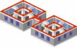](http://brickerik.free.fr/brickciel/images/expl_mod_pas.jpg) | [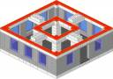](http://brickerik.free.fr/brickciel/images/mod_pass.jpg) | [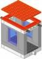](http://brickerik.free.fr/brickciel/images/passerelle_01.jpg) | [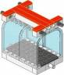](http://brickerik.free.fr/brickciel/images/passerelle_02.jpg) |

**–** **Le module double** (56 x24)  
Il correspond à la fusion de deux modules simples séparés de 8 tenons.

|  |  |  |
| --- | --- | --- |
| [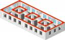](http://brickerik.free.fr/brickciel/images/mod_double_03.jpg) | [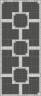](http://brickerik.free.fr/brickciel/images/mod_double_top.jpg) | [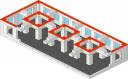](http://brickerik.free.fr/brickciel/images/mod_double_02.jpg) |

**–** **Le module triple** (56 x56)  
Il correspond à la fusion de trois modules simples positionnés en L et séparés de 8 tenons chacun.

|  |  |
| --- | --- |
| [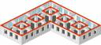](http://brickerik.free.fr/brickciel/images/mod_triple_03.jpg) | [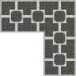](http://brickerik.free.fr/brickciel/images/mod_triple_top.jpg) |

**–** **Le module quadruple (ou carré)** (56x56)  
Il correspond à la fusion de quatre modules simples positionnés en carré et séparés de 8 tenons chacun.

|  |  |
| --- | --- |
| [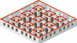](http://brickerik.free.fr/brickciel/images/mod_quad_03.jpg) | [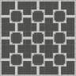](http://brickerik.free.fr/brickciel/images/mod_quad_top.jpg) |

A partir de ces 4 modules différents, on peut obtenir un grand nombre de configurations, ainsi qu’une configuration pyramidale (pour des tours trés hautes)

|  |  |  |
| --- | --- | --- |
| [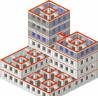](http://brickerik.free.fr/brickciel/images/expl01.jpg) | [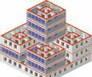](http://brickerik.free.fr/brickciel/images/expl02.jpg) | [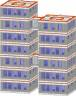](http://brickerik.free.fr/brickciel/images/expl03.jpg) |

**–** **Aménagement**

Chaque module devra etre aménagé. Il existe de nombreuses possibilités : bureaux, appartements, restaurant, boutiques, musée, salle de sport, serre, terrasse... Il est possible de faire un module correspondants à 2 ou plusieurs étages pour y créer des mezanines, ou si l’aménagement l’y oblige (un musée avec un tyrex...) ;

Un module devra constituer le rez-de-chaussé (RDC), avec porte d’acces.  
Un module devra constituer le dernier étage : terrasse panoramique, toit pointu...  
En cas de superposition de modules de tailles différentes, certains toits spéciaux peuvent être nécéssaires.

Des éléments, tels que des balcons, des bannières, des stores... peuvent dépasser du cadre.

De façon plus générale, un module peut prendre toute forme quelconque, tant qu’il reste compatible par le bas et par le dessus avec des modules standards, et que la solidité par le centre, par les poutres transversales et les coins soit respectée...

A partir de ces modules, plusieurs défis peuvent etre relevés : tour la plus haute, tour intertemporelle (bas de la tour correspondant à l’Egypte, puis au moyen age et de plus en plus moderne, traversant les époques et les collections LEGO...). ELTEP !

Voici le premier gratte-ciel réalisé lors de notre rencontre à Rennes en juillet 2003 :  
[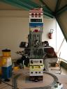](http://www.brickshelf.com/gallery/ea-the-smile/FreeLUG/2003-07-20/brickciel.jpg)
