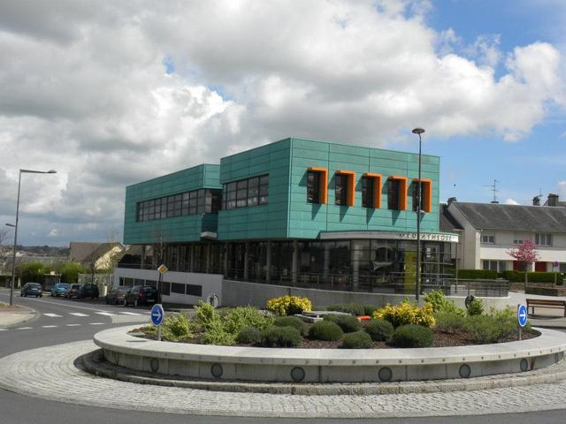
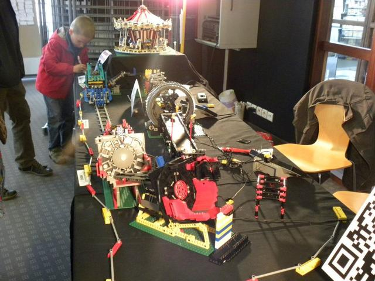
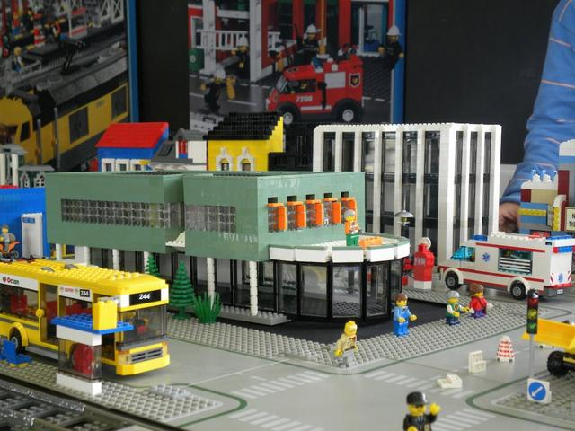
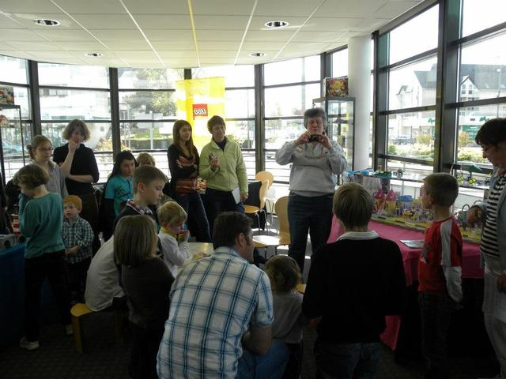
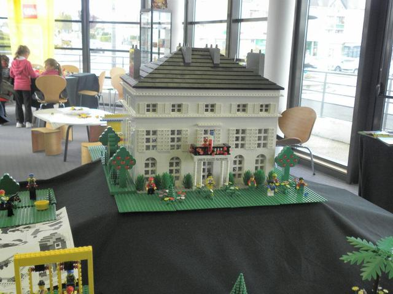
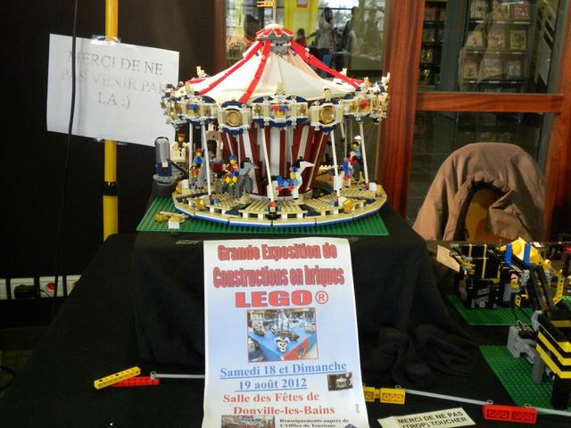
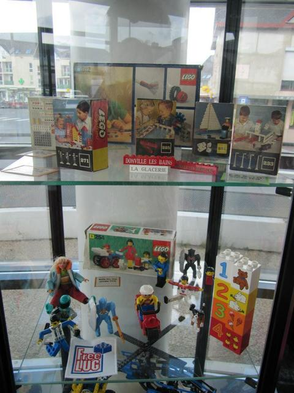

14 jours intenses

Le 5 août 2011, Jérôme Weiss et moi-même faisons connaissance et nous rendons à l’exposition LEGO de Condé sur Noireau (14110).

La journée toute consacrée aux bavardages LEGO me fait découvrir le monde et surtout sur photos la ville "LEGO" de Jérôme.  
Depuis 26 ans habitante du Pays Saint Lois et depuis quelques années avec beaucoup de temps consacré aux briques, j’ai des projets ou des offres.

Le soir même, sans rendez-vous, nous rencontrons Mr Lemarchand Directeur de la médiathèque d’Agneaux qui nous fait entièrement confiance et nous fixons la date de l’exposition et des ateliers enfants.

Cette magnifique salle à 5 min de chez moi est propice à une première expérience (rassurée par un contexte local) car à cette date ni l’un ni l’autre n’avons organisé d’exposition. Tous deux adhérents de FreeLUG, je ne me sens pas seule dans cette aventure pour avoir participé et rencontré d’autres adhérents à des expositions et ce sentiment s’est confirmé.

**Agneaux3**

Je remercie de suite Philo pour son prêt de Grand Bidule à Balles (GBB), Jean-Marc pour le joli carrousel et pour plein de ferroviaire car la ville de Jérôme s’est agrandie, cette belle salle lui a donné des ailes et Jean-Claude pour la réplique de la mairie de la ville d’Agneaux qui a tant paru dans la presse.

**Agneaux1**

D’autres amis Hélène, Thierry, Jacky ont participé au projet et donné un sérieux coup de main aux ateliers (dans une autre grande salle à l’étage) et au démontage en même temps que les parents de Jérôme.

Il se dit souvent que les expositions locales sont un lieu de nouvelles rencontres d’AFOLs : je vous confirme car Michaël du Pays St Lois nous a apporté dès le lendemain de sa visite à l’exposition, le vendredi de la première semaine, une partie de sa collection Star Wars. Ce fut une énorme surprise pour les visiteurs et nous même ! Le dimanche 15 c’était l’émerveillement des enfants et des grands pendant qu’il faisait déambuler son robot dans la salle.

Un nouvel AFOL, Eddy fait lui aussi partie du groupe maintenant.

Sur les photos (un visiteur m’en a adressé 130 merci), vous verrez Benjamin présent tous les jours pour surveiller avec Alain le train et toutes ces balles qui veulent se sauver du GBB.

Avec Benjamin (11 ans et très responsable) des projets sont en cours, j’espère qu’il vous en parlera sur notre site.

Trois groupes d’enfants du centre de loisirs d’Agneaux sont venus sur 3 demi-journées d’ateliers, et 3 autres demi-journées ateliers pour tous et sur inscriptions (de 14 enfants) ont eu lieu.

**Agneaux2**

Une tombola réunissant 470 billets des enfants visiteurs a permis de faire gagner les boîtes Bob l’éponge offerte par King Jouet Agneaux.

Je remercie Mr Lemarchand directeur de la médiathèque pour sa participation qui a vraiment fait vivre cette exposition et a participé a sa réussite et tout le personnel de la médiathèque qui ont vraiment tout fait pour que je me sente à l’aise dans cette belle médiathèque pendant ces deux semaines

Je remercie tous les élus qui sont venus m’encourager

Les nombreuses photos vont vous raconter le reste !

_Brigitte Eury_

* * *

Une très bonne expérience ! Pour une deuxième exposition, plus de 1000 visiteurs. Mon seul regret est de ne pas avoir pu être sur place tous les jours. Durant ces deux semaines, il y a eu beaucoup d’échanges avec les AFOLs qui sont venus à notre exposition et le public. Cela a permis à la communauté Manchoise de s’agrandir.

Je remercie Jean-Marc Barré pour les trains de marchandise, les plaques et les rails, Jacky (Le Mans) pour les rails, les plaques et le démontage, Thierry (Condé) pour le démontage, Brigitte et Alain Eury pour le matériel et l’aide au montage/ démontage de l’exposition, Jean -Claude Petit pour sa création, Philo pour le prêt de ses modules de grand bidule à balles, Benjamin pour sa présence et son aide durant l’exposition, Mr Lemarchand et le personnel de la médiathèque pour son aide tout au long de l’exposition.

_Jérôme Weiss_

* * *

Répondant à l’invitation de Brigitte et Jérôme, j’ai mis à leur disposition un prêt de matériel en rails, plaques, deux rames de conteneurs et le carrousel.

D’après les dernières nouvelles, le public a vivement apprécié cette exposition.

Bravo et bonne continuation

_Jean-Marc Barré_

**Agneaux5**

## Galeries photos

**–** [Photos Brigitte EURY](http://photos.freelug.org/main.php/v/EURY/agneaux/)  
**–** [Photos Jérôme Weiss](http://photos.freelug.org/main.php/v/Jerominus/Agneaux2012/)  
**–** [Site de la médiathèque d’Agneaux](http://www.agneaux.fr/fr/mediatheque/liens-de-la-mediatheque/default.asp)  
**–** [Album de photos de la médiathèque](http://www.facebook.com/media/set/?set=a.10150731402024872.420794.142434244871&type=1&bef=10150767570559872)

## A venir

Jérôme et Brigitte vous donnent rendez-vous les 18 et 19 août 2012 à Donville les Bains (Manche ) dans la Salle des fêtes de 650 m2 pour une en exposition 100% constructions en briques LEGO avec cette fois 15 exposants.

[Calendrier des animations dans la Manche](http://media.wix.com/ugd/7894fd_a4eb99a0ac58b16dd92b2e6327f8b3be.pdf?dn=Animations%2B%C3%83%C2%A9t%C3%83%C2%A9.pdf)
