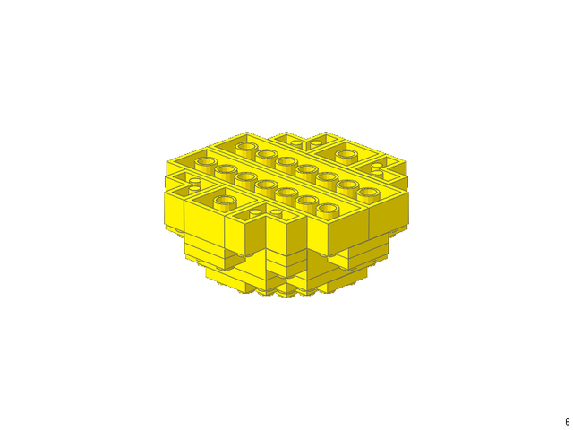
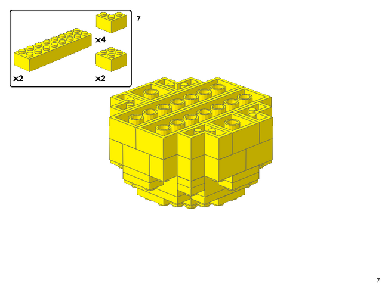
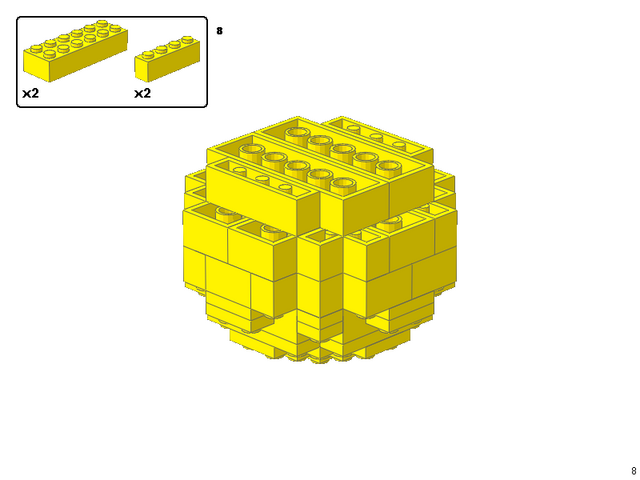
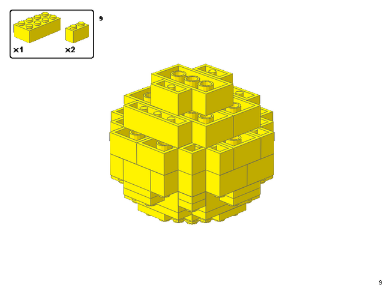
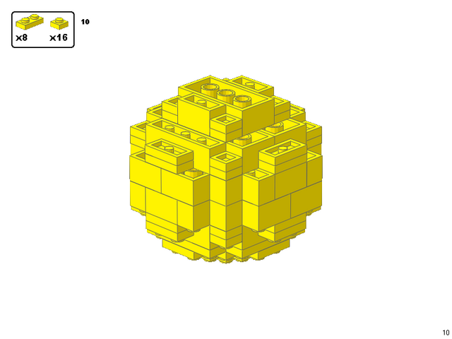
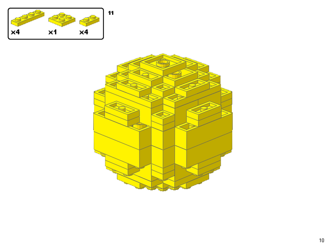

Après la partie I, nous savons maintenant comment construire un dôme. Je pense que vous avez compris comment nous allons construire une sphère : en complétant le dôme par un autre, semblable, mais symétrique.

Cela peut paraître simple mais cela ne l’est pas. Tout d’abord, il faut construire en assemblant les briques à l’envers, ce qui n’est pas sans poser des problèmes de repérage. Ensuite, faut-il aussi qu’on se souvienne du montage du premier dôme. Ces deux écueils sont toutefois mineurs. On prend vite l’habitude du montage inversé et le premier dôme sert de modèle pour le montage du second.

Il reste des questions. Pourquoi ne pas construire une sphère complète dès le départ ? Pourquoi construire le dôme supérieur en premier ? Construire le dôme inférieur en premier permettrait de monter les briques dans le bon sens. Cependant la construction va en s’évasant et cela n’est ni stable, ni pratique. De plus, concevoir de façon modulaire, avec deux sous-ensembles va nous permettre de construire des formes plus complexes en assemblant, par exemple une demi-sphère et un cône pour faire une glace.

Il est temps de passer à la pratique. Parmi tout les objets qui nous entourent, certains sont des sphères plus ou moins parfaites comme de nombreux fruits et balles ou ballons de sport. Pour commencer, parmi les plus petits, la balle de tennis avec ses 6,35 à 6,67cm de diamètre, fait un parfait objet de reproduction pour débutant. Nous allons donc construire une sphère jaune de 8 tenons - 6,4cm - de diamètre pour reproduire la petite balle jaune.

Vous avez déjà construit la moitié de la balle dans la première partie, voici la suite de la notice de montage. Commencer par retourner le dôme supérieur et suivez les instructions.

Comme vous le voyez, construire la seconde moitié de la sphère est aussi simple que de construire de façon symétrique un second dôme.

Dans la prochaine partie, nous construirons une orange et une pomme.

[Des balles avec des briques. Partie I : les dômes](/articles/1487/)
