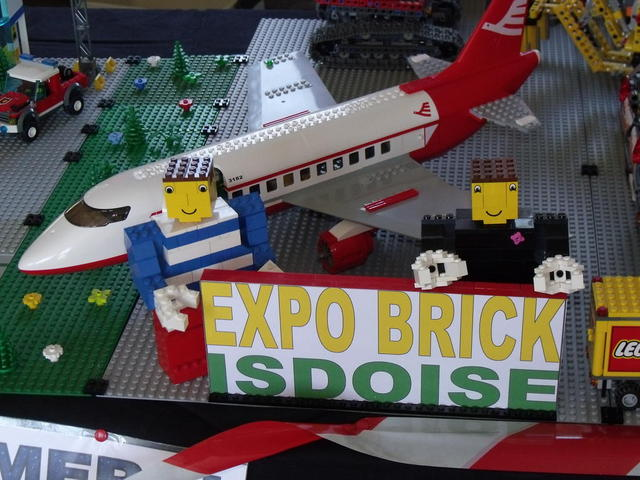

Pour cette troisième édition de EXPO BRICK ISDIOSE, nous avons eu beaucoup de monde : enfants, ados, parents et des grand parents.  
Du soleil, un peu de fraicheur le matin, mais du soleil.

En fin d’après-midi, il y a eu 2 personnes de FreeLUG qui sont passées me voir et aider à ranger, Philippe Label et Sébastien Hamon.

**Remerciements :**  
**–** Au CA de FreeLUG, pour la banderole LEGO et d’avoir accepté la mise en avant de l’association FreeLUG.  
**–** Au comité des fêtes de Isdes, pour nous autoriser d’exposer et nous trouver une salle.  
**–** A la famille Goberville d’Orléans, de nous avoir mis a notre disposition du matériel (rails de train, plaques de base, transfos de train...).  
**–** Au JouéClub de Gien pour nous avoir fourni une affiche JouéClub et de s’être mis en contact avec LEGO FRANCE.  
**–** A LEGO FRANCE, pour nous avoir fourni catalogues, cadeaux pour les enfants...  
**–** A Philippe Label et Sébastien Hamon, de m’avoir aidé et soutenu à ma charge pénible et déprimante de tout ranger dans les cartons.  
**–** A mon père Vincent Kurys, d’avoir voulu rentrer dans l’association FreeLUG, pour pouvoir m’aider dans mes expositions.

Merci à tous les visiteurs.

[Galerie photos](http://photos.freelug.org/main.php/v/davidkurys/expo-brick-isdoise2012/)

_A bientôt pour une nouvelle exposition_

David KURYS
