A l’approche des vacances, direction la forêt et la montagne pour une petite escapade pleine d’aventures.

[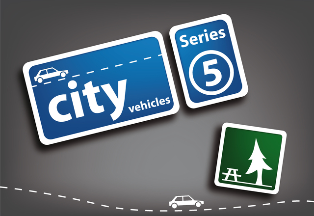](https://www.freelug.org/IMG/jpg/logo_serie_1e_copie.jpg)

**CITY vehicles series 5**

Voici tout d’abord le nouveau logo qui va venir introduire les séries de véhicules CITY. A chaque série, le panneau du dessous changera pour annoncer le thème de la série.

## Le camping-car.

[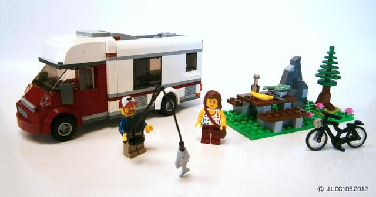](https://www.freelug.org/IMG/jpg/FCC1.jpg)

**La sortie en camping-car**

Cet ensemble comprend un camping-car et une table pour le pique-nique. Clin d’oeil au set 4435, le camping car reprend le même schéma de couleur que la caravane présente dans le set. La couleur "dark red" est un bon choix, elle ressort bien avec le blanc et elle est moins voyante que du rouge.

Le camping-car se compose de deux modules : la partie avant avec 6 tenons de large et la partie arrière avec 7 tenons de large. Ce décrochement apporte plus de réalisme au camping-car car souvent la partie arrière de celui-ci est légèrement plus large. L’objectif et le défi majeur était ici de réaliser un véhicule solide et résistant avec deux châssis de dimension différentes. C’est chose faite ici, avec 4 fixations entre la partie avant et la partie arrière. Le compartiment à bagages au dessus du poste de conduite permet également de renforcer la résistance du modèle en rattachant les deux parties ensemble.

[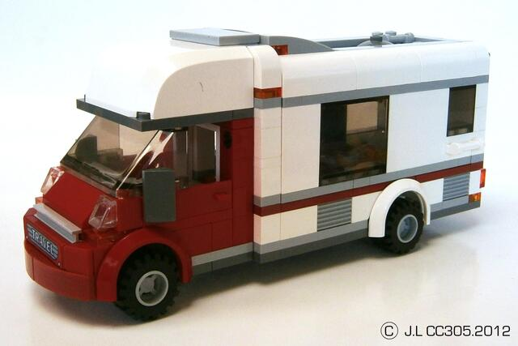](https://www.freelug.org/IMG/jpg/FCC3.jpg)

**Le camping-car / vue générale**

On accède à l’intérieur de la partie arrière en soulevant la partie basculante. Sur l’autre côté du camping-car, une porte permet également d’accéder à l’intérieur. A noter également la présence d’un passage entre le poste de conduite et l’arrière du camping-car.

[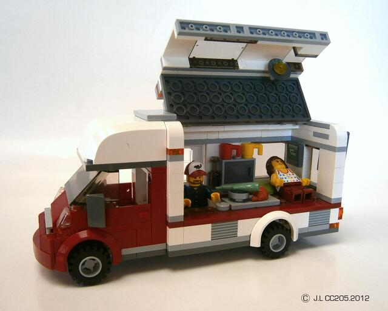](https://www.freelug.org/IMG/jpg/FCC2.jpg)

**Le camping-car / Vue intérieure**

[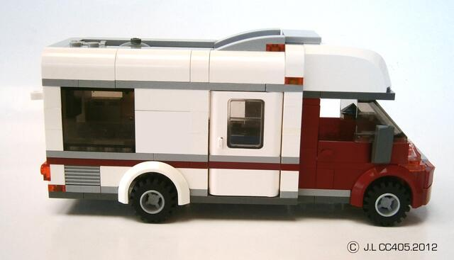](https://www.freelug.org/IMG/jpg/FCC4.jpg)

**Le camping-car 2**

L’intérieur se compose d’un lit, d’une petite cuisine, de rangements et d’un bureau. On peut ranger d’autres accessoires dans le compartiment présent au dessus du poste de conduite.

[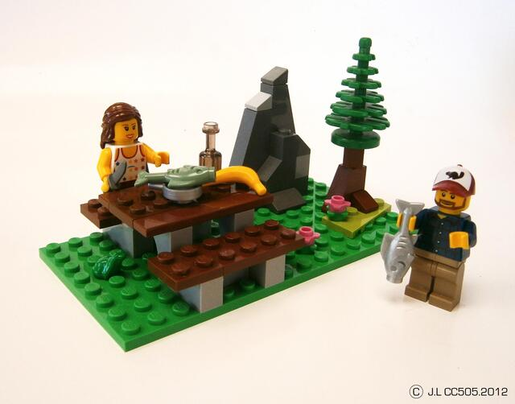](https://www.freelug.org/IMG/jpg/FCC5.jpg)

**La table de pique-nique**

La table pour le pique-nique, élément de décor qui revient régulièrement dans ce type de set apporte un petit air de vacances. Madame fait du vélo, Monsieur va pêcher le poisson qui fera office de repas .

## La sortie canoë.

[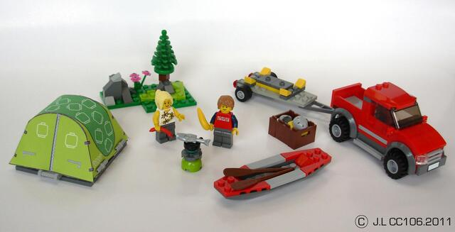](https://www.freelug.org/IMG/jpg/CC1-2.jpg)

**La sortie canoë**

Cet ensemble se compose d’un petit 4X4, d’une remorque, d’un canoë, d’une tente, d’un petit décor et de nombreux accessoires.

[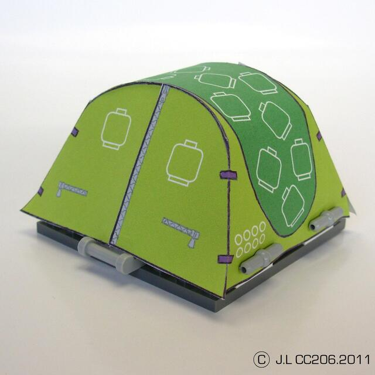](https://www.freelug.org/IMG/jpg/CC2.jpg)

**La tente**

Voici une tente au design plus contemporain, avec des couleurs qui rappellent la nature. La toile de tente est en une seule pièce et elle est fixée à une base de 8X8.

## L’hydravion.

[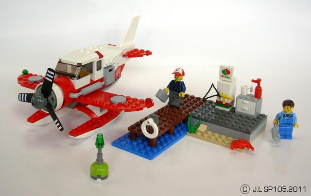](https://www.freelug.org/IMG/jpg/SP1.jpg)

**L’hydravion / Vue générale**

L’hydravion est une alternative intéressante pour une escapade en forêt ou à la montagne, à condition bien sûr de trouver un lac où se poser.  
Cet ensemble se compose d’un hydravion et d’un petit ponton pour charger les marchandises et faire le plein.

En général, un hydravion a les ailes au dessus du cockpit afin notamment de profiter de la vue. Ici, les ailes sont plus basses pour des raisons esthétiques et pratiques.

[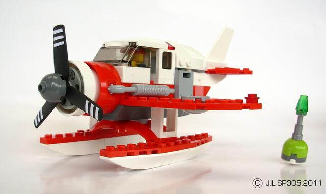](https://www.freelug.org/IMG/jpg/SP3.jpg)

**L’hydravion**

Cet hydravion possède deux petits rangements et un accès aux parties techniques pour d’éventuelles réparations.

[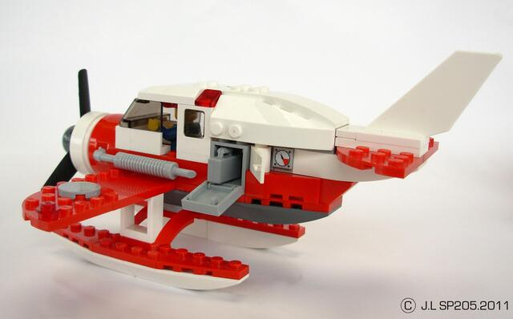](https://www.freelug.org/IMG/jpg/SP2.jpg)

**L’hydravion / Vue arrière**

## Le véhicule de premiers secours.

[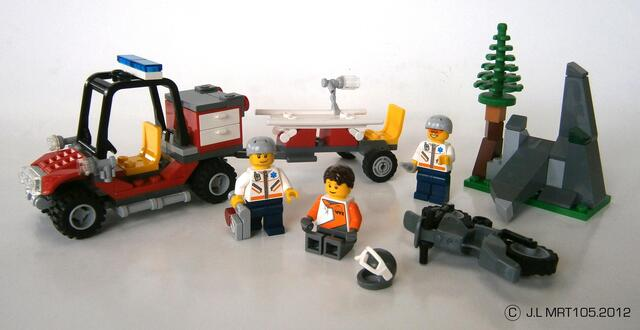](https://www.freelug.org/IMG/jpg/MRT1.jpg)

**L’intervention de l’équipe des premiers secours**

Ce véhicule est une version modifiée du [quad présenté dans la précédente série](/articles/1482/). Cette fois-ci, ce quad sert de véhicule de premiers secours pour les milieux difficiles d’accès.

Un motard a été victime d’une chute de pierres, les secours arrivent pour intervenir. L’ensemble se compose donc d’un quad avec rangements à l’arrière pour stocker le matériel et d’une remorque avec un brancard et une place assise pour le médecin.

[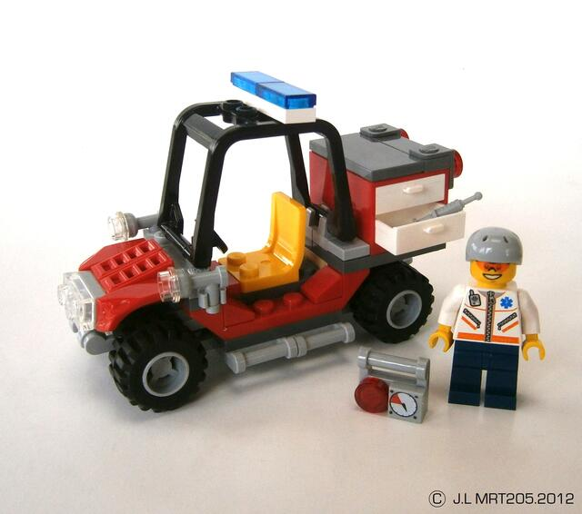](https://www.freelug.org/IMG/jpg/MRT2.jpg)

**Le quad**

[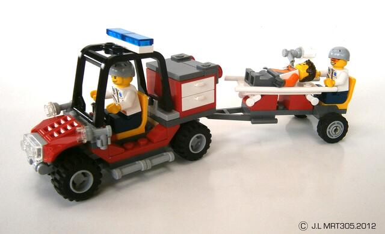](https://www.freelug.org/IMG/jpg/MRT3.jpg)

**Le quad et sa remorque**

La petite montagne a un bloc qui bascule pour simuler l’éboulement.

[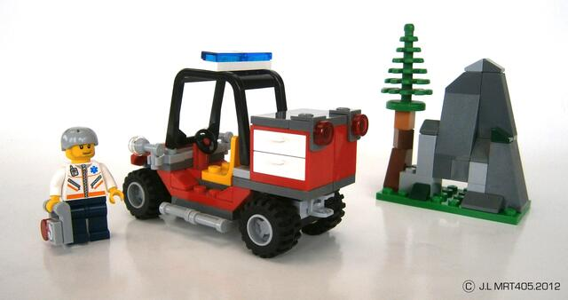](https://www.freelug.org/IMG/jpg/MRT4.jpg)

**Le quad de secours / Vue arrière**

## L’accrobranche.

[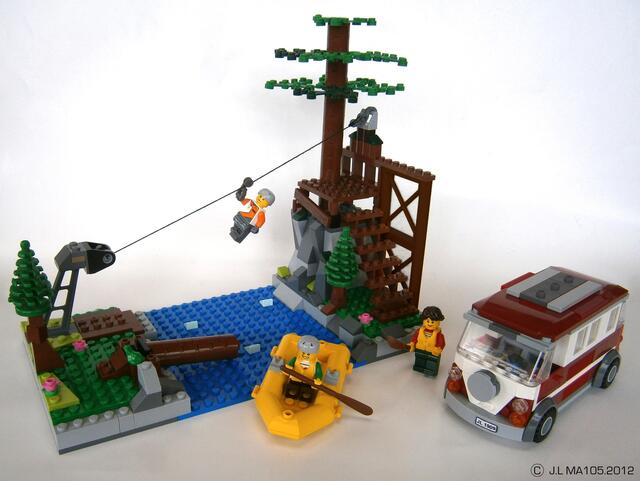](https://www.freelug.org/IMG/jpg/MA1.jpg)

**Aventure à la montagne**

Cet ensemble comprend un gros élément de décor avec rivière et accrobranche et un van.

[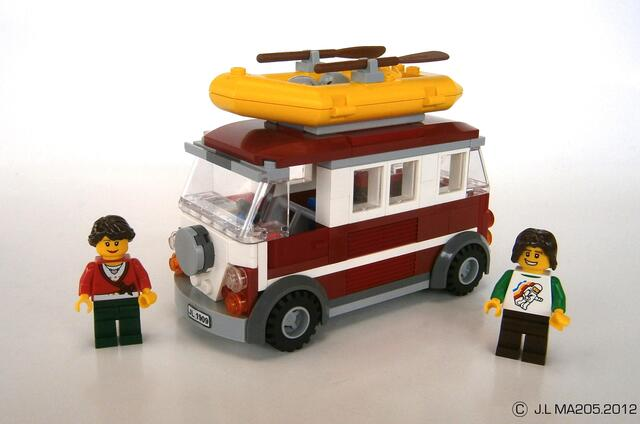](https://www.freelug.org/IMG/jpg/MA2.jpg)

**Le van / vue générale**

Le véhicule rappelle un célèbre van des années 70. Sa construction est assez simplifiée, il n’y a pas de portes latérales hormis celles du poste de conduite. On accède à l’intérieur en soulevant la partie supérieure. Il y a trois places à l’intérieur, une pour le conducteur et deux places à l’arrière autour d’une table.

[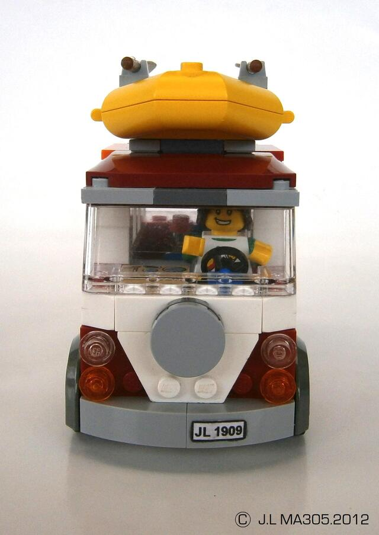](https://www.freelug.org/IMG/jpg/MA3.jpg)

**Le van / vue avant**

[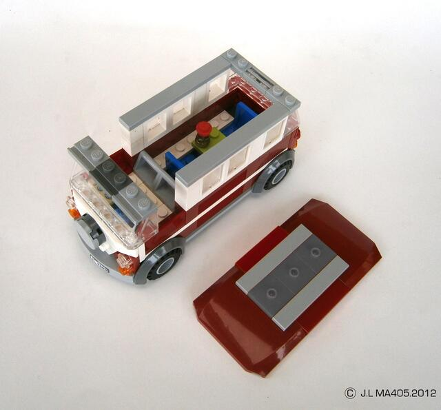](https://www.freelug.org/IMG/jpg/MA4.jpg)

**Le van / Vue intérieure**

[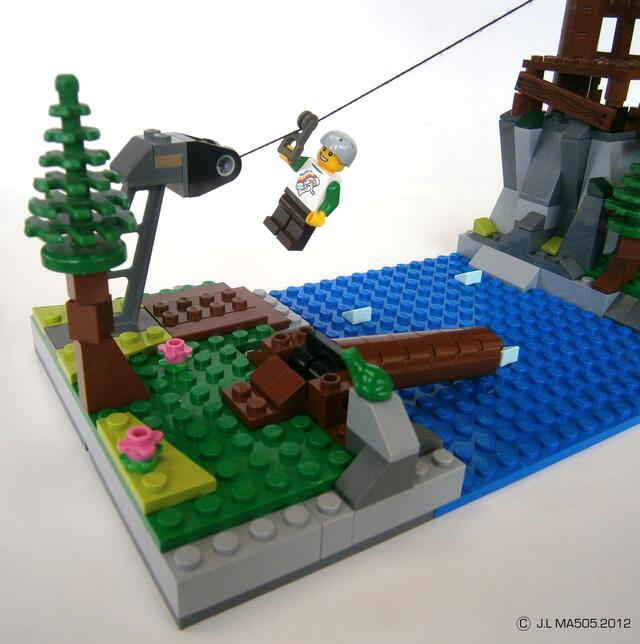](https://www.freelug.org/IMG/jpg/MA5.jpg)

**L’accrobranche**

Attention à l’arrivée !

[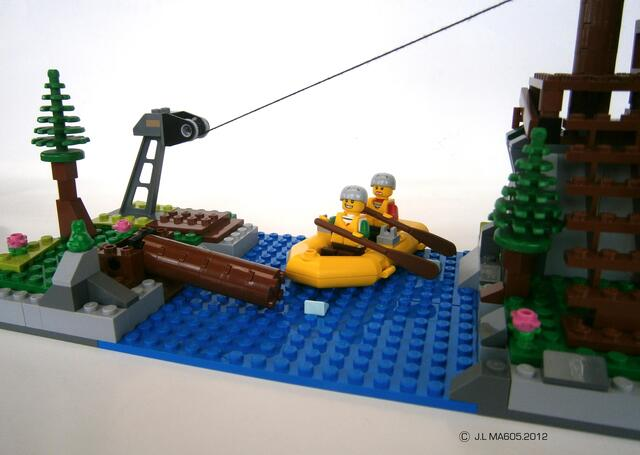](https://www.freelug.org/IMG/jpg/MA6.jpg)

**Le rafting**

Un arbre a chuté dans la rivière ! Attention.

Voilà pour cette cinquième série. J’espère qu’elle vous a plu.  
Merci pour vos nombreux commentaires sur la dernière série. N’hésitez pas à en laisser un autre.

La série 6 et 7 étant déjà en cours de réalisation, la série 8 vous laisse la possibilité de choisir des véhicules que vous aimeriez voir réaliser. Je sélectionnerai 5 ou 6 de vos propositions pour la série 8. Il doit s’agir d’un véhicule contemporain avec au moins 4 roues, peu importe le thème ou la fonction.

Pour les séries précédentes, c’est par ici :  
**–** [Série 1 : véhicules utilitaires](/articles/1418/)  
**–** [Série 2 : camions](/articles/1441/)  
**–** [Série 3 : véhicules pompiers](/articles/1460/)  
**–** [Série 4 : véhicules agricoles](/articles/1482/)

A bientôt

Julien
