Encore une très belle édition, riche en évènements.

Pour notre quatrième participation, oui déjà, nous avions décidé de ne pas forcément présenter des modèles Star Wars. Nous avions déjà présenté un diorama Star Gate l’année dernière, ce n’est donc pas une première.

L’ambiance de l’exposition est bien libre et donc cela nous permet d’exposer ce que l’on veut. C’est pour cela que nous nous sommes permis un exercice sur l’_Heroic Fantasy_ cette année.

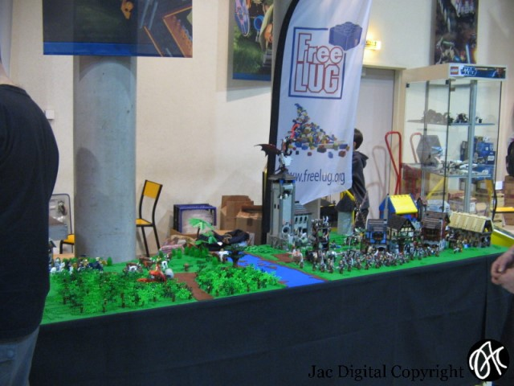

Tout de même et grâce à la venue de Rémi, nous avons présenté un beau stand LEGO Star Wars UCS, avec des modèles rares, anciens, en test de vol qui ont été bien appréciés et qui ont fait des envieux.

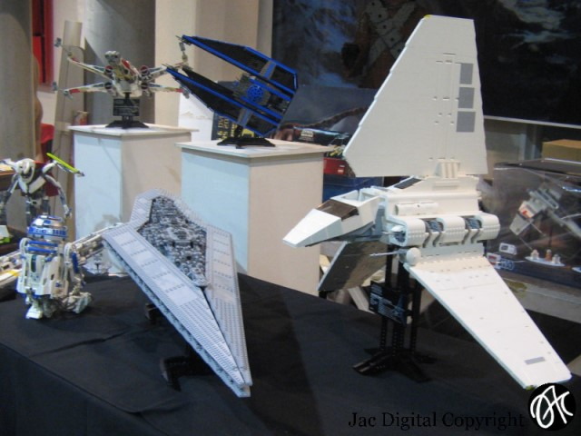

Nous avions les tous premiers modèles UCS (Ultimate Collector Series) avec le Tie Interceptor et le X-Wing, des moins connus avec le Y-Wing resté très peu de temps à la vente et des derniers avec l’imposant SSD "Executor". Il y avait aussi la nouvelle navette impériale avec à son bord Luke, la Princesse Leïa, Han Solo, Chewbacca et la troupe de rebelle. La navette est magnifique mais lourde et imposante, surtout chargée de toute la troupe. Nous avions mis son pied, un peu bancal au début du coup elle a fait un test de vol. Mais en tombant en arrière l’essai n’a pas été bien concluant. Le remontage sans notice n’a pas été simple. Surtout qu’il manquait quelques petites pièces... Enfin, cela nous restera bien marqué dans les esprits !

Philippe, membre des Héritiers de la Force, avait pu monter en avant première, grâce à un prêt de LEGO France, toute la gamme "Comics". Tous les sets était présentés dans une superbe vitrine sur notre stand.

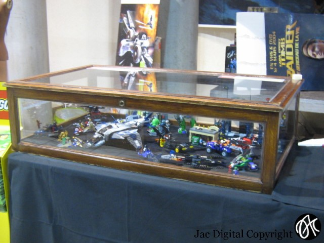

**JAC**

* * *

Fan de Star Wars à mes moments perdus, cela faisait quelques années que j’allais régulièrement à Cusset en touriste. 2012, année de tous les changements, j’ai franchi le pas et je me suis donc retrouvé, non pas devant le stand mais derrière. A mon arrivée le samedi matin, j’ai retrouvé Jac, Pierre, Pierre en train d’empiler des briques et un étrange Yoda, en civil qui était là pour visualiser l’installation.

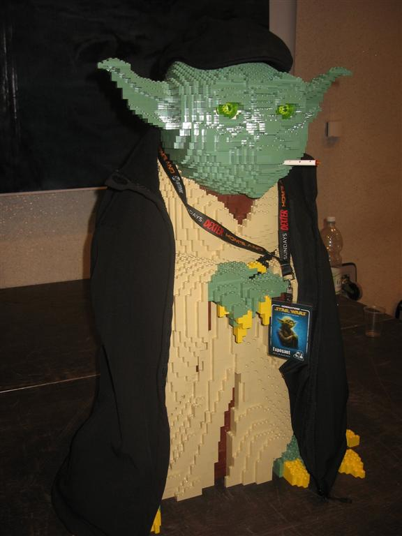

Moi je n’apportais pas grand chose, juste l’UCS du X-Wing et du Y-Wing ainsi que le R2-D2 LEGO Technic.

[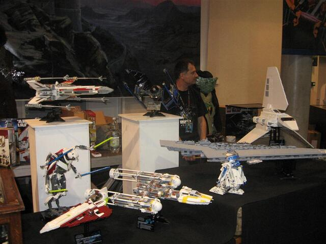](https://www.freelug.org/IMG/jpg/Cusset_2012_5_.jpg)

Je n’avais ni le temps, ni les pièces nécessaires pour préparer autre chose en rapport avec le thème du Diorama, l’Heroic Fantasy...

[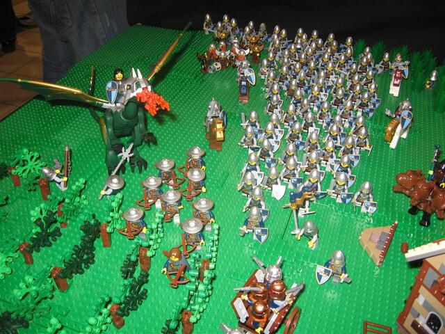](https://www.freelug.org/IMG/jpg/Cusset_2012_20_.jpg)

Et l’agriculture ?

[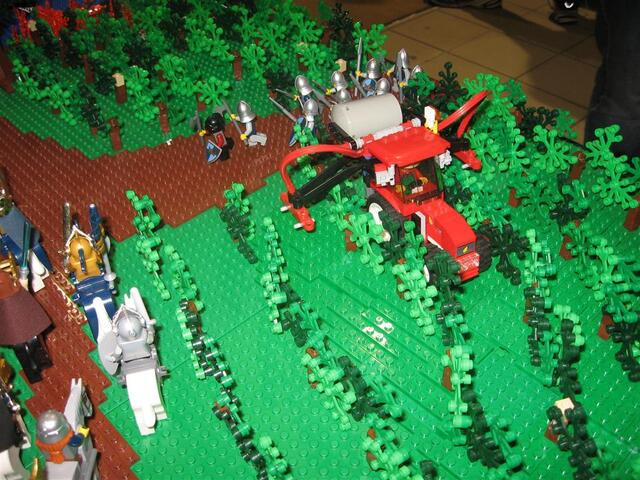](https://www.freelug.org/IMG/jpg/Cusset_2012_21_.jpg)

Organisation très bien ficelée avec nourriture apportée par un Jawa au sourire étrange mais avec un sac LEGO, l’honneur est sauf.

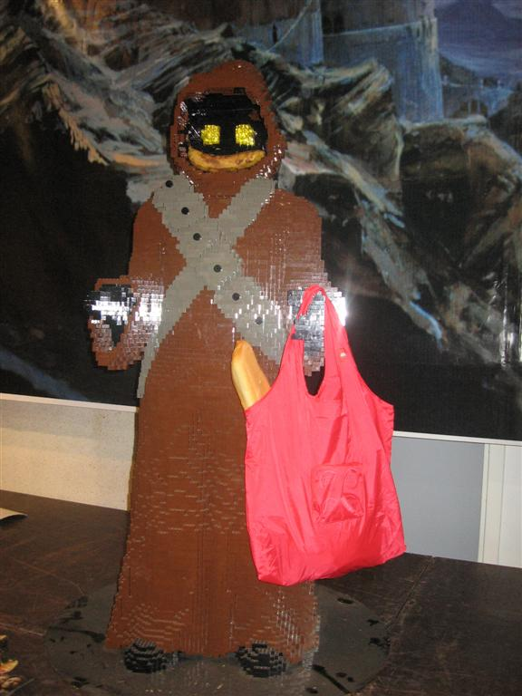

L’après midi, digestion dans les taillis (dur le m&m’s)

[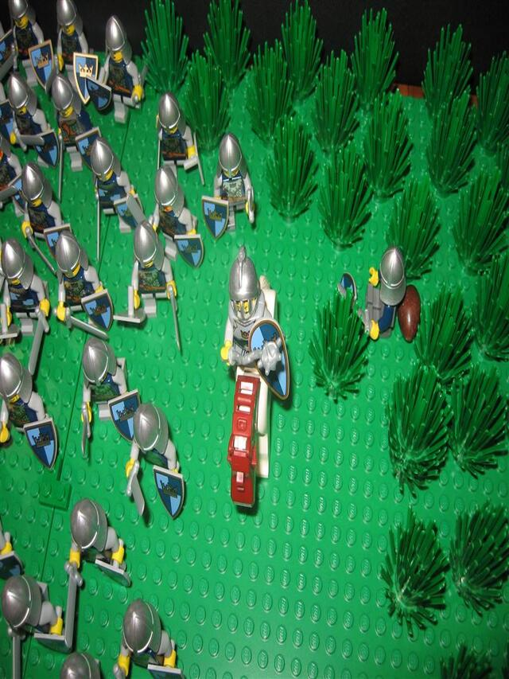](https://www.freelug.org/IMG/jpg/Cusset_2012_22_.jpg)

et atelier mécanique suite à un test de vol en marche arrière non concluant.

[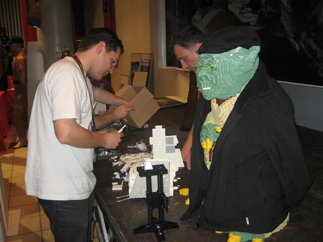](https://www.freelug.org/IMG/jpg/Cusset_2012_8_.jpg)

Le dimanche fut beaucoup plus calme, juste un incendie à déclarer.

[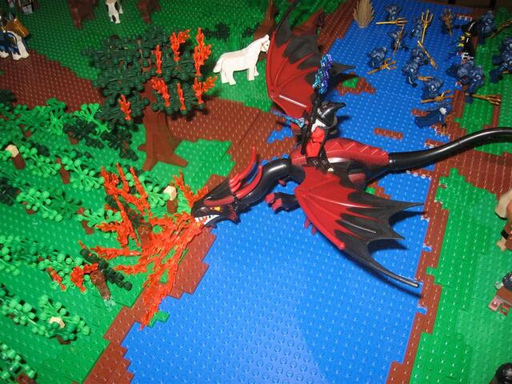](https://www.freelug.org/IMG/jpg/Cusset_2012_18_.jpg)

Ah, et j’oubliais le lézard qui s’était perdu dans la salle qu’il a fallu accompagner à la caisse centrale (je m’égare là).

[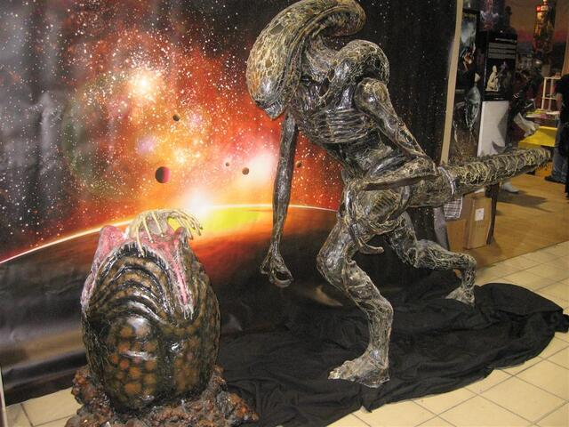](https://www.freelug.org/IMG/jpg/Cusset_2012_27_.jpg)

Bref, pour ma première exposition, bilan très positif, très bon contact avec le public, passionnés de Star Wars, passionnés de LEGO ou passionnés tout court. Passionnés et sympa, les organisateurs le sont également comme dirait notre ami Yoda et puis vivement la prochaine édition !

**Rémi**

* * *

Une nouvelle édition de passée ! et ce n’est jamais la même chose !

Cette année nous sommes partis sur du medieval/fantastic pour changer et cela a bien plu. Tant mieux, nous aussi nous avons pris plaisir à déambuler au milieu des stands de ventes, d’associations de fans ou encore d’exposition d’objets cultes.

Merci encore à Jac pour l’accueil !

**Pierre L / Pierrolego**

* * *

Mes camarades ayant tout dit, il ne me reste plus qu’à remercier JAC, notre hôte pour son accueil, et bien sur Séverine, sa copine, pour nous avoir supportés, Pierre et moi, pendant ces quelques jours.

Encore une de passée, mais toujours aussi agréable, avec une organisation parfaite, que ce soient des "Héritiers de la Force" pour l’exposition, ou JAC pour le stand FreeLUG !

A l’année prochaine, pour du Lord of the Rings ou du Marvel ?

**Pierre C / Tribolego**

* * *

Galerie photos :

-   [JAC](http://photos.freelug.org/main.php/v/JAC/Exposition/2012/SW/)
-   [Pierrolego](http://photos.freelug.org/main.php/v/pierrel/exposition/2012/cusset2012/)
-   [Rémi](http://photos.freelug.org/main.php/v/scrat1982/Cusset+2012/)
