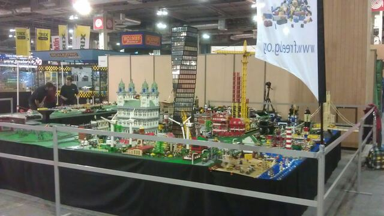
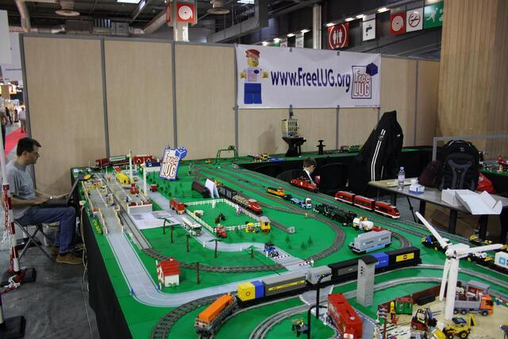
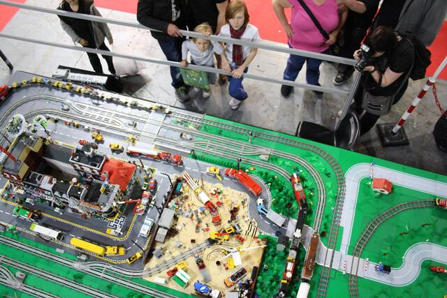
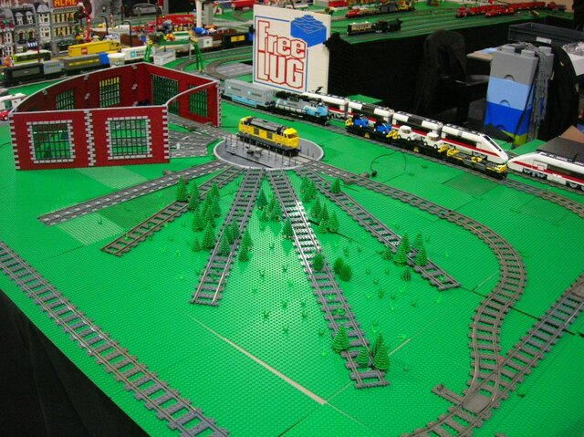
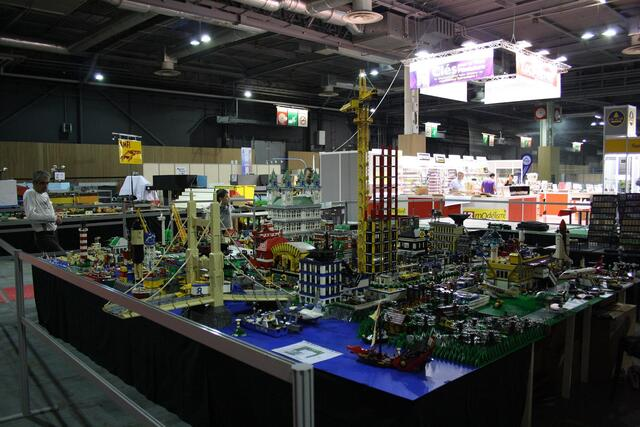

Bonjour à tous,  
du 14 au 17 juin s’est déroulé le salon du mondial du modélisme aux  
Halles d’expositions porte de Versailles à Paris.  
FreeLUG avait été cordialement invitée par la FFMF à venir exposer à ce salon et  
nous a mis à disposition un bel espace exposé sur trois faces au public.

Il nous a fallu une bonne journée de mise en place avec un peu d’improvisation, dû au  
fait que les plans initiaux prévus ne correspondaient pas aux mesures prises sur place, mais  
heureusement que les Minifigs étaient au rendez-vous pour improviser et construire le tout dans les côtes et à temps avant l’ouverture.

Denis a fait un carton avec les jeunes qui ont pu avoir le plaisir d’essayer et de comprendre le fonctionnement d’une gare de ferroutage et savoir enfin comment on effectue le chargement et le déchargement des camions sur les trains. Les mouvements pilotés à distances sont source de surprises et d’admiration.

Pascal a pu faire rêver des anciens en faisant revivre les trains 12V et impressionner les fans du  
ferroviaire par ses réalisations de trains MOC’s. Les enfants étaient également fascinés par les détails  
et les pointes d’humour dans son décor dans le moindre détail. Son chantier a fait un carton, surtout le  
bonhomme avec son marteau-piqueur dont le casque secoue au rythme.

La rotonde de Pierre-Charles en a également impressionné plus d’un.

L’espace jeune a également eu son succès par le fait que les enfants pouvaient essayer et conduire des  
trains sur un petit circuit. On n’avait juste pas pensé que certains s’amuseraient à changer les canaux créant  
ainsi des accidents ferroviaires sur nos villes. Mais bon le problème a pu être rapidement résolu et les minifigs  
ont pu réparer les dégâts. Le petit train MOC de Pascal a même fait une pointe avant de s’encastrer dans un train et de finir en mille morceaux dans le décor... :-(

Pour ma part ça été une bonne expérience et une première "grosse" exposition avec ma grande ville qui avait reçu  
également une bonne appréciation du public dont certains sont restés de longues minutes afin de découvrir un  
maximum de détails. On a même surpris certains qui mitraillaient notre exposition avec leurs appareils photo.  
Et pour les flash on a demandé aux gens d’éviter de les utiliser car ça faisait mal aux yeux des  
minifigs....certains y ont cru et se sont excusés !!!

On est tous courbaturés, fatigués et sourds (bruits des avions et autres) mais contents de cette exposition.

Je remercie également tous les FreeLUGiens qui sont passés et qui nous ont aidés à surveiller le stand afin  
qu’on puisse respirer un peu... ainsi qu’au soutien, mise en place et rangement...  
Merci aussi à Richard et Christophe pour l’organisation de cette exposition qui était assez prenante en temps  
et investissement personnel.

Maintenant retour dans nos familles qui nous ont manquées durant ces cinq jours et content de  
les retrouver. Mais pleins d’idées en tête, et à la prochaine.

@+  
Georg  
MadLegoFan

PS : Vous pouvez déjà trouver quelques images sur la galerie FreeLug :  
[http://photos.freelug.org/main.php/v/madlegofan/MondialModelisme2012/](http://photos.freelug.org/main.php/v/madlegofan/MondialModelisme2012/)

D’autres images suivront, notamment les films faits avec des caméras embarquées dans les trains ou hélicoptères... il faut juste nous laisser un peu de temps pour récupérer et le retour à nos activités professionnelles... ;-)
