Pour rappel, l’école Ste Anne de Bieuzy Lanvaux, où est scolarisé mon fils, cherchait des idées pour récolter des fonds afin d’agrandir l’école devenue trop petite. Il y a quelques mois, j’ai suggéré de faire une exposition LEGO et il m’a fallu l’aide de mon blog pour faire comprendre aux parents quel genre d’événement je leur proposais ! ;)) Ils n’avaient jamais entendu parler de cela...

Maintenant ici tout le monde est conquis ! Le public, venu nombreux grâce à une communication très active sur notre événement, a été séduit par les très belles présentations des uns et des autres et la présence du grand atelier enfant de Brigitte.

Avec plus de 2600 entrées, nous dépassons toutes nos espérances !

Voici quelques photos qui illustrent les différents stands :

[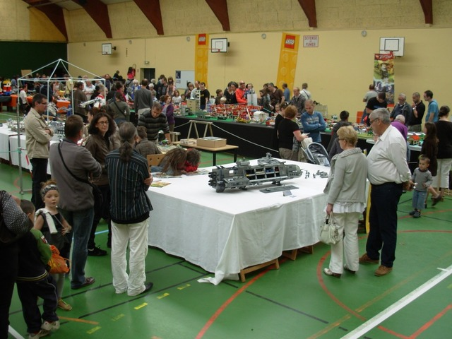](https://www.freelug.org/IMG/jpg/028.jpg)

[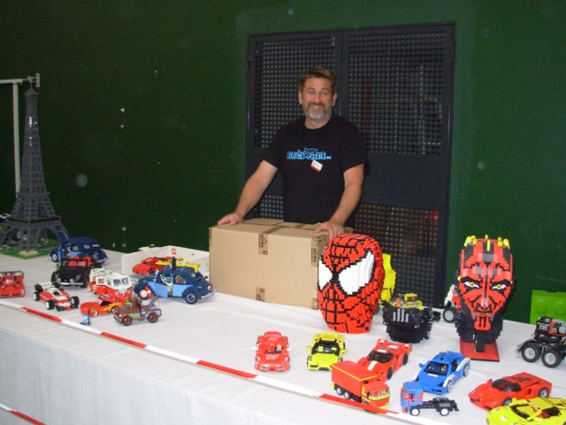](https://www.freelug.org/IMG/jpg/061.jpg)

[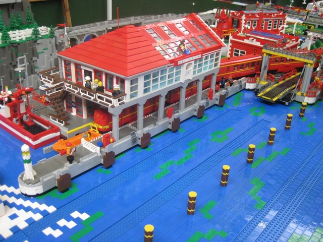](https://www.freelug.org/IMG/jpg/027.jpg)

[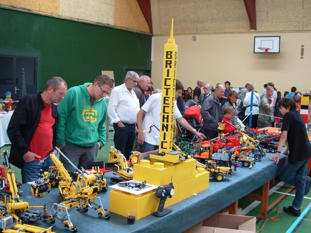](https://www.freelug.org/IMG/jpg/036.jpg)

[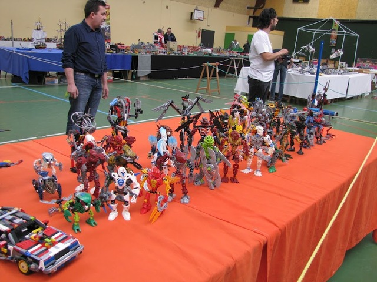](https://www.freelug.org/IMG/jpg/bionicle.jpg)

[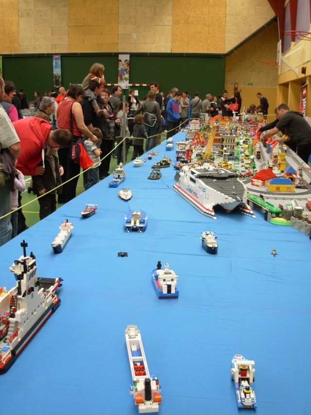](https://www.freelug.org/IMG/jpg/049.jpg)

[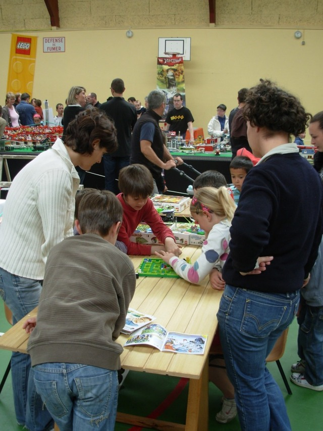](https://www.freelug.org/IMG/jpg/040.jpg)

[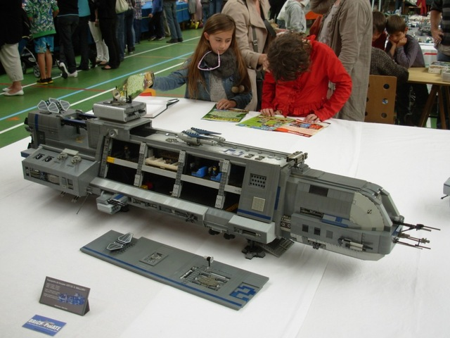](https://www.freelug.org/IMG/jpg/030.jpg)

[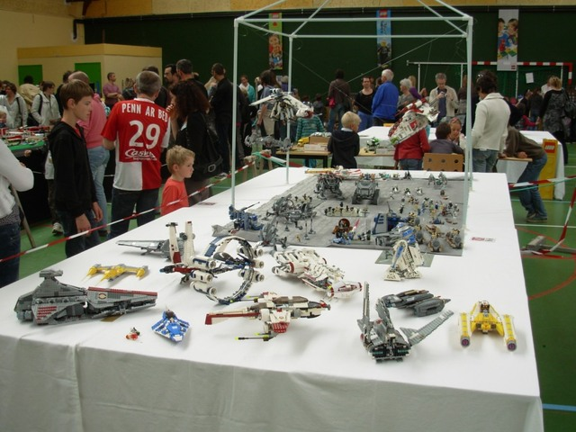](https://www.freelug.org/IMG/jpg/038.jpg)

[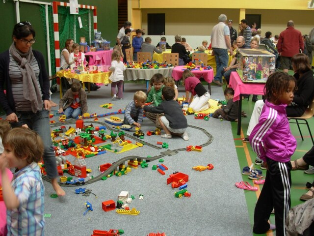](https://www.freelug.org/IMG/jpg/022.jpg)

[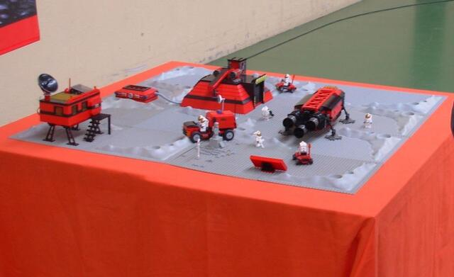](https://www.freelug.org/IMG/jpg/013rognee1.jpg)

[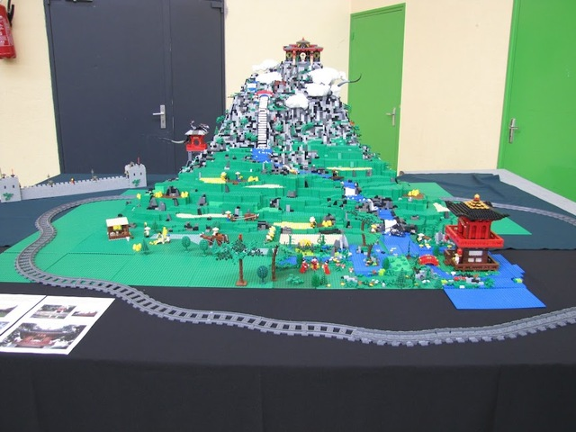](https://www.freelug.org/IMG/jpg/montagne.jpg)

[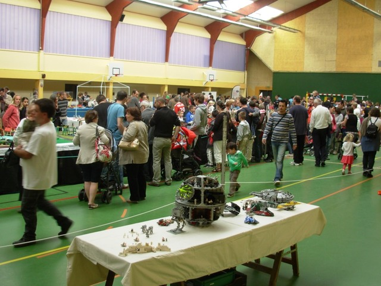](https://www.freelug.org/IMG/jpg/020.jpg)

[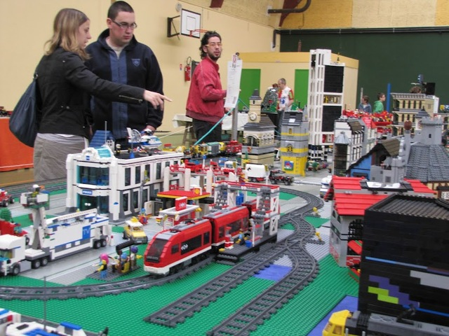](https://www.freelug.org/IMG/jpg/dio01.jpg)

[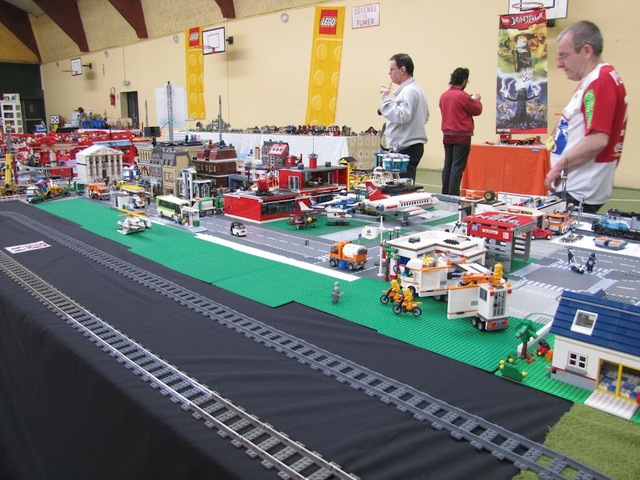](https://www.freelug.org/IMG/jpg/ville_cyril.jpg)

[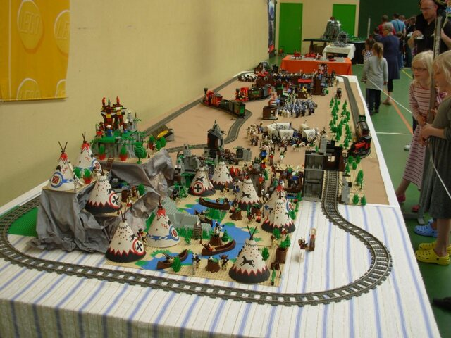](https://www.freelug.org/IMG/jpg/012.jpg)

[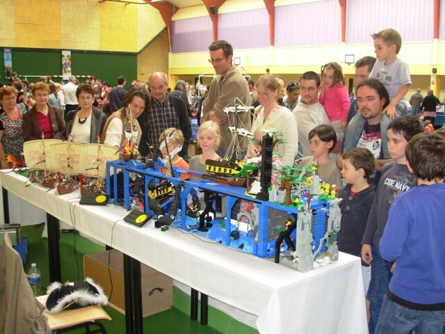](https://www.freelug.org/IMG/jpg/009-3.jpg)

[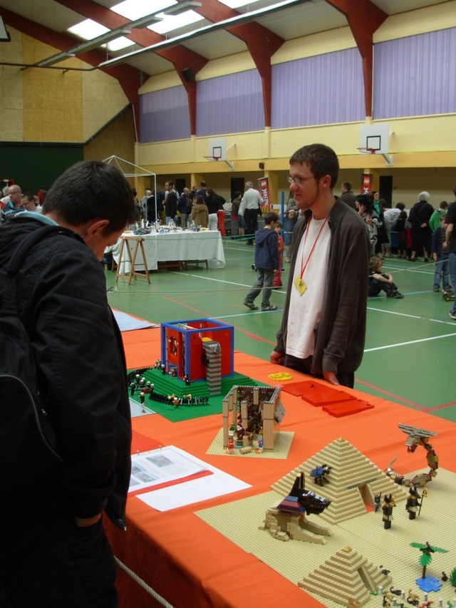](https://www.freelug.org/IMG/jpg/002-4.jpg)

[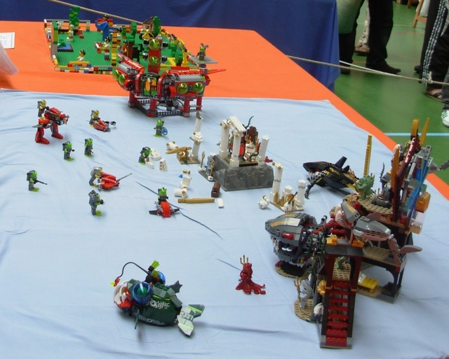](https://www.freelug.org/IMG/jpg/006rognee.jpg)

[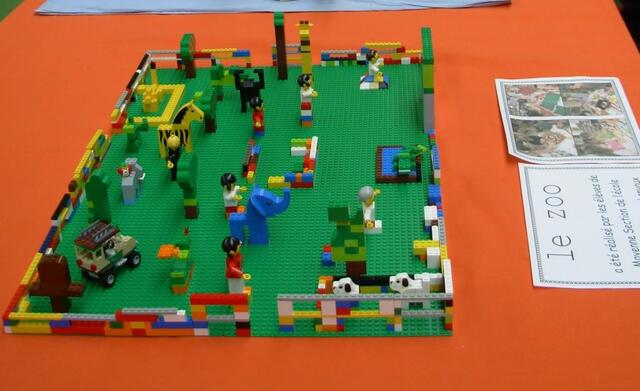](https://www.freelug.org/IMG/jpg/034rognee.jpg)

[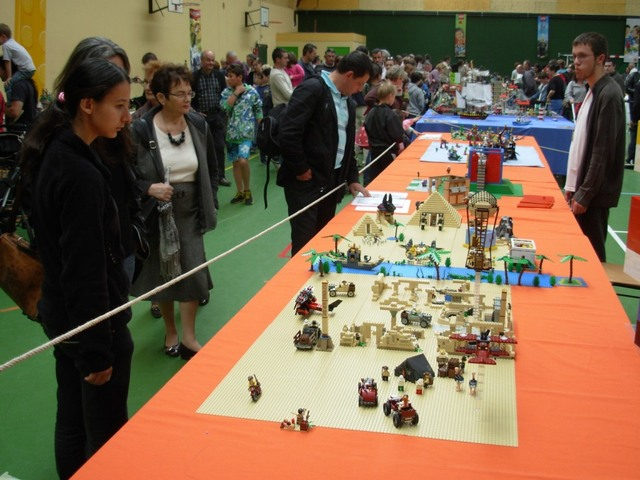](https://www.freelug.org/IMG/jpg/005-3.jpg)

Je remercie tous les exposants qui ont répondu à mon appel et qui ont apporté leur bonne humeur en plus de leurs LEGO.

Je remercie également FreeLUG qui a prêté du matériel (plaques et nappes) ce qui a contribué à la bonne présentation de nos dioramas.

Je n’oublie pas les nombreux bénévoles de l’école, y compris les maitresses, qui ont géré l’organisation de cette fête.

Et quelle belle fête, au service de nos enfants.  
Merci.

_Gaelle_

[Toutes mes photos](http://legogaga.blogspot.fr/2012/06/exposition-100-lego-de-pluvigner-56.html#more)

* * *

Voilà, un excellent week-end qui se termine trop vite à mon gout.  
L’exposition était vraiment formidable, le public nombreux et intéressé et l’ambiance vraiment formidable.

Je tiens à remercier les bénévoles de l’école pour leur travail et leur accueil. Je tiens surtout à remercier Gaelle, qui a brillamment démontré ses capacités d’organisatrice hors-paire, pour le travail accompli et la qualité de son accueil.

Je veux aussi remercier les autres exposants, et Cyril et Marc en particulier, pour la bonne humeur, que dis-je, la franche rigolade qu’ils ont apportés.

Cette exposition, donnée pour la bonne cause, a été la plus agréable de celles auxquelles j’ai participé. On remet ça quand vous voulez. ;-)

_Mindrunner_

* * *

Difficile d’écrire après Thierry, tout est dit

Je suppose donc que nous sommes extrêmement nombreux du même avis. Une réussite complète cette première exposition

Alors je vais ajouter quelques points sur mon atelier enfants.

Je n’ai jamais eu dans une exposition autant de place pour valoriser mon atelier.

Tout : la vitrine Belville, jumbo le trotteur jaune, les PRIMO, DUPLO, TOOLO, Train DUPLO les notices de montages System ont pu être agréablement installés.

Alain Eury s’est même un peu fait houspiller car nous aurions pu et du apporter tous les rails DUPLO du 736 .Miss ériba était soi disant en surpoids ;)

Toute l’équipe du responsable de salle Claude aux divers personnes présentes et souvent anonymes, tous m’ont suivi dans mes galopades vendredi après midi dans tout ce gymnase, ouvert les portes etc. et nous avons ainsi pu apporter un maximum de confort aux enfants et parents.

Parfois plus de 70 enfants en même temps vous pourrez le voir sur les photos et des montagnes de chaussures ôtées avant d’entrer sur les tapis de jeux.

Cette fois Alain travaillant lundi, nous vous avons laissé le soin de ranger les tapis etc. après notre départ. Merci encore aux nombreux bénévoles.

Alain lui dès l’ouverture, s’est posté à l’entrée avec son boxe LEGO à peser. Il était très fier des compliments des dames bénévoles qui l’observaient amusées et nous avons réalisé notre objectif et plus défini au départ de Saint-Lô par nous deux et au profit de l’école.

J’ai beaucoup apprécié la communication immédiate, aux exposants, des différents chiffres concernant cette journée.

Notre fatigue et les km du retour ont été plus légers. Nous étions heureux d’avoir tenu nos engagements avec vous. A une autre fois peut-être...

_Brigitte et Alain Eury de Normandie_

[Nos photos de l’atelier enfant](http://photos.freelug.org/main.php/v/EURY/PLUVIGNER12/)

* * *

Succès colossal ! Que de monde !

Comme les autres exposants, j’ai apporté ma contribution et ma passion au salon de Gaelle et de son école.

Je pense avec certitude que ce salon sera gravé dans les mémoires du public local et d’ailleurs.

L’organisation a été excellente, intérieurement et extérieurement, (repas chez Gaelle).

Les bénévoles de l’école ont été efficaces, mention très bien à Gaelle qui a géré tous les détails.

L ’ambiance a été au rendez-vous et, une fois de plus, j’ai eu droit aux plaisanteries bon enfant de certains afols.

Le retour s’est bien passé avec beaucoup de souvenirs et peu de casse.

A la prochaine

Amicalement

_jean marc_

[Mes photos](http://photos.freelug.org/main.php/v/barr__/expositions/2012/pluvigner/)

* * *

Un week-end à 200 à l’heure pour ma part entre le temps passé sur la route, l’exposition et une réunion de famille, épuisant ><

Un grand bravo à Gaelle et aux bénévoles de l’école pour l’accueil ainsi qu’aux exposants pour leurs créations géniales !

Le succès était au rendez-vous pour le plaisir de tous :)

À la prochaine !

_Erik / ScroogeMcBrick_

* * *

Une exposition en grand format pour une bonne cause, très originale et toujours sympathique. Grâce à l’organisation pétaradante et tambours battants de Gaelle, on a eu droit à un gymnase rempli de LEGO et pour tous les thèmes, ou presque. Entre les espaces science-fiction et Star Wars, le diorama City géant, le stand Egypte, l’atelier pour enfant, ou le diorama exclusif de Roger qui faisait face à la valeur sûre des collections de LEGO Tecnic, je présentais mon Kraken, qui n’avait pas fonctionné depuis Cholet au mois d’octobre dernier.

Résultat : aucun incident majeur de tout le week-end, ce qui achève de démontrer la fiabilité de mon mécanisme ! Venait également ma collections de vikings, un thème rare sur les expositions qui a beaucoup plu au public avec ses grands drakkars, ses dragons mythiques et sa petite armée de Normands. Et encore, me disais-je, les enfants n’avaient pas vu mon dernier dragon motorisé en PFS qui bat des ailes ! Cette partie du stand se présentait comme un aperçu de mon prochain projet de diorama : le raid d’un village médiéval par une troupe de vikings.

Juste à côté, Gaelle et mon papa s’occupaient d’un diorama Western où se mêlaient un village nordiste et une réserve indienne avec montagne, tipis, attaque de diligence... Plusieurs trains étaient en circulation autour de la table, dont une modification en 9v du train Toy Story par Gaelle, dont la cheminée était trop grande pour passer dans ma mine d’or... Qu’importe, l’originalité et le design épuré du diorama ont beaucoup plu également !

Et puis, lorsque je n’étais pas en train de m’occuper du Kraken ou d’aller observer les réactions des gens autour de mon stade et de la ville que nous nous étions empressés de mettre en place le samedi matin (Gaeeeeeeeeeeelle !!!) il fallait aller s’amuser un petit peu du côté de chez Jean-Marc, où les enfants faisaient le queue pour jouer avec ses trains. Et pendant ce temps, tout au fond du gymnase, Brigitte disposait d’un grand espace pour faire jouer les enfants avec ses briques pour tous les âges ;)

Mais le meilleur moment du week-end restera sans aucun doute la soirée de folie qu’on a passée dans la charmante maison de Gaelle, pour un repas entre AFOLs et bénévoles complètement déjanté, on a bien mangé, on s’est bien amusés, on a bien bu aussi, mais le plus important : on a joué aux LEGO tout le week-end, ce qui était un vrai bonheur après mes cinq mois à Madrid passés sans toucher la moindre brique !

Un grand merci, mais également un sacré bravo pour Gaelle et son école qui ont très bien fait les choses, fait face aux imprévus sans se prendre le chou, et permis à ce week-end de faire figure de grande fête LEGO pleine de passionnés et de bons moments ;) D’autant plus que ce fut un succès incontestable, et bien au-delà des espérances !

Bruno m’a par ailleurs fait savoir que c’était certainement la meilleure exposition à laquelle nous ayons participé, encore devant Cholet. Chapeau les artistes, vivement la prochaine tous ensembles !

_LaurentB & Bruno_

* * *

Une exposition à moins d’une heure de chez moi, et pour une bonne cause, je ne pouvais pas ne pas y être. J’ai donc charger tant bien que mal dans la voiture ma ville, mon diorama Clone-Wars et mes jeux de société LEGO.

Une fois sur place il fallait commencer le montage mais par quel stand commencer, la ville nécessitant le plus de temps je préfère commencer par elle, mais je ne pouvais pas commencer tant que Laurent n’avait pas poser son stade...

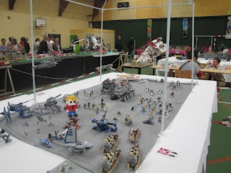

Mais après, la ville fut vite posée et j’ai pu m’occuper du stand Star Wars avec la tonnelle pour faire "voler" les vaisseaux mais lors de la mise en place du second, il nous a glissé des mains faisant tomber le premier sur un véhicule placer dessous... C’est à ce moment précis qu’a retenti "On ouvre dans 30 minutes !"

Mais tant bien que mal et entre les premiers visiteurs, je suis parvenu à finir mon installation.

Le soir, un super repas chez Gaelle avec quelques bénévoles nous attendait. Un repas chargé de doubles sens et de bonnes nouvelles.

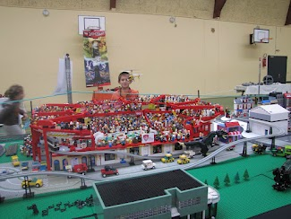

Le dimanche était quant à lui placé sous le signe du jeu avec quelques démonstrations des jeux LEGO, mais aussi nos jouets qui ne peuvent pas servir à la maison (MiniZ, Hélico radio-commandé,...)

Le soir, après le départ des derniers spectateurs, il fallait ranger... Mais c’est à ce moment que la fatigue a fait son arrivée... Et je ne savais plus par où commencer le démontage, quel set allait dans quelle caisse...

Je garde de bons souvenirs de cette exposition, une super ambiance, une belle salle, et un bon public. Merci à Gaelle pour l’organisation, merci aux bénévoles pour le patience et leurs bonne humeur, merci aux autres exposant pour ce bon WE !

_DURGE (Cyril)_

[Mes photos](https://plus.google.com/u/0/photos/103711135069797634225/albums/5755468670196383617)

* * *

PS : Le commentaire de Damien (le constructeur de ferry) qui faisait sa première exposition : "C’est super, mais vraiment fatiguant ! Vivement la prochaine !"

PPS : Le Commentaire de Marc et FX (de BRICTECHNIC) : "Nous avons été très contents de participer à cette expo à but caritatif, l’ambiance était bonne, l’expo bien sympa et Gaelle agréable !"
