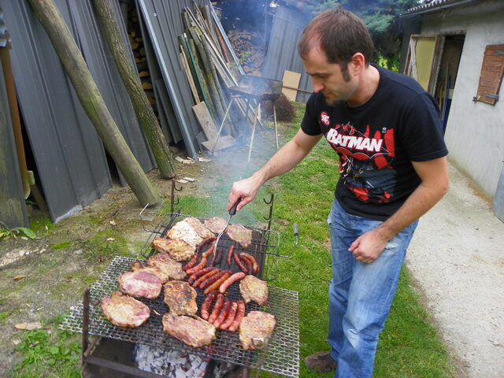
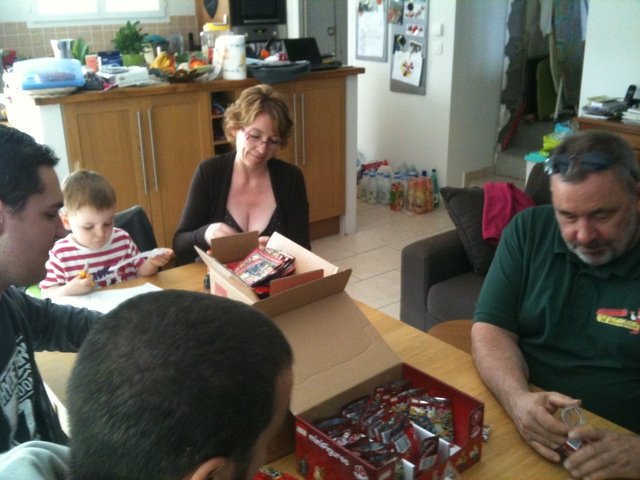
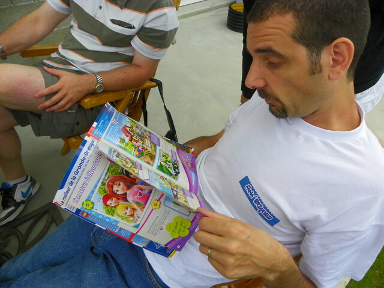
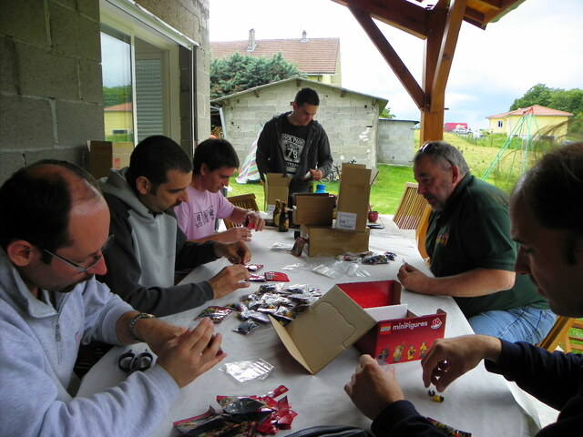
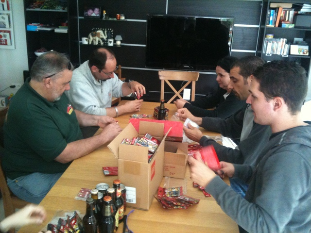
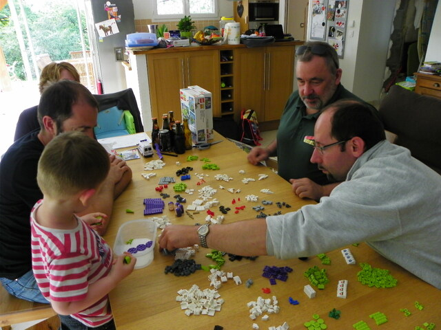

Voilà, un petit moment que je souhaitais organiser un barbecue à la maison entre Freelugiens de la région. Nous avons régulièrement l’occasion de nous voir lors des expositions, mais les occupations de chacun font qu’on ne trouve pas toujours le temps de discuter. C’est pourquoi j’affectionne particulièrement ce genre de rencontre, et cette fois-ci, c’est à Diémoz que nous nous sommes retrouvés.

Tout était là, barbecue, apéro, un peu de tri de Minifigs, et un draft pour finir. Les enfants ont pu jouer dehors, jusqu’à ce que la pluie fasse son apparition.

Bien sûr, nous avons pu parler de l’organisation de la future Briqu’Expo Diémoz, qui sera la première pour la région Rhône-Alpes, et qui aura lieu les 14-15 septembre 2013.

Une très bonne journée. A refaire !

_Yannick (Yannoch06)_

* * *

Je confirme.

Tout.

Passer un moment avec des amis - certains très anciens - autour d’une table, que ce soit pour manger, pour trier ou pour drafter c’est toujours mieux que de regarder pendant des heures des mecs appuyer comme des fous sur des pédales...

...enfin, bon, on aime bien le Tour de France aussi, il y a peut être une idée de MOC à développer là, qui sait ?

_Didier_

* * *

Bon alors pour aller à Diémoz depuis Grenoble, c’est facile : c’est juste avant Lyon. Donc j’y vais. Mais bon, après plus d’une heure de voiture, sur un chemin de terre, le soleil dans les yeux .... je fini quant même par retrouver du goudron nid de poules et mamy Nova qui passait par là sur son vélo bleu Friends m’indique le chemin. J’arrive juste pour la fin de l’apéro (qui a encore duré une heure).

Après, le temps a passé trop vite en parlant LEGO, tri des Minifig série 7, draft et de la future Briqu’Expo Diémoz 2013 : il y aura les trains qui roulent très vite et un autre thème qui fera l’objet d’un petit article à la rentrée pour le lancer et changer de braquet.

Bisous.

_cdhd_

* * *

Encore un bon moment passé entre AFOLs mais le temps passe toujours trop vite quand on discute LEGO. En tout cas merci pour le BBQ (et pour le tri).

_Xavier_

PS : Diémoz il y a une LGV.... affaire à suivre.
