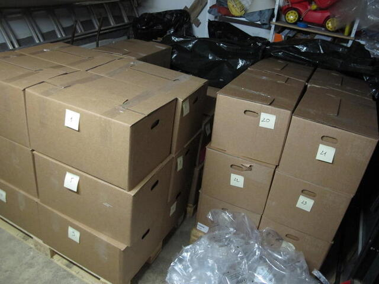
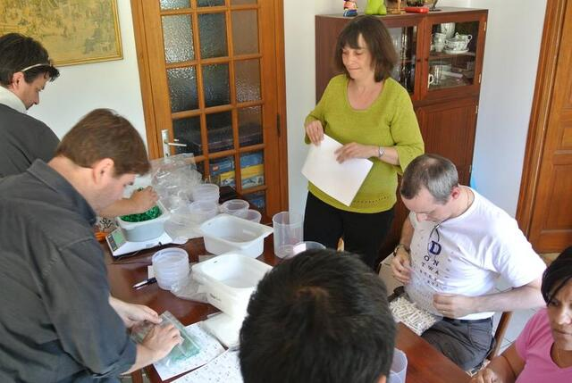
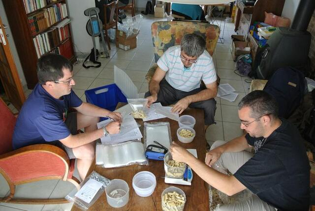
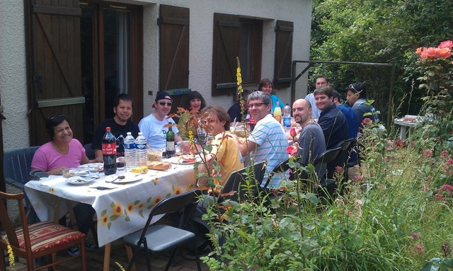
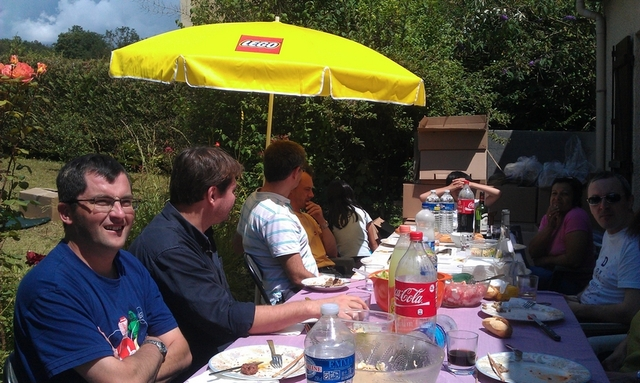

En guise d’introduction :  
**–** 3 palettes ;  
**–** 31 cartons bulk + 4 cartons de plaques ;  
**–** plus de 600 kilos ;  
**–** plus de 270 000 pièces !

Et c’est reparti pour un tour.

Forts de l’expérience des tris précédents, cette séance pour ce bulk toujours plus imposant a été préparée avec l’achat de nouvelles balances compteuses, de sachets zip, de sacs, d’étiquettes et de récipients, et l’édition de divers documents de pointage.

L’objectif était de parvenir à répartir les 273 000 pièces commandées en 1800 lots en une journée, objectif atteint grâce aux quatorze personnes venues trier.

Alors certes, la journée a duré 12 heures pour les plus assidus, mais faute à une des nouvelles balances qui nous a lâchés en milieu de matinée.

Pour le déjeuner, pause bien méritée, un barbecue a permis aux trieurs de reprendre quelques forces pour l’après-midi.

* * *

Une journée très enrichissante. Outre la possibilité de rencontrer des AFOLs, j’ai pu voir l’énorme préparation que nécessite le tri d’un BULK. Tout était parfaitement organisé, et la distribution des tâches se faisait du coup très facilement, et le tout dans une bonne ambiance (puisque justement bien préparé, pas de mode panique !).

Outre des balances compteuses supplémentaires, je suggèrerai pour cette année d’avoir plus de grands sachets zip. A part ça, rien à redire !

Ah si : vu l’énorme boulot que ça représente, j’ai du mal à comprendre que certains membres fassent des réflexions blessantes. Je leur suggère de prendre part à l’organisation, afin qu’ils se rendent compte de toutes les erreurs qu’il serait possible de faire, et de constater qu’au final, à quelques briques près sur des milliers, le compte est bon. S’ils savent faire mieux, je suis persuadé qu’ils seront les bienvenus !

A bientôt au prochain tri !

_S. CACHEUX_
