J’ai craqué pour ce train fantôme, qui n’est pas sans rappeler [le set "Time Cruiser" 6497](http://guide.lugnet.com/set/6497)

[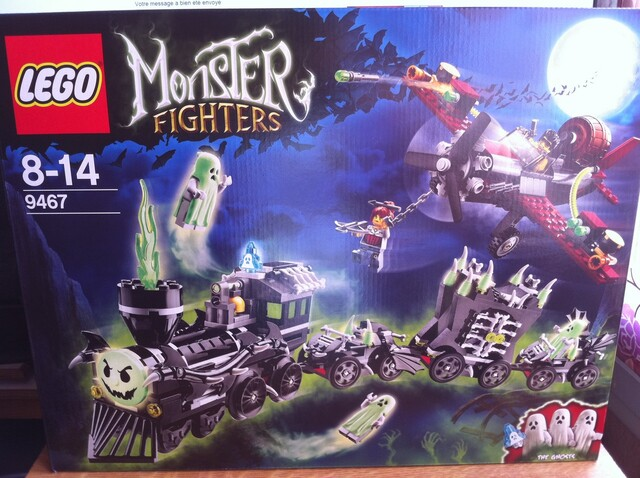](https://www.freelug.org/IMG/jpg/IMG_6877.jpg)

D’ailleurs, si on regarde de plus près, la référence 6497 est proche de 9467 ? Ce n’est surement pas par hasard.

[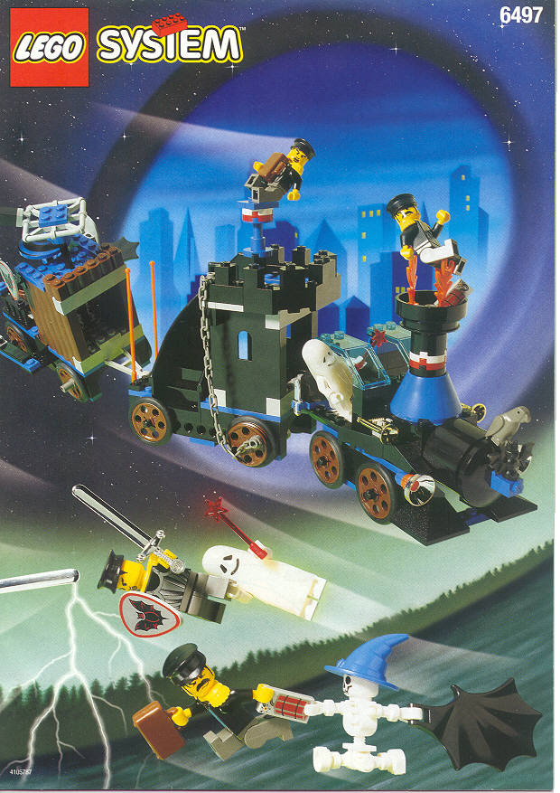](https://www.freelug.org/IMG/jpg/6497-1.jpg)

Ouverture de la boite : 6 Sachets, une pochette pour protéger les 2 notices, et 2 flexibles "Fluos".

## Sachet N°1

Les minifigs : 3 fantômes et 2 humains. Ils ont des torses recto/verso, et des double têtes.  
Je les trouve assez réussis.

[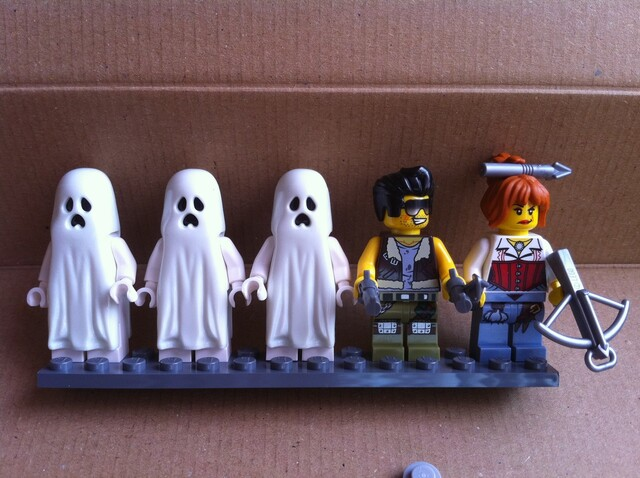](https://www.freelug.org/IMG/jpg/IMG_6882.jpg)

On commence donc le montage de cette boite de train par... l’avion !  
Dès le début, on constate qu’il sera robuste, et que le train d’atterrissage ne se repliera pas. Quelques pièces _Dark red_, toujours utile. J’aime bien l’utilisation des revolvers pour faire les échappements du moteur.

[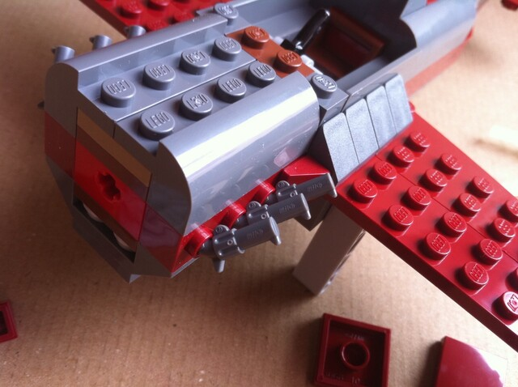](https://www.freelug.org/IMG/jpg/IMG_6885.jpg)

## Sachet N°2

La suite de l’avion. ( On commence quand le train ? )  
Joli moteur une fois fini, les canons sur les ailes lancent des projectiles alimentés par le tonneau sur l’arrière.  
Bon... Celui-là ne volera jamais ! :)

[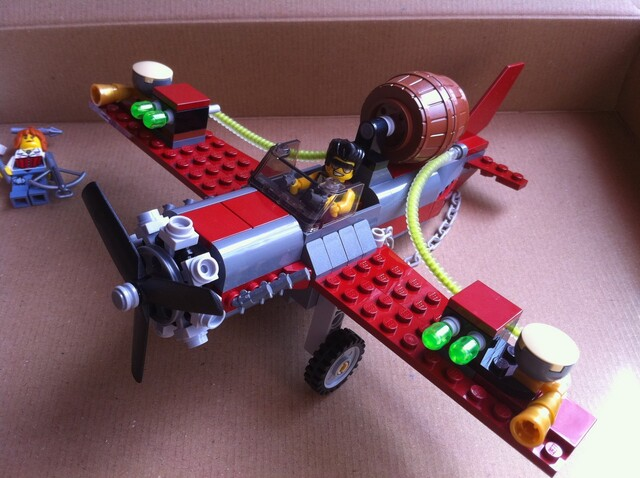](https://www.freelug.org/IMG/jpg/IMG_6890.jpg)

## Sachet N°3

Enfin la locomotive.  
On constate à l’ouverture qu’il y à 4 grandes roues avec flasque, et 2 sans. Ces 2 roues sont en extra. Je vais rapidement leur trouver une utilisation.

La grille avant en noir, et un "Glaçon" bleu avec un fantôme dessiné dessus.

Construction des bogies. Des os longs décorent le bogie avant. Le foyer est du plus bel effet avec la flamme, et la porte est bien réussie.

[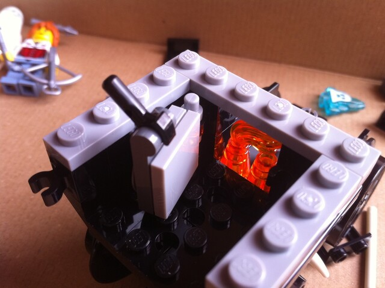](https://www.freelug.org/IMG/jpg/IMG_6895.jpg)

Deux tubes de sabre lasers en blanc "glow in the dark" à l’arrière. Ils se sont lâchés sur cette couleur. Vivement ce soir que je puisse l’essayer de nuit.

## Sachet N°4

Une belle flamme verte également "glow in the dark", en bi-couleurs, un "smiley", et plein de briques de couleur... ( toujours et encore du rouge ).

Montage de la chaudière. Les briques rouges ne seront pas du tout visibles.

Tiens ? Il y a un monstre marin dans cette boite ?

[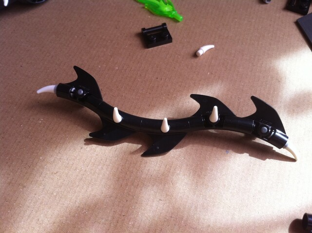](https://www.freelug.org/IMG/jpg/IMG_6900.jpg)

Une fois la cheminée montée, on comprend l’utilité des plates rondes vertes. Belle locomotive.

Vu le montage des bogies, il sera difficile de la faire tourner sur un réseau. Il y aura de la modification profonde à apporter.

[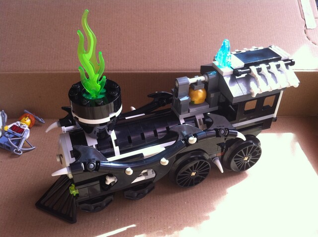](https://www.freelug.org/IMG/jpg/IMG_6902.jpg)

## Sachet N°5

Montage d’un wagonnet (En fait 2 fois le même. Dommage, un manque de créativité de la part de LEGO sur ce point).  
Deux griffes à l’arrière sont montées souples. On ne voit pas trop pourquoi à ce moment.

[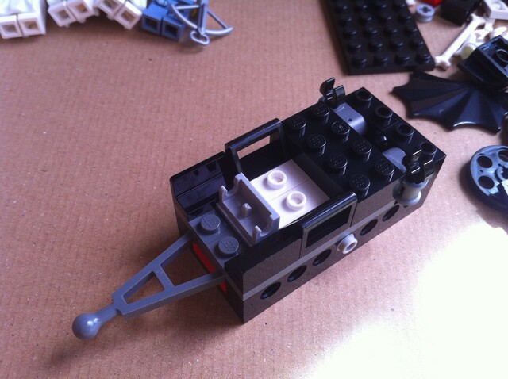](https://www.freelug.org/IMG/jpg/IMG_6904.jpg)

Une fois fini, on comprend mieux. Une came sous chaque roue permet de faire battre des ailes à ces wagonnets. Il fallait y penser, mais l’effet est garanti ! :)

[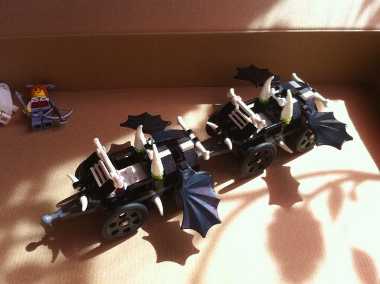](https://www.freelug.org/IMG/jpg/IMG_6906.jpg)

## Sachet N°6

Le dernier wagon. Le bogie part sur la même base.  
Plein de bras de squelettes, d’os, et de griffes dans ce sachet. Il faut de la patience pour les placer.

[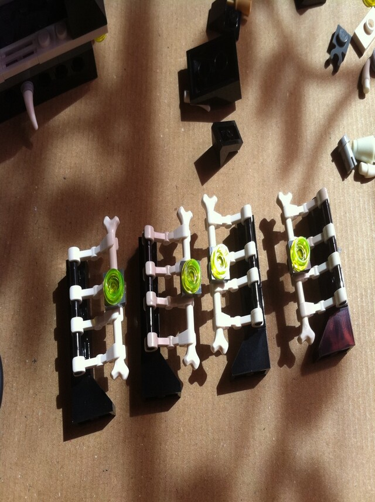](https://www.freelug.org/IMG/jpg/IMG_6910.jpg)

Une fois fini, le wagon-cage est très chouette. Aussitôt fini, la chasseuse de fantômes termine dedans.

[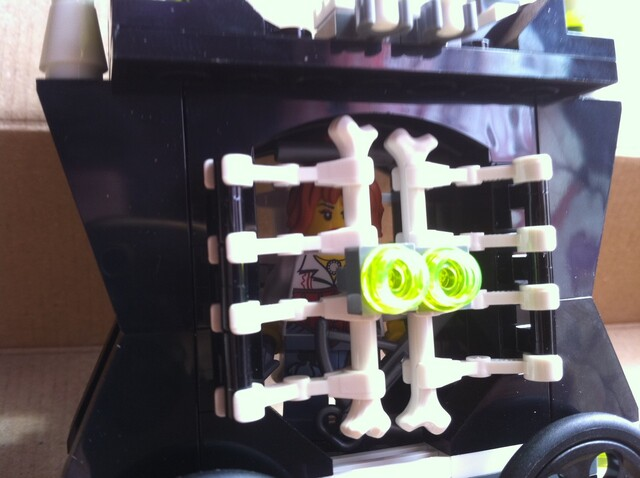](https://www.freelug.org/IMG/jpg/IMG_6913.jpg)

Pas mal d’extra-pièces dans cette boite.  
L’ensemble me plait bien, et sera sans aucun doute modifié pour rouler sur voies, dans les expositions à venir.

[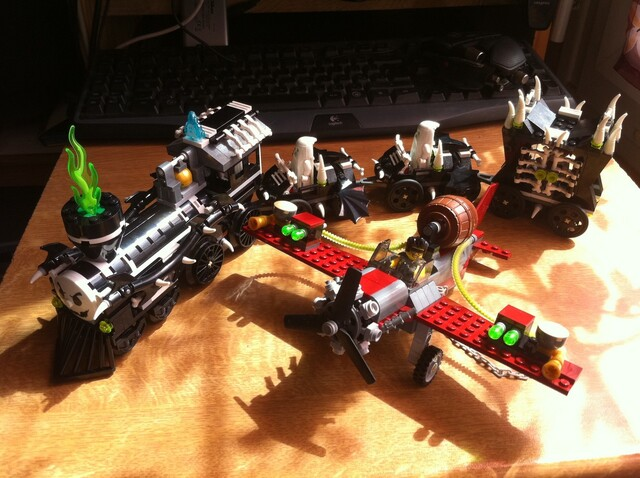](https://www.freelug.org/IMG/jpg/IMG_6916.jpg)

[Les photos du montage](http://www.brickshelf.com/cgi-bin/gallery.cgi?f=509391)
