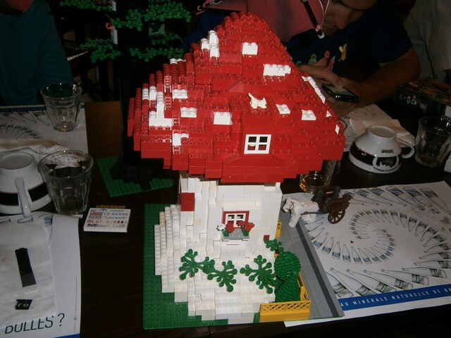
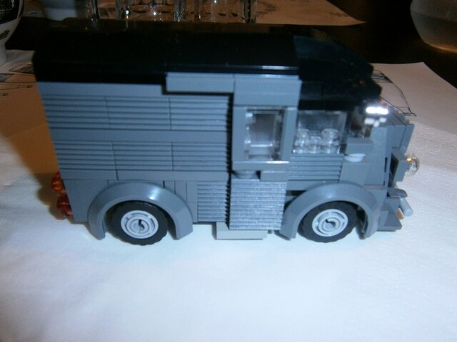
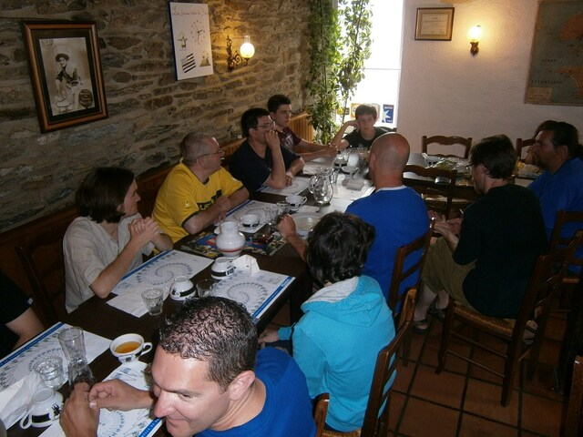
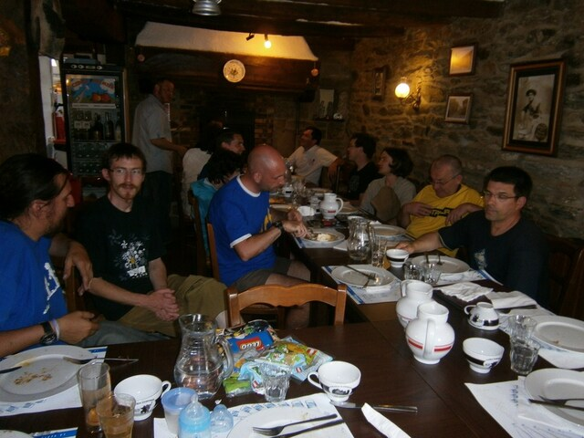

Petits mots des participants à ce restolego !

J’ai fait un passage sur Carhaix, je ne connaissais que Daniela et Sébastien.

Ça bouge en Bretagne, ils ont plein de projets, beaucoup font des thèmes identiques où la même échelle est de mise. Une très bonne dynamique.

Pas évident de discuter des fois sur des thèmes différents, je suis dans les LEGO depuis mon enfance sans jamais m’arrêter, je suis passé par plein de phases, la plus longue étant la collection.  
Maintenant j’opte plus pour la création avec plus ou moins de réussite mais le plaisir de faire est là donc tout va très bien :) Je reste vraiment très inspiré pour les modèles Technic sur le thème agricole.

Après quelques conversations j’ai appris la présence d’autres fans Technic en Bretagne, très content que Sébastien ait sa bible LEGO. Je trouve plus dur d’exposer du Technic en diorama vu l’échelle de certains modèles, ils ne sont pas évidents à placer les uns près des autres.

Chouette resto crêperie, le patron très cool, il y avait plein de trolls qui nous surveillaient.

_Rémi de Nantes_

* * *

Une belle occasion de retrouver les membres Freelugiens déjà connus (ou pas !) autour d’un bon repas.

On a pu discuter des expositions passées et à venir, des créations personnelles à venir ou fraîchement terminées...  
À ce sujet il était possible de voir les voitures de marque de Sébastien, le diorama "Panique à Kerbrick" de Ronan, et mention spéciale à Laurent pour sa maison champignon qui se fondait dans le décor fantastique du restaurant ;)

Et pour finir : à refaire dès que possible bien sûr !

La maison champignon de Laurent

Une des voitures de Sébastien

_Erik / ScroogeMcBrick_

* * *

Un restolego tout à fait charmant dans une crêperie à Carhaix, dans la Bretagne profonde ! Après avoir retrouvé les têtes que l’on connait déjà dans la région et avoir discuté avec les nouveaux, on a pu se réjouir, avec la peau du ventre bien tendue évidemment, de découvrir les dernières créations des participants. Le déplacement en valait d’autant mieux la peine, que c’était également le rendez-vous que l’on s’était fixé avec les chameaux (un grand merci au passage :) ) pour récupérer les parts du Bulk et échanger quelques mots au sujet des futures créations rendues possible par ce Noël avant l’heure, fébrilement attendu depuis des semaines !

Elles sont rares ces fois où on arrive à réunir autant d’AFOL d’horizon géographiques différents, mais elles ont toujours une saveur particulière, j’espère qu’on aura prochainement l’occasion de renouveler l’expérience !

_LaurentB & bruno_

* * *

Puisque ça nous arrive souvent d’être en Bretagne en été, nous voilà arrivé pour le restolego de Carhaix. Un restaurant avec un patron très sympathique et bien sûr la rencontre des AFOL. Des nouveaux visages et des retrouvailles avec certains, c’est comme toujours un plaisir. Les LEGO sur les tables, ceci est une obligation et les clients de la crêperie nous ont regardés bizarrement, mais ça, on a l’habitude. Bref merci pour l’organisation et à très bientôt pour une prochaine édition.

_Daniela et les 2 Sylvain_

* * *

Toujours aussi sympa de se retrouver autour d’une table pour discuter de nos projets, d’autant plus quand la table est si bien tenue !

C’est vrai aussi que l’été nous permet (nous bretons), de revoir les Afols habitants loin d’ici, et ça c’est cool !

Merci à Sebastien pour l’organisation et à tout le monde pour avoir fait le déplacement,

Vivement le prochain resto,

_Ronan_

* * *

Et oui pour une énième édition, nous nous sommes retrouvés dans un restaurant en Bretagne pour marquer pour beaucoup d’entre nous les vacances d’été. Comme l’a dit Laurent se fut pour moi l’occasion de distribué le [bulk 2012](/articles/1511/) que j’avais pris avec moi après le tri. Cette année c’est Carhaix qui est à l’honneur avec une crêperie typique pour un cadre très sympathique. Cela a permis de rencontrer les nouveaux adhérents de Bretagne.

A l’année prochaine pour de nouvelles aventures

_Sébastien_

* * *

Et un de plus...

C’est devenu une tradition maintenant, le resto de l’été en Bretagne ! Toujours un plaisir de se revoir, de discuter, de parler des projets...

Alors on se voit l’été prochain..? !

_Pierre_
