Jusqu’à présent, les objets que nous avons représenté ont des couleurs unies. Une pomme toute rouge, une balle de tennis toute jaune, un œuf tout blanc et une orange toute... orange.

Mais certains objets portent des couleurs variées ou des motifs géométriques. Peut-on représenter des rayures, des formes géométriques comme les polygones noirs et blancs d’un ballon ou mieux encore des formes biologiques ou naturelles comme les tracés des continents et océans sur un globe terrestre ?

L’exemple que je vous propose - un cône de chantier - est simple et  
ne demande pas la mise en œuvre de technique particulière mais juste une petite planification pour positionner correctement les alternances de couleurs, blanc et orange, en fonction de la hauteur.

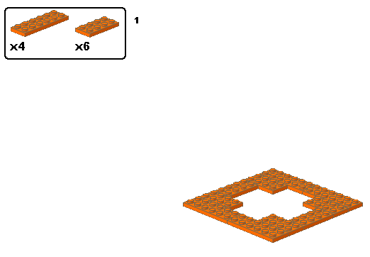

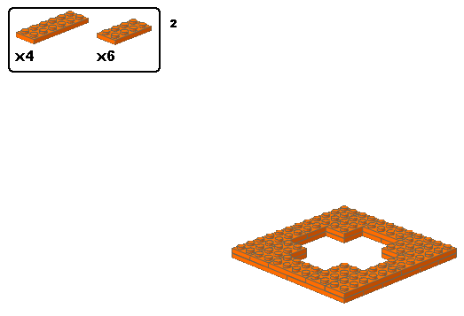

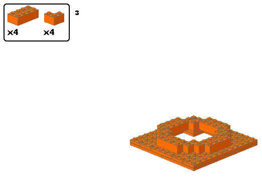

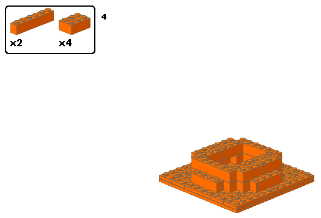

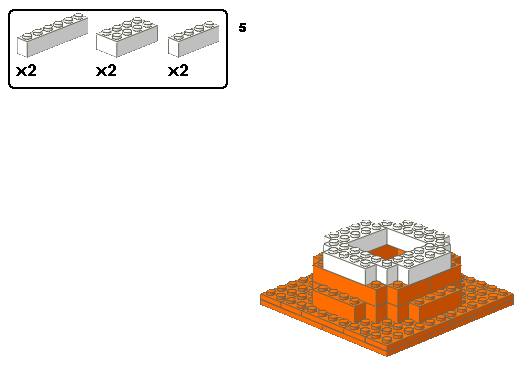

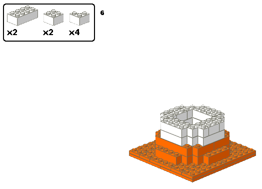

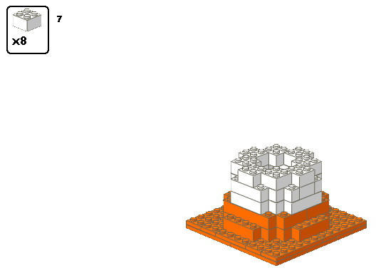

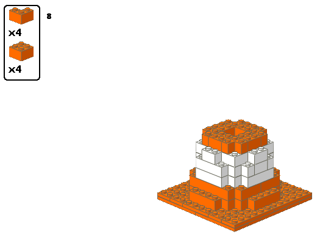

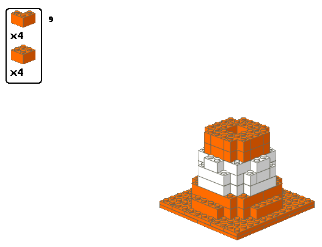

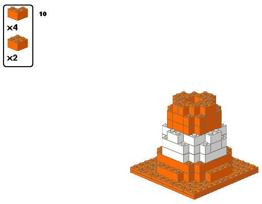

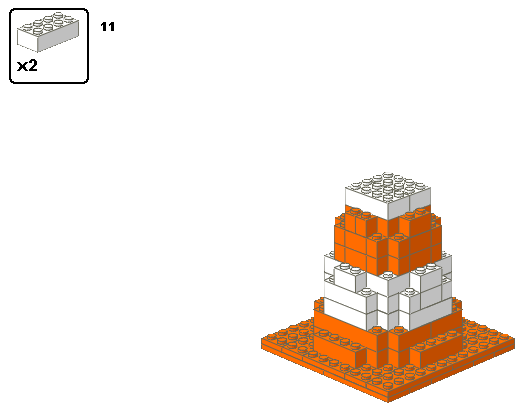

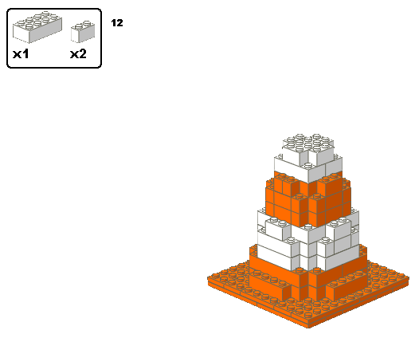

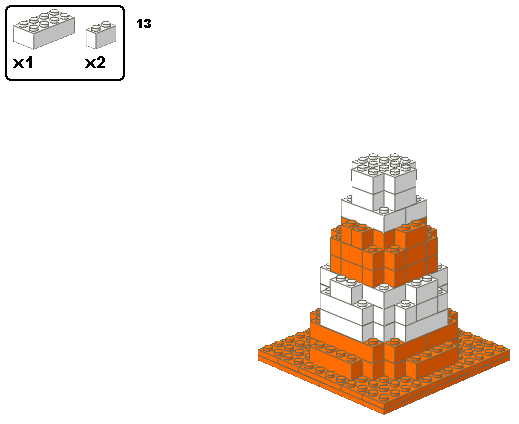

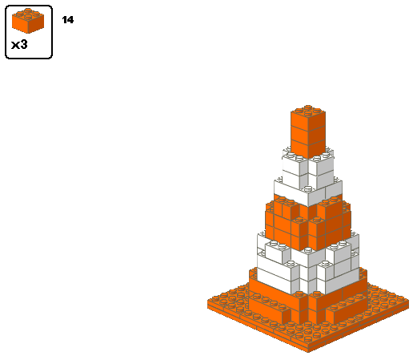

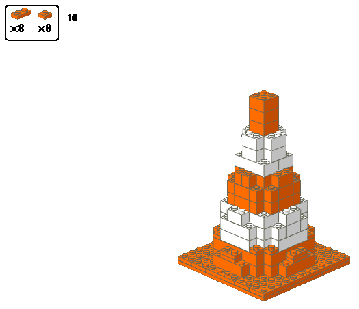

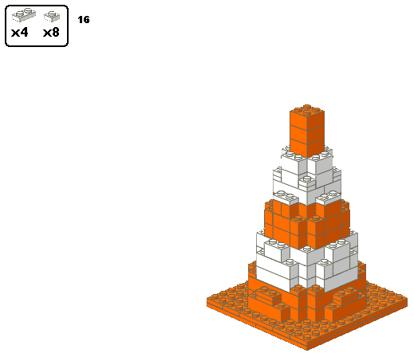

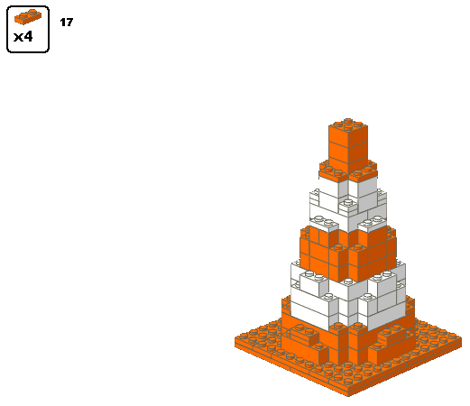

Pour les formes plus complexes, nous vous proposons d’utiliser les  
techniques classiques de mosaïque. Il s’agit de transférer l’image, de manière virtuelle ou physique, Un premier modèle uniforme, sans motif, est créé sur lequel on applique par transparence le motif à reproduire. Cela peut sembler simple a priori mais tout comme avec une mosaïque « à plat », plusieurs essais peuvent être nécessaires pour obtenir un résultat convenable, et celui-ci ne peut être fidèle que sur des modèles de grandes tailles. L’exemple ci-contre représente le transfert des pentagones sur un ballon de football.

[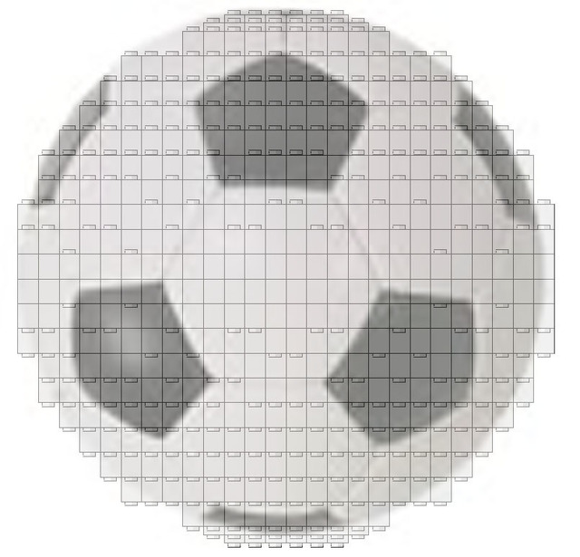](https://www.freelug.org/IMG/jpg/foot90.jpg)

[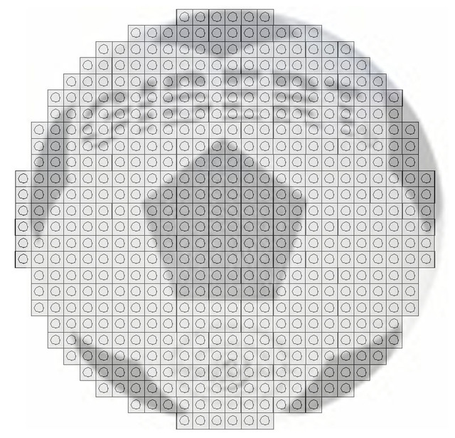](https://www.freelug.org/IMG/jpg/footdessus.jpg)

L’exercice du globe terrestre est aussi apprécié comme vous pourrez en juger sur [BrickShelf](http://www.brickshelf.com/cgi-bin/search.cgi?q=globe&stype=dfic).

* * *

**–** [Des balles avec des briques. Partie I : les dômes](/articles/1487/)  
**–** [Des balles avec des briques. Partie II : la sphère](/articles/1488/)  
**–** [Des balles avec des briques. Partie III : les fruits.](/articles/1489/)  
**–** [Des balles avec des briques. Partie IV : les œufs](/articles/1491/)
