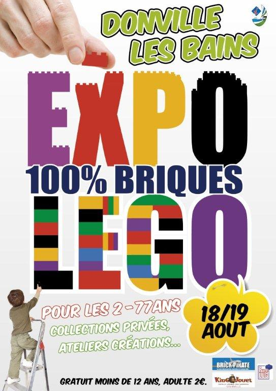
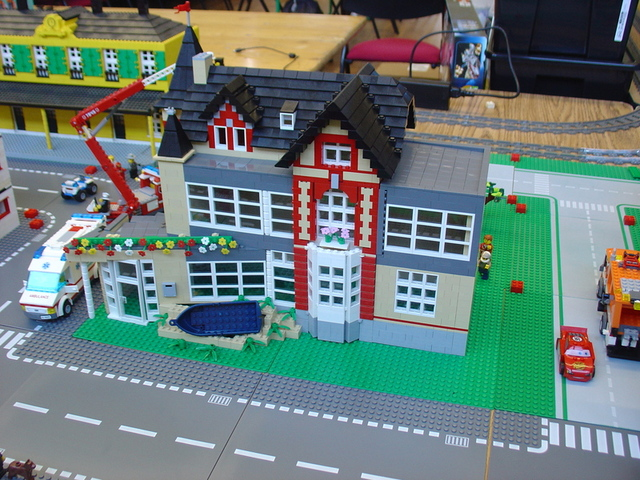
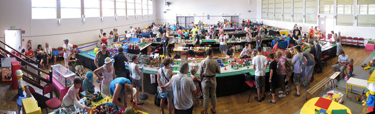
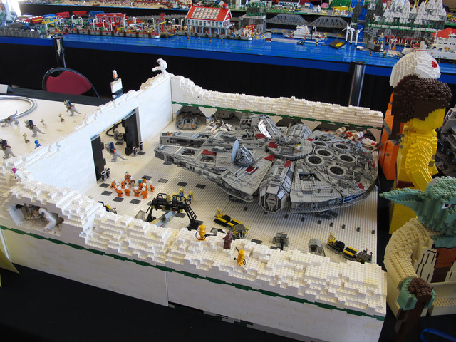
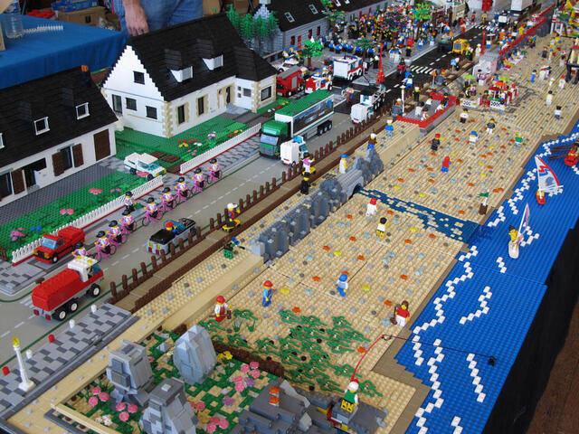
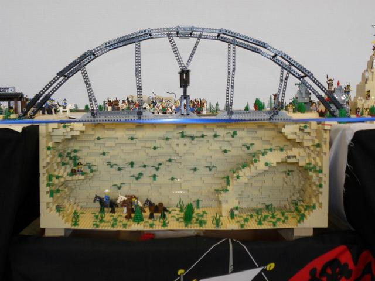
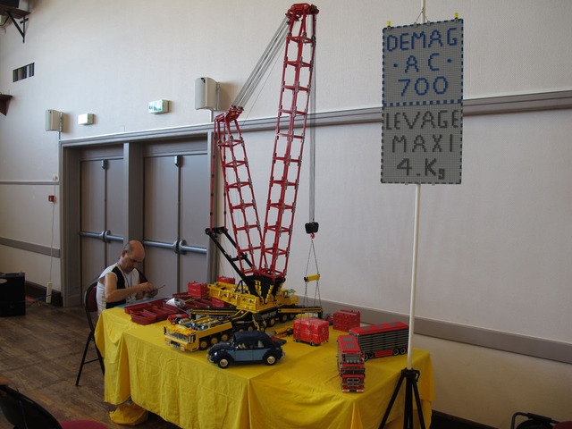
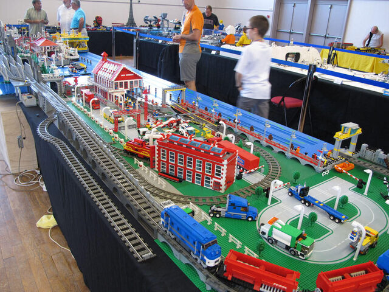
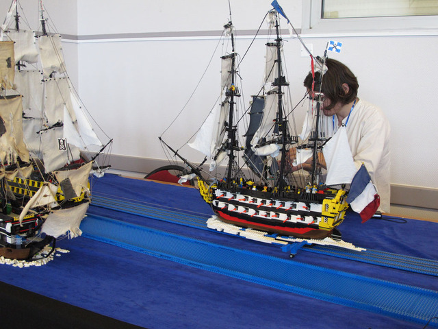
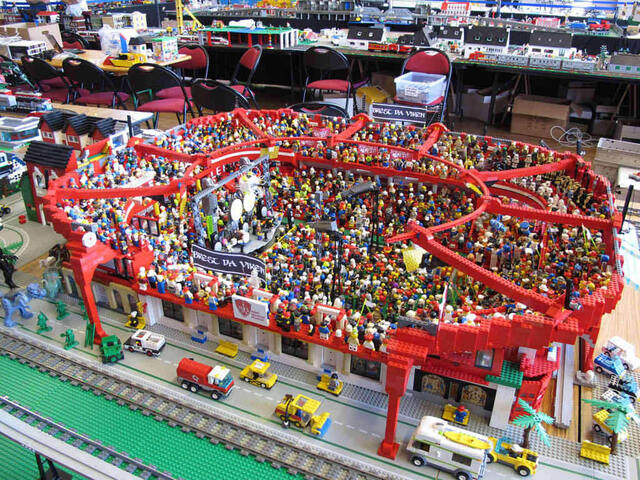

18 et 19 août 2012 à la salle des fêtes de Donville-les-Bains, tout près de la plage, exposition et ateliers LEGO

Cette première exposition dans notre presqu’île normande est une réussite d’abord et avant tout exprimée par l’Office du Tourisme (OT) ainsi que de la Mairie de Donville-les-Bains, rehaussée de la présence de M. le Maire et de l’ensemble des responsables de l’OT.

**AFFICHE ABRIS BUS**

Beaucoup d’amis nous ont rejoins (une vingtaine d’AFOL) pour exposer et quelques 1400 visiteurs se sont déplacés, notamment plein d’anglophones, même des Irlandais. Nous avons pu admirer le grand stade, la mairie de Donville, la médiathèque d’Agneaux, un diorama Breton, la mine, un thème Star-Wars et Egypte, un thème Western et Pirate sans oublier le GBB et des modèles Technic(r) sans oublier le fameux thème bateau de Jean-Marc et bien d’autres choses encore que les photographes « AFOL » auront certainement à cœur de poster sur FreeLUG ou bien sur Brickshelf et autres sites.

**Mairie de Donville-les-Bains**

Chaque heure, une tombola animée par Alain permettait de remettre aux visiteurs les nombreux lots offerts (minifigs et boites LEGO) par King Jouet de Granville.

Les enfants petits et grands ont pu toucher nos précieuses briques dans les ateliers à leur disposition.

La Mairie de Donville et l’association de l’OT ont participé à la création de cet événement. Eux aussi ont contribué à la réussite par la communication, la mise à disposition d’une salle, la prise en charge des frais de repas et bien d’autres choses. C’est une vraie aide que nous avons reçu de la part des salariés municipaux et des bénévoles.

Brickpirate, Fanabriques et FreeLUG ont participé à l’information.

La contribution de l’association FreeLUG s’est traduite par le prêt de nappes et de plaques.

Je tiens à tous vous remercier, sans citer nommément pour être sûr de n’oublier personne. Je crois que plusieurs exposants ont pu se baigner sur la plage à 500m. Un an de préparation, mais un week-end inoubliable. Je donne la parole aux exposants et à leurs photos.

Merci encore.  
_Brigitte_

**–** [Photos de Brigitte](http://photos.freelug.org/main.php/v/EURY/EXPO+DLB/)  
**–** [Revue de presse](http://photos.freelug.org/main.php/v/EURY/presse_002/)  
**–** [Revue de presse](http://photos.freelug.org/main.php/v/EURY/presse_001/)

* * *

* * *

Une première organisation d’exposition qui s’est soldée par une belle réussite ! Les exposants contents d’être venus, les membres et employés de l’office de tourisme ravis ainsi que le Maire.

Comme dit Brigitte, nous travaillons sur cette exposition depuis septembre 2011, pour arriver à un résultat extrêmement satisfaisant. 1400 visiteurs pour une première, c’est impressionnant !

Un grand merci aux services techniques de la ville pour les dernières fournitures, les découpes que nous avons demandées pour le port et la plage de Vincent !

Pour quelques exposants, ce fut leur premier week-end d’exposition, je pense à Jacky, Thierry, Mickaël et moi. Un merci aussi à Benjamin pour être venu tout le week-end avec sa cheville dans le plâtre.  
J’ai aussi été ravi de voir (enfin) en vrai les dioramas de Jean-Marc Barré, de Gilles Bordier, de Laurent et Bruno Le Berre et de Vincent Meeuw, et de revoir celui de Dominick Ollivier (et ceux de ses fils). La collection de Boris est toujours aussi impressionnante ! Je remercie aussi Philippe (Philo) et Annie Hurbain pour leur présence et leur aide, Thierry Meyer et ses fils pour leur aide sur mon diorama ainsi que Denis Hureau pour être venu avec son impressionnante grue.

_Jérôme (Jerominus) Weiss_

* * *

* * *

Très grande expo, à refaire !  
J’espère participer à la prochaine édition si elle a lieu !

_Benjamin_

* * *

* * *

Bonjour tout le monde,

Après la route sans histoire, j’ai retrouvé Brigitte et Alain à l’Office du Tourisme de Donville les Bains à l’heure du rendez vous. Puis nous sommes allés à notre hébergement. Le lendemain matin, après avoir installé les tables, j’ai commencé sans tarder l’installation de mon diorama trains et ferries (toujours 11h) . Samedi matin, les réglages et finitions furent terminés et prêts à l’emploi. A 14h , j’accueille les premiers visiteurs , beaucoup d’enfants ne s’attendaient même pas à jouer avec moi, ils ont été conquis.... Ma démonstration était permanente jusqu’à 23h avec interruption rapide vers 20h (repas).

Pour la nocturne, seul le ferry blanc était allumé pour sa navigation, le super ferry n’avait pas ses feux réquisitionnés sur d’autres dioramas , je penserai à les remettre un jour... Dimanche , nouvelle journée de démonstration sans accroc . Au final, le matériel s’est bien comporté malgré une certaine chaleur , ma commande du super ferry est tombée en miettes par un enfant, 15mn de remontage (grrrrrr).  
En conclusion, grand bravo aux organisateurs, à l’office du tourisme, merci à Jeannine de m’avoir hébergé, je salue tous mes collègues et puis à bientôt.

Merci à Brigitte et Alain pour la ballade dans les environs.

_Jean-Marc_

[Photos de Jean-Marc](http://photos.freelug.org/main.php/v/barr__/expositions/2012/donville/)

* * *

Pour conclure la saison estivale du LEGO en beauté, Brigitte nous avait invité depuis plusieurs mois déjà à sa première édition de l’expolego Donville-les-Bains, près de Granville, à quatre heures de route de chez moi. Après le grand succès qui avait couronné l’expolego de Pluvigner en juin, cette réunion portait beaucoup de promesses, qui ont toutes été tenues.

Avec un nombre d’entrée qui a stupéfait tous les élus et marqué les esprits de tous les officiels venus faire la visite, les LEGO de Donville ont suscité beaucoup d’admiration et ont surtout imposé un respect auquel tout le monde ne s’attendait pas. On a donc eu droit à un maire bluffé par la prestation, qui s’est retrouvé à jouer aux LEGO avec ses collègues, et une foule de visiteurs et de curieux, se demandant s’il y aurait d’autres éditions de l’évènement. Pour une première, c’était réussi.

Arrivé dès le vendredi avec le fourgon de mon père, j’ai pu procéder à l’installation de mes créations. Au programme du week-end : un stand sur le thème de l’histoire, avec une bataille navale, ma collection de navires de guerre, le kraken animatronique, ainsi qu’un village western avec plusieurs créations inédites, présenté à l’initiative de mon père. Je participais également au grand diorama urbain avec le stade qui avait été installé en configuration concert pour l’occasion, avec une scène et une fosse à spectateurs à la place du terrain, et plusieurs jeux de lumière. J’avais également prêté un de mes navires à Jérôme pour occuper l’espace maritime du port.

L’accueil de l’office du tourisme, des volontaires réunis par Brigitte, et l’ambiance des exposants venus jusque de Belgique, ont été spectaculaires, et absolument rien n’a manqué à la fête ; nous avons été reçus en véritables amis, de grands moments de partage et de découverte avec les autres exposants ont permis de découvrir et de redécouvrir des gens ouverts et pleins de surprises, et ce fut un immense plaisir de faire la connaissance de ceux qui venaient exposer pour la première fois.

Après la nocturne du samedi soir qui a permis de mettre en valeur les créations illuminées, j’ai pu profiter de la baignade granvillaise (excellente au passage) et parler des projets d’expositions futures avec les autres membres. Au démontage du dimanche soir, il était temps de détruire le kraken qui a donc été réduit à l’état de vrac pour renaître de ses briques dans une version 2.0 qui pourra être opérationnelle pour les prochaines sorties. Mais également de constater qu’après une année sur les routes des expolegos, le stade commence à accuser des faiblesses structurelles qui donnent à réfléchir à une reconstruction, pour un projet plus grand, plus stable, et plus audacieux, qui sera mis en chantier d’ici la livraison du prochain bulk.

L’expolego de Donville a donc été l’occasion de prouver que le LEGO est définitivement un évènement de taille, créant le jamais-vu partout où il passe, et capable de créer l’admiration jusque chez les plus réticents.

Un grand merci donc à l’office de tourisme que nous avons enfin pu rencontrer après tout le bien que l’on en avait entendu, et aux Eury pour avoir rendu possible cet accueil chaleureux dans une région magnifique.

_LaurentB&Bruno_

[Photos de Laurent](http://photos.freelug.org/main.php/v/Laurent+B/Donville/)

* * *

## Tous les autres liens photos

**–** [Thierry](http://www.fanabriques.fr/accueil.php?action=articles&catid=2&artid=299)  
**–** [Annie et Philo](http://photos.freelug.org/main.php/v/philo/DLB2012/)  
**–** [Hélène et Myrtille](http://www.flickr.com/photos/myrtille14/sets/72157631271731200/)  
**–** [Dominick](http://www.flickr.com/photos/dominickollivier/7824768762/in/photostream)  
**–** [Gilles](http://photos.freelug.org/main.php/v/FIRE+GARDEN/donville+2012/)  
**–** [Jérome](http://photos.freelug.org/main.php/v/Jerominus/expodlb2012/)  
**–** [Vincent](http://www.brickshelf.com/cgi-bin/gallery.cgi?f=513621)
