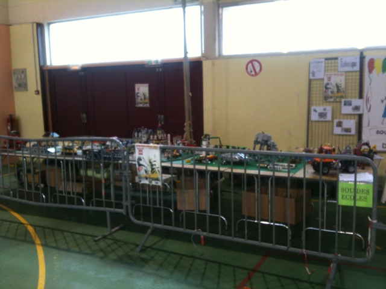
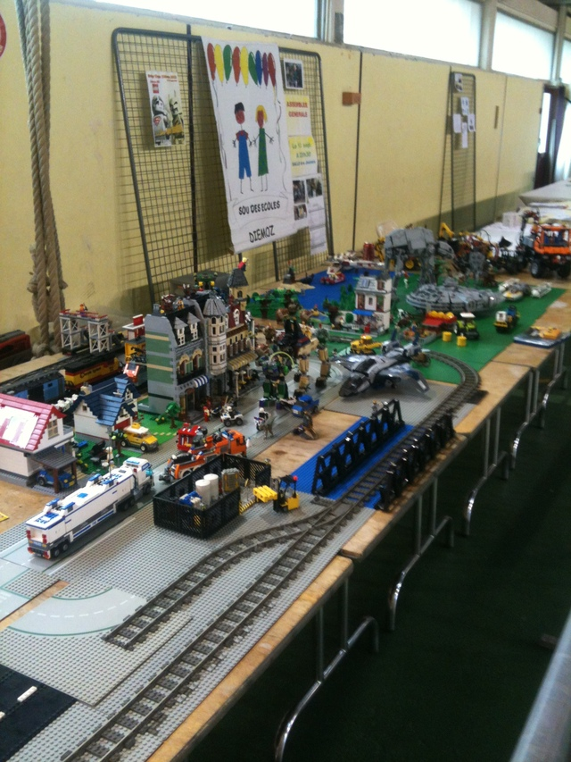
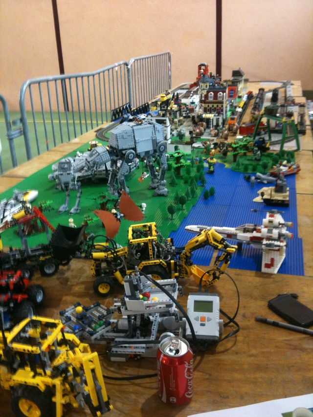
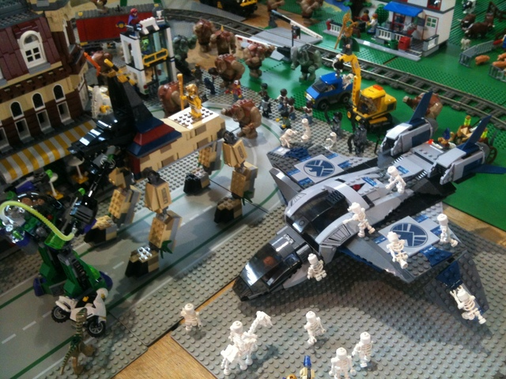
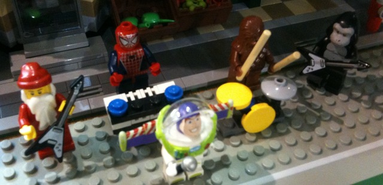

A l’occasion du Forum des Associations de Diémoz, nous avons présenté un petit layout sur le stand du Sou des Ecoles, association avec laquelle nous organisons la future Briqu’Expo.

Même si nous n’avons pas fait une grosse exposition, nous voulions présenter des thèmes variés. Evidemment les grands classiques étaient présents : Train, City, Star Wars, mais aussi, du Technic, du NXT, et quelques autres thèmes intégrés dans le Diorama, tels que Pharaoh’s Quest, Super Hero et Monster Fighters.

Pour beaucoup de visiteurs, c’était une première : les enfants et adultes contemplaient avec émerveillement ces quelques tables joliment décorées.

Le thème de la Briqu’Expo à venir étant "les héros", il est fort à parier que nous les retrouvions dans les situations les plus cocasses, ce qui était déjà le cas.

Rendez-vous les 14-15 septembre 2013 au même endroit mais cette fois avec une surface dédiée à nos chères briques de 800m² !

[Plus de photos](http://photos.freelug.org/main.php/v/yannoch06/Expositions/2012+-+Forum+des+Associations+Diemoz/).
