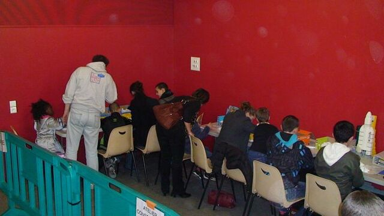
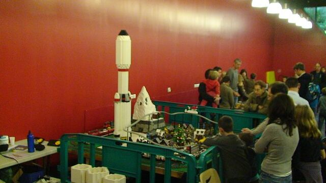
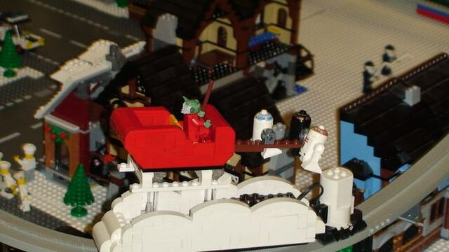
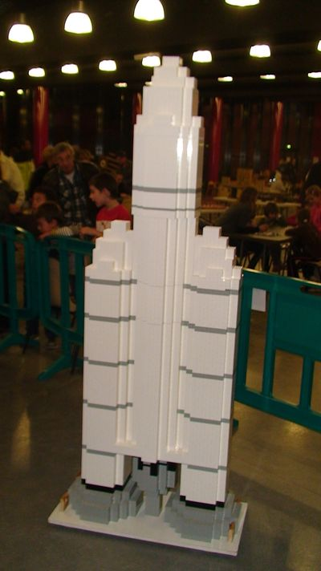
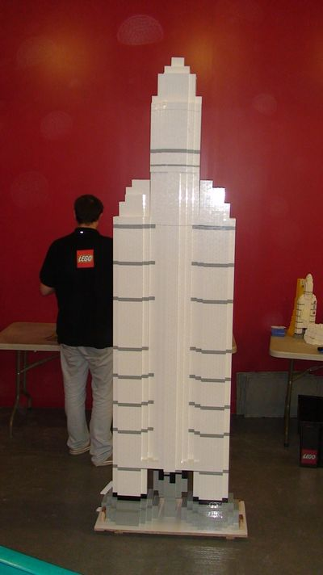
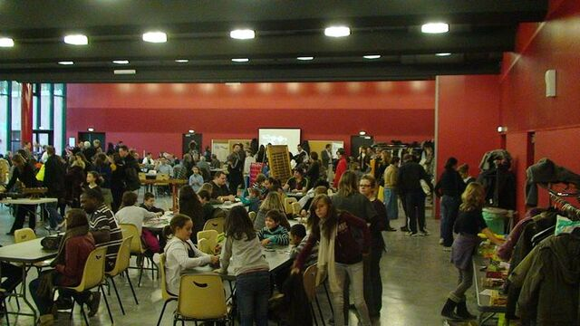

Lors de Kidexpo 2010, nous avons été contactés par le responsable de l’association 1,2,3 soleil, pour nous demander si nous pourrions participer avec eux à une manifestation, qu’elle n’a pas été ma surprise quand il a indiqué le lieu qui est celui de mon domicile.

J’avais déjà envie d’y participer, mais n’avais pas eu l’occasion de prendre contact, car cette manifestation se passe le même week-end que l’exposition [LVB](https://www.freelug.org/spip.php?article1399) ou près de [celle d’Orléans](/articles/1208/).

Là je n’avais plus le choix. Nous avons donc prévu de reprendre contact pour l’exposition prévu en 2011 (2010 trop court et j’avais Orléans à préparer).

Comme le thème est le jeu, avec Thaaz nous avons installé l’atelier « FUSEE ».

Plus un petit diorama dans l’air du temps, un village sous la neige.

Avec le nouveau Père Noël (obligé d’anticiper l’ouverture de la dernière case du calendrier de l’avent) :

La fusée a été montée une fois par jour, un peu plus haut le dimanche, ou une partie m’est tombée sur la tête (désolé il n’y a pas de vidéo).

Samedi :

Dimanche :

Animation agréable avec une très bonne ambiance, heureusement que je n’ai jamais caché que mon hobby était les briques LEGO, car maintenant...

Le public a été surpris par notre animation (car c’était une première pour cette manifestation) et a bien participé, le diorama a déclenché beaucoup d’admiration et d’envie.

Cette manifestation est très agréable car les visiteurs viennent et reviennent pour jouer.

L’association 1,2,3 soleil apporte une collection énorme de jouets en bois et de grande tailles. Ainsi que des casses-têtes (un de mes anciens thèmes de collection).

Il y a aussi beaucoup d’autres jeux fournis par la ludothèque et des associations de la ville.

Nous n’avons pas eu le temps de jouer à tout, juste 2 ou 3 jeux d’adresse.

La mairie, grâce à un questionnaire à remplir remis lors de la sortie, a comptabilisé environ 1 000 entrées.

## Photos et vidéos

**–** [Mes photos](http://photos.freelug.org/main.php/v/FreeLUG/Animations/2011/Soisy_2011/)  
**–** [Mes vidéos](http://photos.freelug.org/main.php/v/gmifr/Expositions/2011/Soisy2011/videos/)  
**–** [Photos par la ville](http://www.soisysurseine.fr/spip.php?article833)  
**–** [Présentation de la manifestation](http://www.soisysurseine.fr/spip.php?article826&var_recherche=jeux)  
**–** [Présentation de la ville](http://www.soisysurseine.fr/spip.php?rubrique1)

* * *

_Remarques_

Avec Thaaz, nous avons participé en même temps à LVB, au niveau de l’installation et du démontage.

En plus pour Thaaz, réalisation de MOCs pour LVB et pour ma part prêt de briques, minifigs, plaques ou d’anciens MOCs, ainsi que des tables et travaux de menuiserie sur place ;-).

Nous avons aussi retrouvé le samedi soir les participants de LVB pour le repas.

Même si cela n’était pas trop loin, cela a compliqué notre week-end et le rangement après deux expositions...
