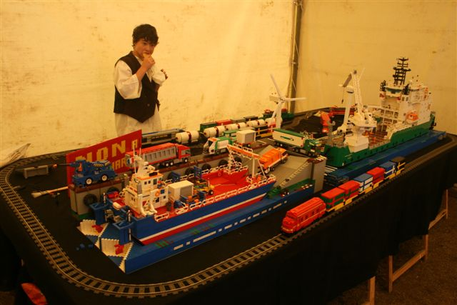
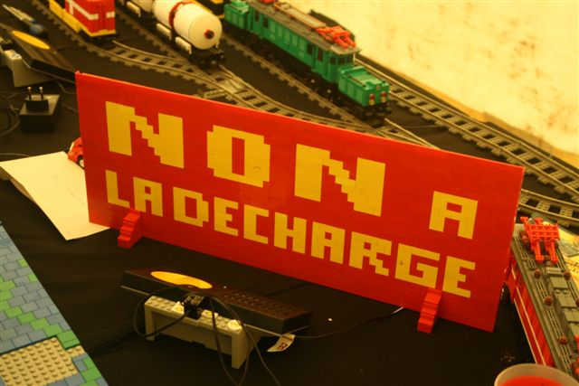

Suite à une invitation du collectif contre la future implantation de la décharge à Plourin les Morlaix (29) prés de Morlaix , j’ai présenté un stand FreeLUG mi marin, mi ferroviaire de 4mx1.60m le 9 septembre 2012.

C’est donc sous un barnum que je me suis installé, dés 8h, en compagnie d’autres exposants qui présentaient entre autres des pow pow , (petits bateaux qui avancent grâce à une pièce chauffée par une bougie.

Sans surprise, j’ai présenté le BOURBON et sa houle animée, la barge animée de l’Ile de Batz, un circuit de trains et... un panneau en briques : _NON A LA DECHARGE_, histoire de marquer le coup sans être politique.

L’électricité du stand était fournie par un groupe électrogène assez bruyant, il a fallu augmenter un peu la puissance vu le nombres de transfos 9v. C’est le charme de la campagne profonde juste à coté de la ferme et ses vaches !

Plus de 800 personnes sont venues admirer notre barnum, l’accueil a été très sympathique, repas du midi offert.

Coté LEGO, le matériel a marché à peu prés, car, le sol pas très plat coinçait mes mécanismes, le train, pas de problème.

Les catalogues LEGO sont partis comme des petits pains, j’ai répondu aux questions du public comme il se doit.

A 18h, démontage du stand, les organisateurs étaient satisfaits, la recette de cette journée servira à financer en partie les recours judiciaires pour retarder l’ouverture de la décharge.

[Galerie photos](http://photos.freelug.org/main.php/v/barr__/expositions/2012/plourin/)
