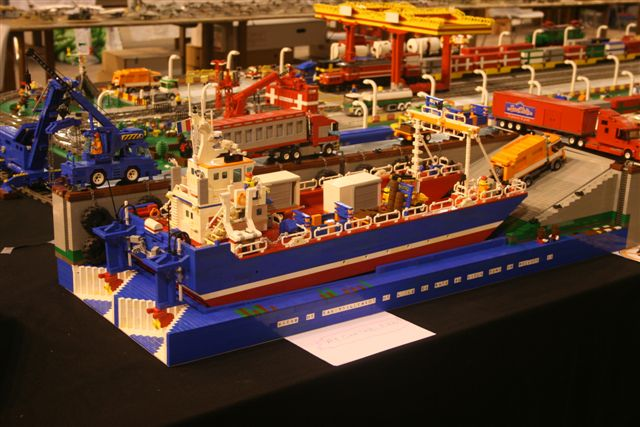
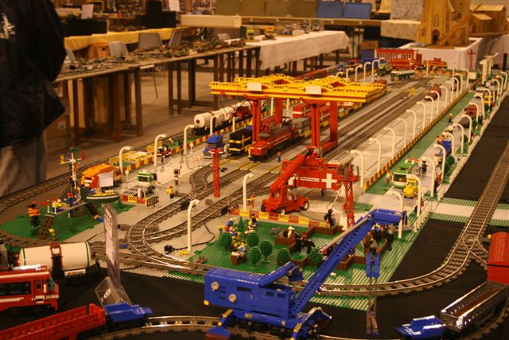
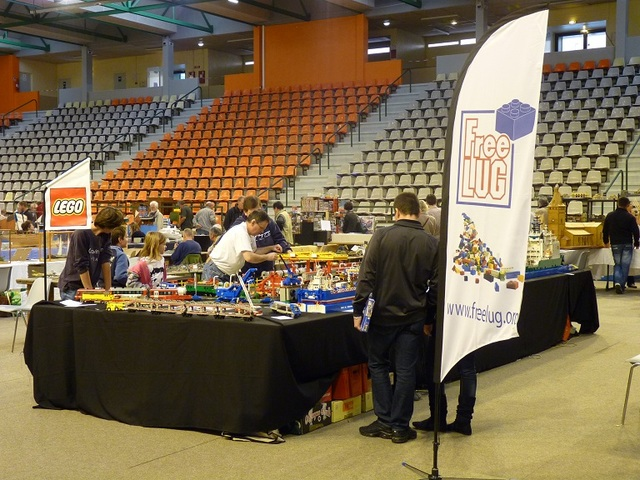
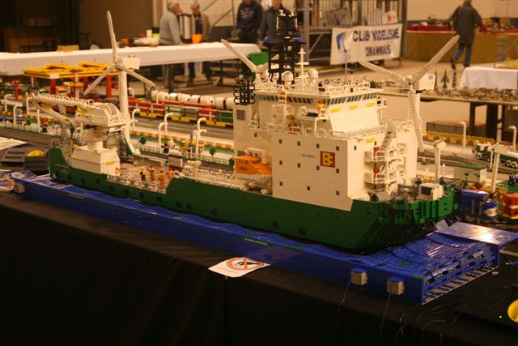

Quatre ans plus tard (ndla : le salon a lieu tous les 2 ans), les organisateurs de Dinan m’ont de nouveau invité à exposer mes dernières créations. Cette fois-ci, je souhaitais la présence d’exposants locaux, impossible, ce n’est que partie remise.

Cette année, j’ai amené :  
**–** le Bourbon Enterprise, grosse barge off shore et sa houle animée,  
**–** le diorama animé du bateau de fret de l’ile de Batz ,  
**–** et en exclusivité, la première sortie de la plate forme rail/route de Saint Martin des Champs,  
**–** plus des créations ferroviaires de ma collection.

Arrivé vendredi vers 14h, j’ai commencé le montage du stand. Brigitte et Alain Eury, en voisins et visiteurs, m’ont rejoint.  
Le stand de 6m x 2.40m fut terminé vers les 22h, je prends mon temps maintenant.

Merci à Brigitte et Alain pour le coup de main et les scénettes. Je me suis vite familiarisé avec la plate forme, réactualisée depuis, qui est un diorama alternatif car toutes les plaques de base proviennent du diorama trains et ferries, mes 19m de rails droits étaient réquisitionnés.

Au final, j’ai du réapprendre ce système car il fallait repérer le courant selon les aiguillages, les rails courbes emmêlés de Brikolego ont fonctionné correctement, une première sur le Grand Ouest.

Je travaille toujours en manuel, les enfants ont apprécié même si le niveau était assez dur durant les 2 jours. Je m’y attendais, pari réussi quand même.

Samedi tôt dans la matinée, quatre exposants de la petite brique s’installent, un père et son fils en Technic (première fois) et un gars en fauteuil roulant aidé de sa femme pour un layout train vintage. Ces personnes s’ajoutent à Gwenju, adhérent récent , et jul de brickpirate, un local, venus dimanche.

Pour les Côtes d’Armor, ça commence à devenir intéressant, et c’était le but de ma présence. D’autres visiteurs qui possèdent une collection nous rejoindront.

A 10h, le stand FreeLUG, flamme sortie pour l’occasion, accueille ses premiers visiteurs, le public est ravi...

Dimanche, grosse cohue, beaucoup d’enfants ont joué avec mes trains, la barge animée de l’ile de Batz tournait comme une horloge, la houle animée m’a inquiété car les axes soutenant les chenilles avaient tendance à sortir de leur trou. Le problème a été repéré et réparé en rentrant.

A 18h, démontage du stand en 1 heure presque, chacun est reparti sauf moi qui sera hébergé chez Jul le local le soir.

La brique gravée de Dinan est arrivée juste après le salon, certains l’ont reçu, je dois en refaire pour les autres personnes qui m’ont aidé. Merci du fond du coeur.

En conclusion, comme l’a dit la presse, plus de 1600 visiteurs ont vu le salon et nos LEGO. Moi et mes collègues avons été très satisfaits de cet engouement. C’est une surprise à titre personnel.

Pour un Dinan 2014, je demanderai au salon une surface plus grande.

Prochain salon : salon de Relecq Kerhuon les 27 et 28 octobre 2012

_Jean-Marc_

* * *

Dinan n’est pas si loin de St Lô, donc ok. Nous voici partis aider un peu Jean Marc.

Une fois le montage fait et d’autres amis AFOLs venus rejoindre JMB, nous avons visité ce superbe salon.

Le premier prix attribué à cette grande construction MECCANO que je voyais pour la première fois m’a semblé évident. Un robot SW déambulait dans l’autre salle devant les yeux émerveillés des gosses qui prenaient des bonbons dans ses poches/tiroirs et pleins d’activités ont retenu notre attention.

Nos vélos électriques loués nous ont agréablement menés jusqu’au joli port de Dinan et à une brocante pluvieuse le dimanche tôt.

JMB a fait le bonheur des gosses et le sien. Je suis resté avec Alain à l’observer. Il est inépuisable dès que des enfants sont là. C’est une vraie passion. C’est formidable. Les organisateurs ont été aux petits soins pour nous et nous avons rencontré de nouveaux AFOLs. Un WE très agréable.

_Brigitte et Alain_

## Galeries photos

**–** [Photos de Jean-Marc](http://photos.freelug.org/main.php/v/barr__/expositions/2012/dinan/)  
**–** [Photos de JUL](http://photos.freelug.org/main.php/v/barr__/expositions/2012/dinan/jul/)  
**–** [Photos de Brigitte](http://photos.freelug.org/main.php/v/EURY/exposition/)
