Le Legoland Malaysia a ouvert ses portes le 15 septembre dernier, je vous propose une petite visite du parc.

En route pour le Parc Legoland, nous sommes le samedi 29 septembre 9h58, et déjà beaucoup de monde devant l’entrée du Parc.

[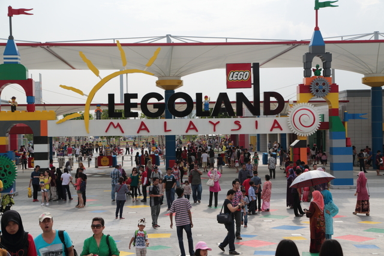](https://www.freelug.org/IMG/jpg/Legoland9152.jpg)

10h00 les premiers visiteurs accèdent enfin au parc.

Un petit coup d’œil au plan du parc.

[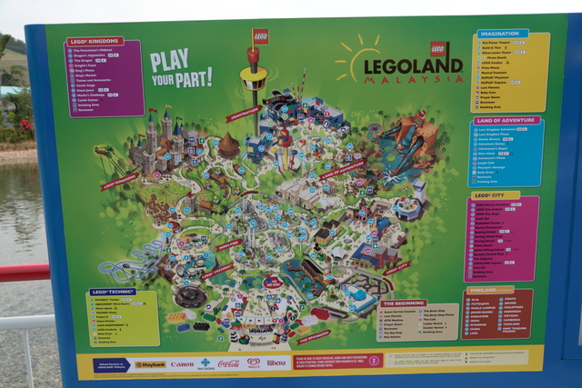](https://www.freelug.org/IMG/jpg/Legoland9153.jpg)

C’est assez ressemblant à Legoland Billund, ou Legoland Windsor.

En Malaisie il fait entre 25 et 30 degrés toute l’année et les fortes averses sont très fréquentes.

[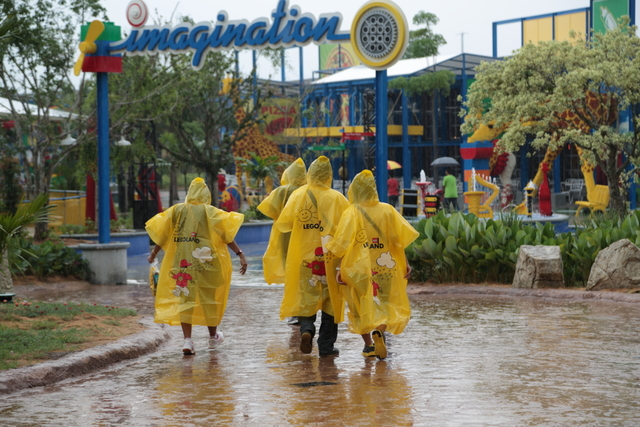](https://www.freelug.org/IMG/jpg/Legoland0068.jpg)

LEGO a donc pensé à tout avec ces magnifiques _Poncho_.  
Un conseil ; ne les achetez pas, l’humidité est très fort toute l’année et une fois mouillé vous ne sécherez plus. Investissez dans un parapluie, on en trouve dans toutes les boutiques du parc.

Toujours sous la pluie, un petit tour de train pour commencer. Voici la gare du Legoland Express et sa superbe fontaine.

[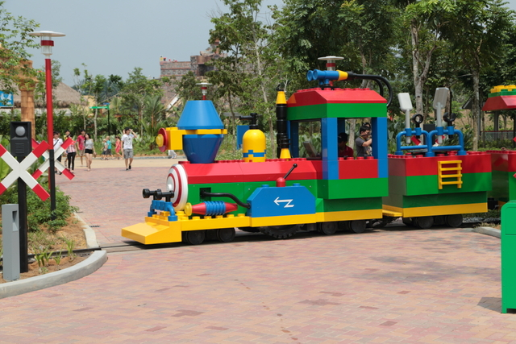](https://www.freelug.org/IMG/jpg/Legoland1201.jpg)

[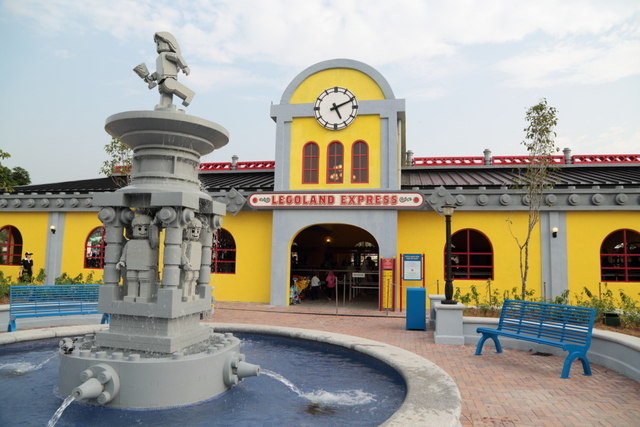](https://www.freelug.org/IMG/jpg/Legoland0119.jpg)

Le soleil est revenu, on va donc faire un petit tour à Dino Island (l’île aux Dinosaures)

[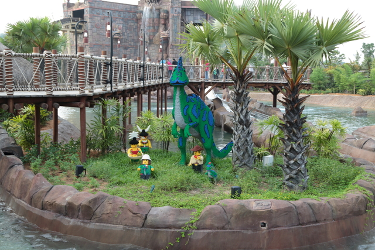](https://www.freelug.org/IMG/jpg/Legoland0121.jpg)

Et pour se rafraîchir

[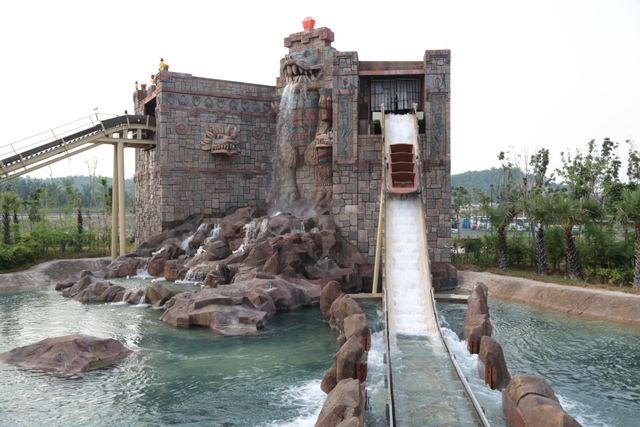](https://www.freelug.org/IMG/jpg/Legoland0122.jpg)

Enfin pour sécher

[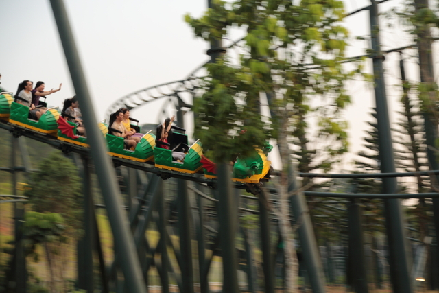](https://www.freelug.org/IMG/jpg/Legoland0127.jpg)

Coté boutiques, on retrouve à l’entrée le BrickShop et son Pick-a-Brick

[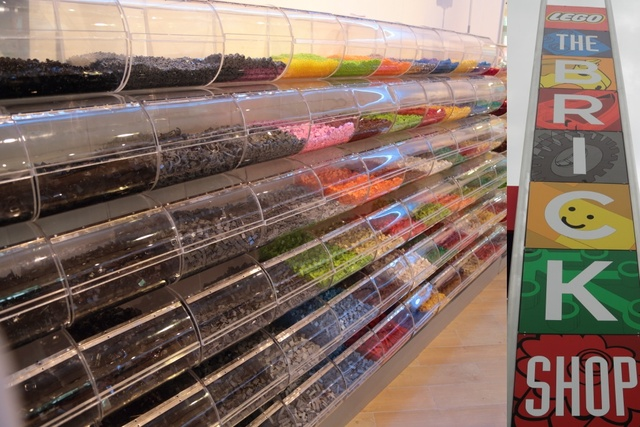](https://www.freelug.org/IMG/jpg/LegolandA006.jpg)

Et le Big Shop

[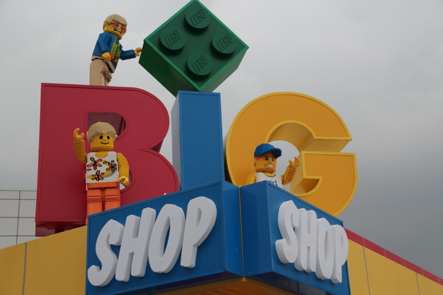](https://www.freelug.org/IMG/jpg/Legoland0010.jpg)

Et de nombreuses boutiques se trouvent également aux sorties des attractions

[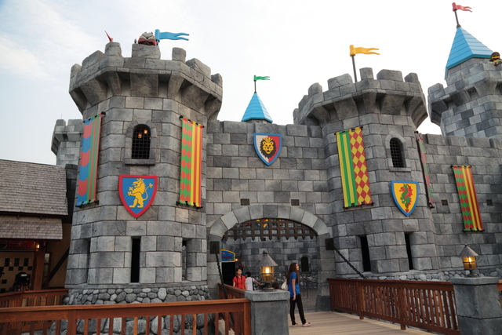](https://www.freelug.org/IMG/jpg/Legoland0123.jpg)

[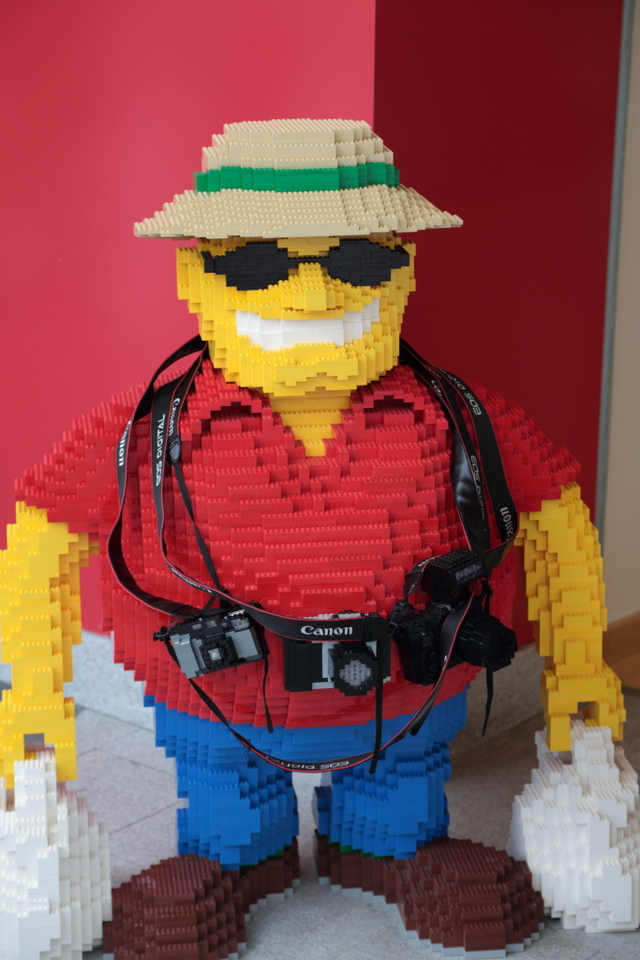](https://www.freelug.org/IMG/jpg/Legoland0008.jpg)

[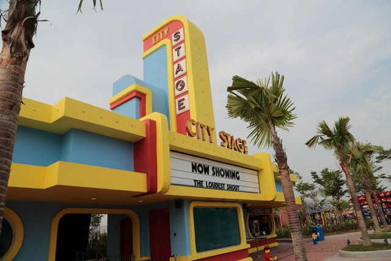](https://www.freelug.org/IMG/jpg/Legoland0120.jpg)

Pour nous AFOLs c’est sans aucun doute la plus intéressante partie du Legoland : MINILAND.  
Pas de tour Eiffel, ni de Statue de la Liberté ou de Big Ben, nous sommes en Asie, nous allons visiter les plus belles merveilles de la région.

On commence par les célèbres tours Petronas à Kuala Lampur,

[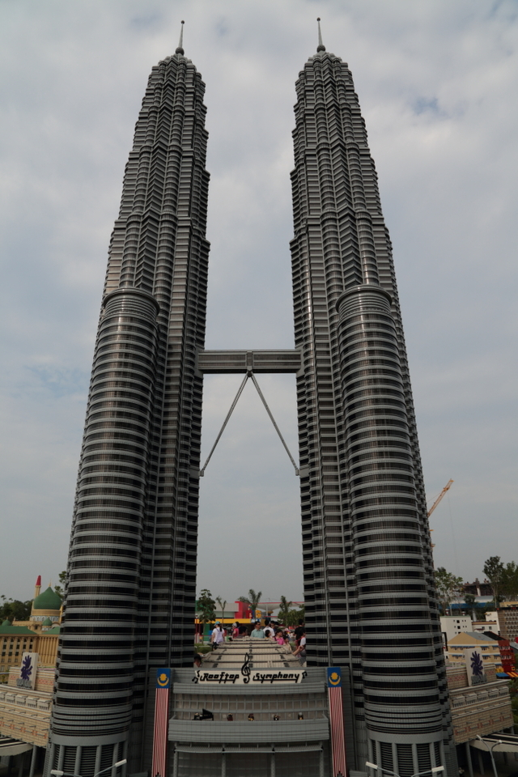](https://www.freelug.org/IMG/jpg/Legoland9230.jpg)

[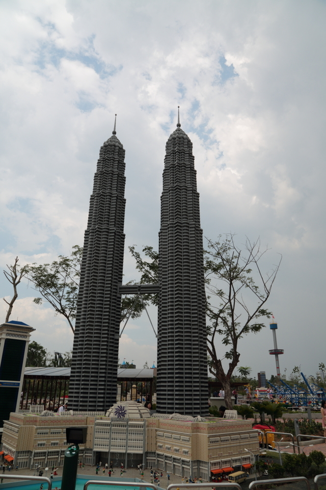](https://www.freelug.org/IMG/jpg/Legoland0022.jpg)

Et le monorail qui sillonne la ville.

[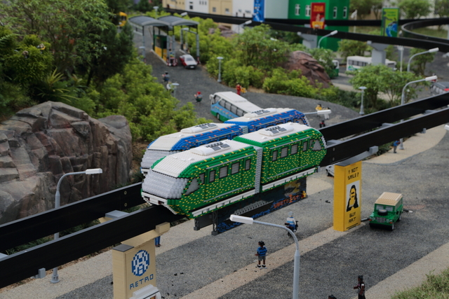](https://www.freelug.org/IMG/jpg/Legoland9211.jpg)

[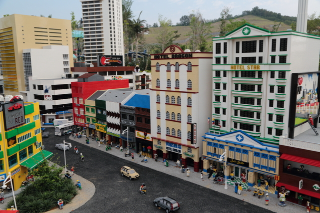](https://www.freelug.org/IMG/jpg/Legoland9241.jpg)

L’aéroport de Kuala Lampur :

[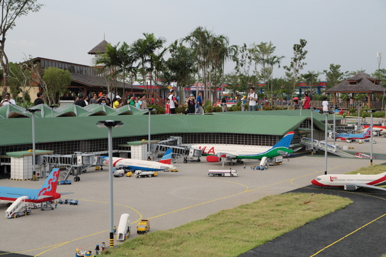](https://www.freelug.org/IMG/jpg/Legoland9270.jpg)

Le pays est aussi doté de grands ports :

[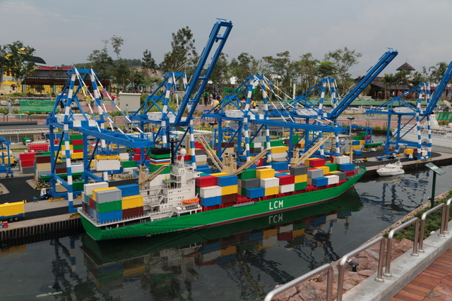](https://www.freelug.org/IMG/jpg/Legoland0087.jpg)

[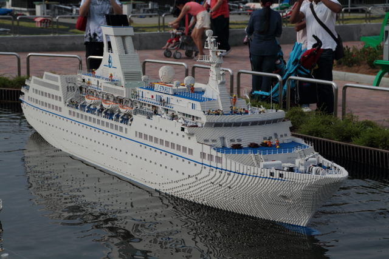](https://www.freelug.org/IMG/jpg/Legoland9282-2.jpg)

Passons maintenant la frontière avec la Thailand (Wat Arun)

[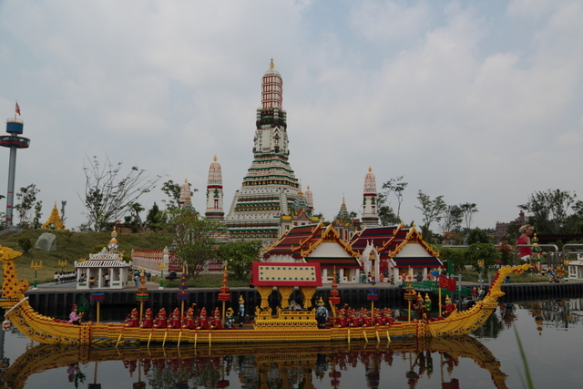](https://www.freelug.org/IMG/jpg/Legoland9411.jpg)

Puis le Cambodge avec le temple d’Angkor

[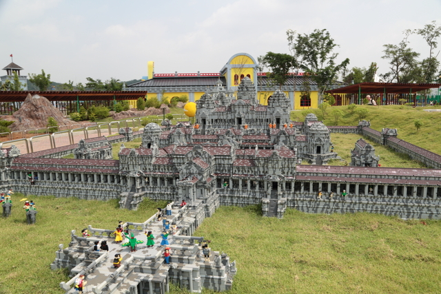](https://www.freelug.org/IMG/jpg/Legoland9425.jpg)

Puis à quelques pas le Taj Mahal :

[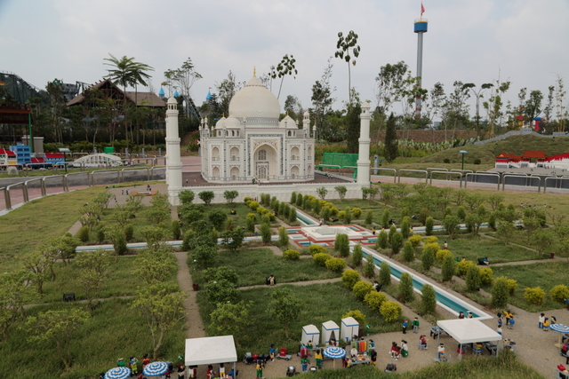](https://www.freelug.org/IMG/jpg/Legoland9399.jpg)

Passons par la Chine. Remarquez la grande muraille en arrière plan

[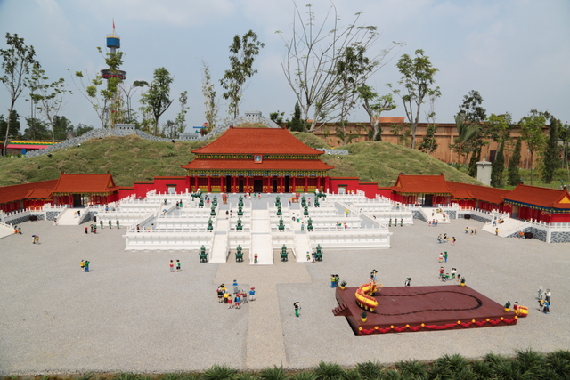](https://www.freelug.org/IMG/jpg/Legoland9461.jpg)

Et enfin, une Mosquée au Brunei.

[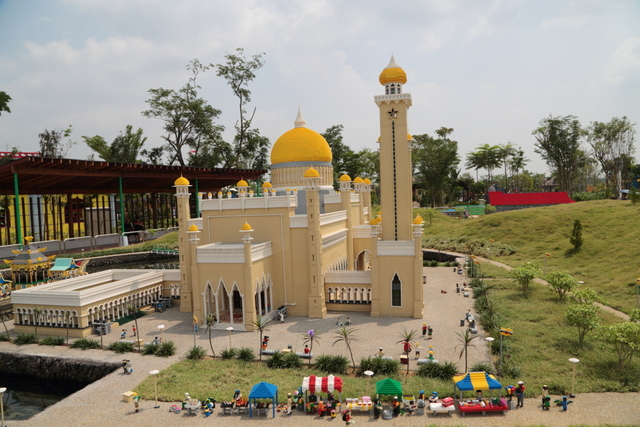](https://www.freelug.org/IMG/jpg/Legoland9436.jpg)

C’est un véritable tour d’Asie que le parc offre aux visiteurs et c’est absolument sublime.

Vous trouverez également des représentations du Laos, des Philippines, du Vietnam et Singapour.

Avant de terminer la journée un dernier passage à la boutique.

[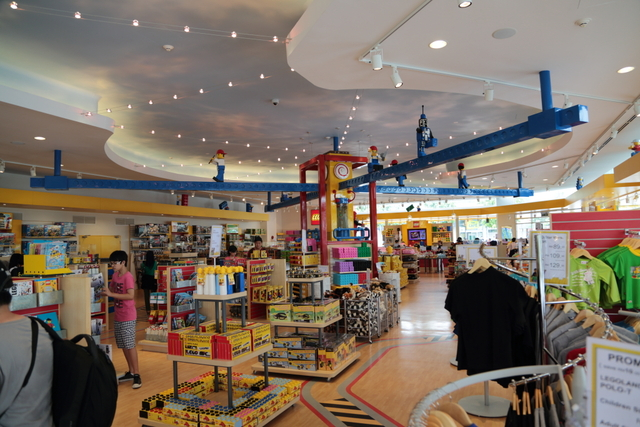](https://www.freelug.org/IMG/jpg/Legoland9478.jpg)

Il n’y a pas de bonnes affaires ici, les LEGO sont environ 10% plus chers. Pas non plus de brique collector, le Malaysian Fan Club du coin ne doit pas être très influent.

LEGO prévoit l’ouverture d’un Water Park similaire à celui de Floride en 2013.

[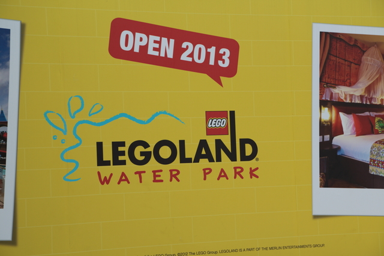](https://www.freelug.org/IMG/jpg/Legoland9484.jpg)

Un hôtel ouvrira quant à lui en 2014.

[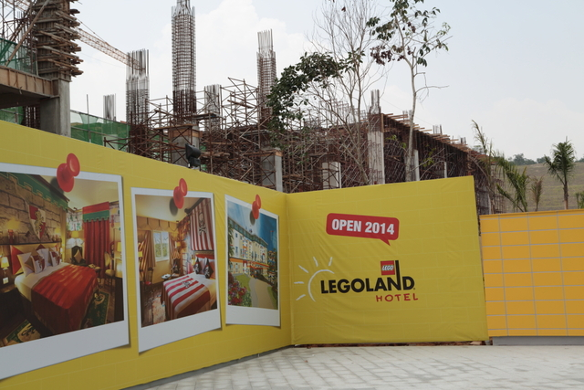](https://www.freelug.org/IMG/jpg/Legoland9485.jpg)

**Informations pratiques :**

L’entrée du parc :  
Le prix d’un ticket (30 septembre 2012) est de 140 RM (Malaysian Ringgit), environ 35 €  
Le prix du pass annuel est de 275 RM env 68 €

Avec l’ouverture du parc aquatique en 2013 et l’hôtel en 2014, les prix seront sûrement réévalués.

Le parking (coûtera) 7RM/jour, les caisses ne sont pas encore opérationnelles à ce jour.

Pour s’y rendre, depuis Paris, Air-France et Singapore Airlines assure des vols directs.  
Depuis la province de nombreuses options sont possibles, via Londres ou Francfort, de nombreuses compagnies desservent l’aéroport Changi de Singapour.

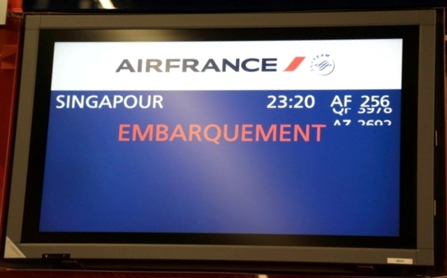

Une fois à Singapour un service de bus est disponible depuis Jurong // Boon Lay, le bus passe la frontière et vous attends avant de repartir.

Depuis Johor, au CIQ (juste après le passage de la frontière) un bus Legoland vous attend.

Depuis les principaux hôtels de la ville, des navettes assurent la liaison.

En voiture, depuis la ville de Johor il faut suivre Kota Iskandar, puis Pusat Bandar et enfin les premiers panneaux Legoland font leurs apparitions.  
Il faut environ 15 minutes depuis le centre de Johor pour rejoindre Legoland.

[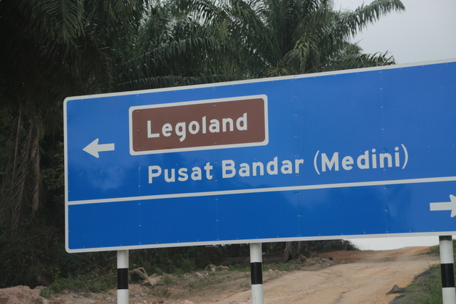](https://www.freelug.org/IMG/jpg/Legoland0001.jpg)

L’aéroport Kansai de Johor Bahru est aussi accessible après une escale à Kuala Lampur.

Logement :  
La Malaisie est très abordable, on y trouve des 5 étoiles pour 50€. Lisez quand même quelques avis sur internet avant de réserver votre hôtel.

Le logement à Singapour est plus coûteux, on y trouve en revanche des chaînes hôtelières (Ibis, Mercure, Hilton)  
En 2013 un parc aquatique ouvrira ses portes.  
En 2014 Legoland aura son propre hôtel au pied du parc.

[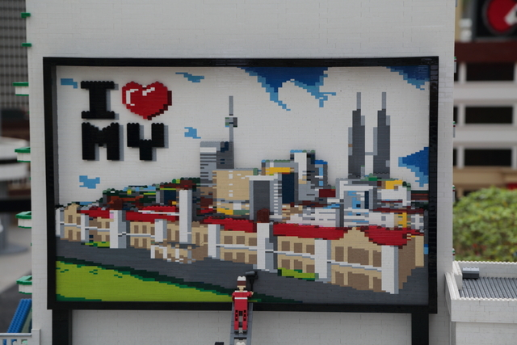](https://www.freelug.org/IMG/jpg/Legoland9031.jpg)

Pour conclure cette visite, le parc en terme d’attraction, de gastronomie ou d’exclusivité n’apporte pas un gros plus, en revanche c’est du coté de Miniland que l’immersion est totale avec les réalisations des Temples, Mosquées et Palais d’Asie tous plus beaux les uns que les autres.
