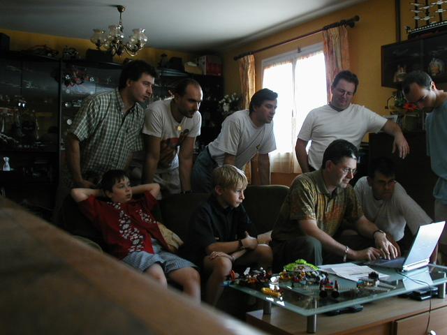

2002, la petite communauté des passionnés de LEGO en France ne se connait que virtuellement, grâce à un groupe Yahoo !, lego-construction.

Ce groupe s’est constitué par l’inscription successive de passionnés, contactés par leur site web personnel consacré aux LEGO ou via les ventes sur les plates-formes d’enchères, telles que e-bay ou le défunt IBazar.

En avril 2002, Jean-Louis, qui a monté un site d’information collaboratif sur les LEGO choisit le nom FreeLUG - pour _French Enthusiast LEGO User Group_, suite à un premier déboire avec la société LEGO pour un nom de domaine _legofr_ (et oui, dès 2002, TLC faisait la chasse aux noms de domaines contenant LEGO).

Le nom FreeLUG s’inscrit dans la lignée des différents LUGs qui sont alors créés un peu partout dans le monde.

En août 2002, Gilles propose sur la liste lego-construction de se retrouver chez lui pour un barbecue, et surtout pour enfin faire connaissance des personnes avec qui on dialogue depuis, pour certains, plusieurs années sur internet.

**Pascal en pleine enchère sur ebay**

Nous sommes 7 à se retrouver :  
**–** Jac  
**–** Jean-Louis B.  
**–** Gilles M., évidemment  
**–** Didier M. (accompagné de son fils et d’un de ses copains).  
**–** Erik A.  
**–** Pascal B.  
**–** Denis L.

A ce jour, tous sont encore dans l’aventure FreeLUG !

Au delà des discussions sur nos jouets favoris, nous abordons du sujet d’une association qui nous offrirait une structure légale, d’être plus visible, mais aussi nous permettrait de devenir un interlocuteur auprès de la société LEGO.

Dès lors, le projet est proposé sur la liste lego-construction.

Deux étapes sont menées en parallèle :  
**–** rédiger les statuts ;  
**–** trouver un nom pour l’association.

En novembre, les statuts sont soumis à débat, ainsi qu’un vote en ligne avec les nombreuses propositions de noms, parmi lesquelles se trouve FreeLUG, Jean-Louis proposant de mettre à disposition de l’association le site et le nom.

Tout se précipite lorsque M6 nous contacte pour un reportage sur les passionnés de la brique LEGO. Nous souhaitons nous saisir de cette opportunité pour promouvoir la future association.

Le 27 novembre 2002, le résultat du vote tombe, FreeLUG est sollicité à 57% pour être le nom de ce qui sera la première association de passionnés LEGO.

Quant au reportage de M6, on préfèrera l’oublier. L’objectif annoncé n’a pas été respecté et les protagonistes pas nécessairement tournés à leur avantage. Ce sera notre première leçon de méfiance vis-à-vis des médias.

[Rétrospective 2003 >>](/articles/1543/)
