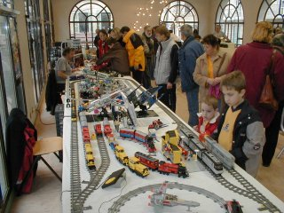
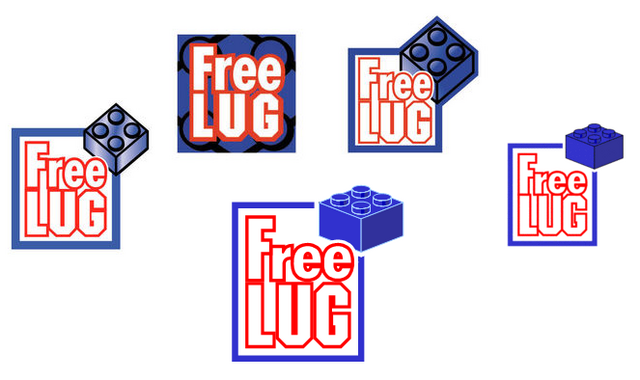
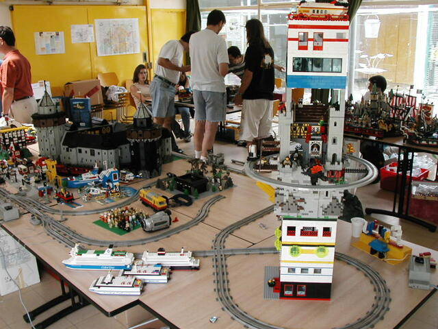
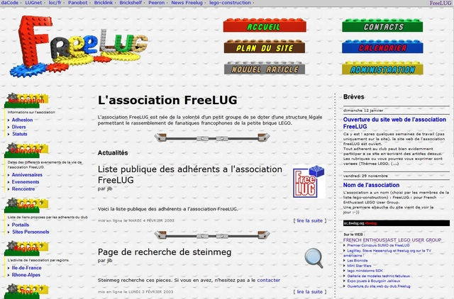

2003, première année de l’association, et déjà active !

L’année débute avec une première exposition, avant même la création officielle de l’association, le [dimanche 26 janvier à Bourgoin-Jallieu](/articles/49/).

C’est l’occasion d’une première rencontre entre membres de la région Rhône-Alpes.

Le 18 février 2003, l’association est officiellement créée.

En parallèle, de janvier à mars, le logo de l’association est en cours de réalisation. Le logo final retenu est issu d’une proposition d’Eric "Baronsat" Druon.

En mars, Pascal Brugier et Gaël Frazier nouent un premier contact avec LEGO, mais en Angleterre auprès du service commercial.

Au mois d’avril, c’est au tour de l’Alsace de participer à [une première exposition à Plobsheim](/articles/92/).

Le [22 mai, se tient la première assemblée générale](/articles/104/). Huit membres se retrouvent à Paris tandis que douze autres y assistent à distance par IRC (irc.freelug.org #freelug). Au 17 mai, l’association compte 45 adhérents.

Les 19 et 20 juillet, Gaël organise à Rennes la première rencontre de ce qui deviendra la Rencontre Estivale, [la Breizhou LEGO© Fête](http://photos.freelug.org/main.php/v/brickerik/expositions/2003/Breizhou/).

Les premiers projets collaboratifs apparaissent, comme le [Brickciel](https://www.freelug.org/spip.php?article148) ou les [concours comme le sumo](/articles/50/).

En octobre, un petit groupe se décide pour se lancer dans l’aventure en organisant une première sortie à l’étranger, en participant au [Legoworld 2003](/articles/165/). Ce sont les premiers vrais contacts avec la communauté internationale.

En novembre, nous participons au [Salon des Passionnés de la Ville du Bois](/articles/179/).

Au cours de l’année, nous avons été présents sur 8 salons différents, de la Bretagne à Rhône-Alpes, en passant par l’Ile-de-France et l’Alsace, permettant de faire connaitre au grand public l’existence de passionnés adultes fans de LEGO, et surtout, permettre à des fans se sentant seuls dans leur coin de découvrir toute une communauté.

2003, c’est aussi l’année du premier partenariat avec un revendeur, le [magasin MaxiToys de Brétigny](/articles/180/).

Côté Internet, une nouvelle version du site s’ouvre à tous les membres, chacun peut y contribuer en articles concernant nos petites briques : résumé des rencontres ou expositions, revue de modèles, présentation de créations, page de trocs, foire aux questions...

Les discussions ont lieu sur la liste [freelug-generale, ouverte à tous](http://lists.freelug.org/cgi-bin/mailman/listinfo/freelug-general), qui prend alors le relais de la liste lego-construction.

Deux offres exceptionnelles permettent aux adhérents d’acquérir des boites exclusives, le [camion Maersk 1831](http://www.brickset.com/detail/?Set=1831-1) et la [maison Velux 1854](http://www.brickset.com/detail/?Set=1854-1).

Au 31 décembre, l’association compte 71 adhérents.

[<< Rétrospective 2002](/articles/1542/)
