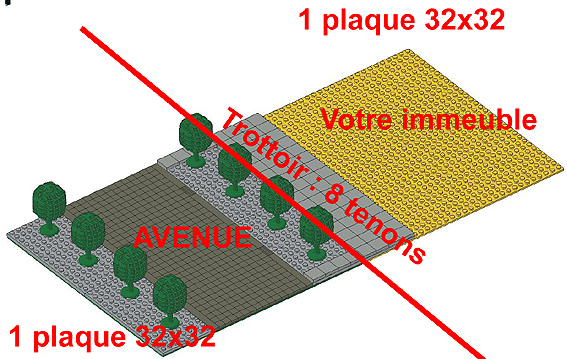
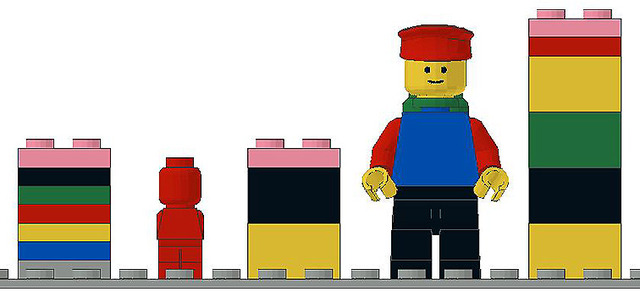

La [REF 2013](http://wiki.freelug.org/REF+2013) qui va se tenir à Coltines dans le Cantal les 13 et 14 juillet 2013 fêtera les 10 ans de FreeLUG. Mais c’est aussi le week-end du 14 juillet avec son mythique défilé des Champs Élysées.

Nous vous proposons donc de faire les Champs Élysées FreeLUG : chacun(e) construit un ou plusieurs immeuble à l’échelle ’microfig’.

## Le cadre général

Il s’agit d’habiller l’avenue avec le maximum de façades d’immeuble.

Il y aura déjà l’arc de Triomphe et l’avenue elle-même versus 14 juillet.

Pour cela il suffit de construire des façades de bâtiments (ou des bâtiments complets) à l’échelle Microfig ou 1,5 Microfig.

Ces façades seront intégrées dans une présentation plus large avec l’arc de triomphe et les champs Elysées eux même en version 14 juillet... ;-).

La construction est totalement libre : il n’est pas nécessaire de reproduire un bâtiment réel des Champs Elysées.

Mais toutefois nous distinguerons deux catégories primées [^1] par le vote ’du public’ :  
**–** catégorie reproduction bâtiment existant (photos preuve à l’appui)  
**–** catégorie bâtiment imaginaire

Pour information, une Microfig fait 2 briques de haut hors tenon (une Minifig fait 2 briques + 1 plate de haut)

N’hésitez pas à poser vos questions (ou vos remarques) sur la liste, j’y répondrai.

Lâchez-vous, et n’hésitez plus à participer !

cdhd

[^1]: les lots (2 ou 3 premiers) restent à préciser
