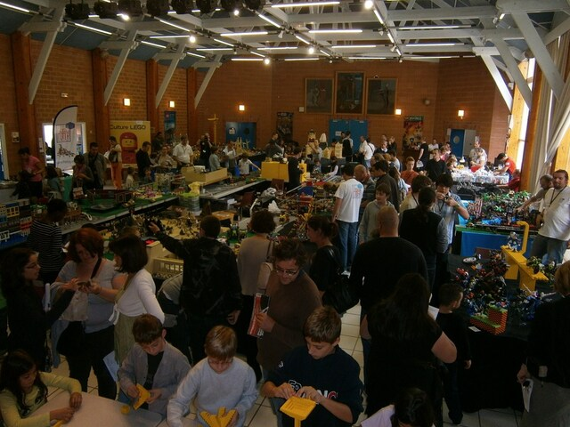
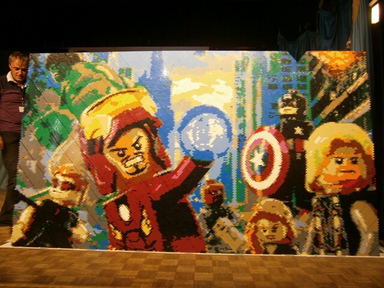
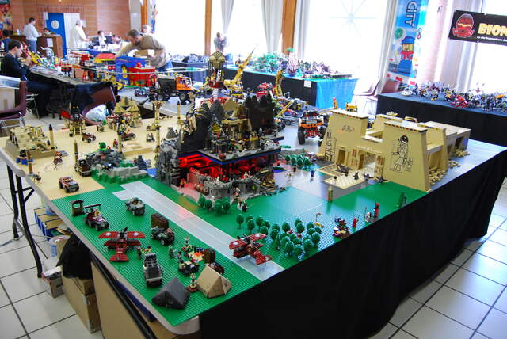
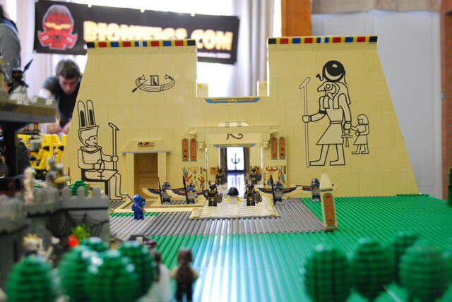
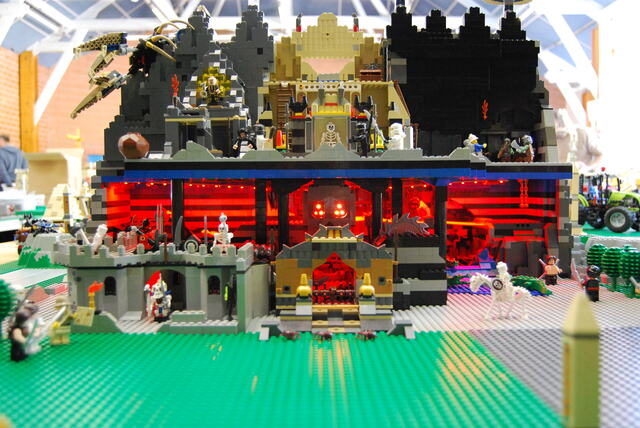
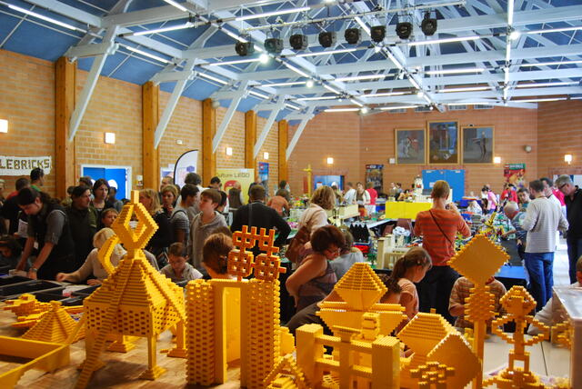
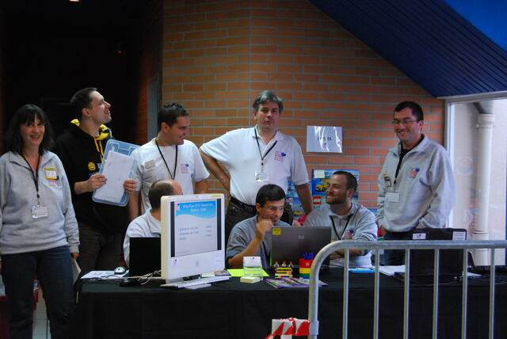
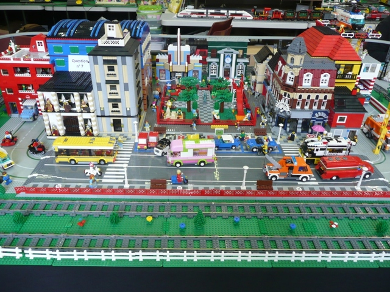
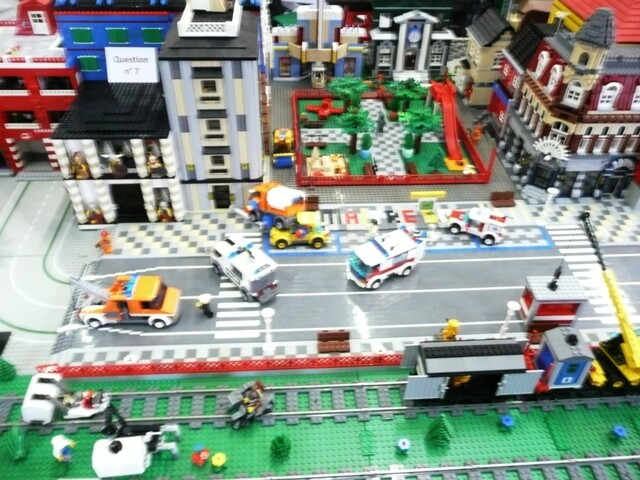
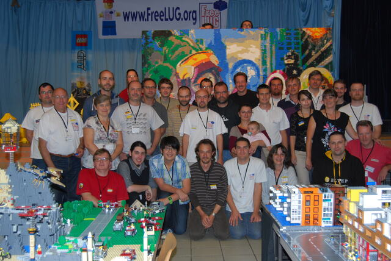

Cette troisième édition, mais la première pour un weekend entier (les deux précédentes étaient uniquement le dimanche après-midi) a eu un joli succès auprès des 700 visiteurs qui sont venus admirer nos constructions.

Un gros travail de communication reste à faire pour 2013 puisque beaucoup de visiteurs ont été informés de l’exposition au dernier moment.

Qu’est ce que les visiteurs ont pu decouvrir ?

Côté exposants il y avait la ville de Georg, un diorama Star Wars de Fabien et Sylvie, les bateaux de Didier, le château de Poudlard d’Eric, l’espace avec Johan, l’ile de Pirates et un tram de Mick, des mocs figurines Hero Factory et constructions de nos jeunes amis de Bionifigs : "Les 3 T" Shaddow, Tom8596 et TTTbionicle ainsi que Xelectis608 (avec mon Sonic préféré de la part de Shaddow), Jenni et Martin avec un diorama du Jura et des animaux de compagnie, Eric, Sylvie et Fabien avec un diorama japonais, des modèles Technic de Sébastien, l’Egypte de Rémi, un tournage du film le Seigneur des Anneaux de Gilles, des sets architectures de Jérémy, quelques bâtiments de la cité de l’architecture de Jérémy, et du City de Damien, Gilles, Cédric, Jean-Claude et Jérémy ainsi que la rotonde de Pierre et un peu de Friends.

Nous avons eu la chance de pouvoir accueillir Nicolas avec le stand Culture LEGO, le graveur Eric avec ses amis Steven, Johan et Karine, et Jenni et Martin avec leur stand de pièces détachées.

En animation nous avons eu la superbe mosaïque de Simon. Le thème c’était les super héros ainsi que la construction libre avec les briques jaunes 2x4.

**Veneux-les-sablons en 2012**

Le samedi soir, après le départ des visiteurs, place au diner entre exposants. Mes amis du CA ont trouvé pleins d’idées pour des animations durant le repas et nous avons beaucoup construits, rigolé et parlé.

L’ambiance entre les exposants et bénévoles était superbe et beaucoup aimeront revenir pour l’année 2013. Ca tombe bien, les visiteurs nous ont donné rendez-vous aussi.

Merci beaucoup à Monsieur le Maire ainsi qu’à l’équipe municipale de nous avoir fait confiance et de nous avoir accompagné lors de l’inauguration de notre exposition avec tant d’enthousiasme.

Merci beaucoup à tous les exposants, les bénévoles : Erik, Julie, Anne- Laure, Yannick, Pierre L., Jicé, Bruno et Laetitia ; et les accompagnateurs, sans vous, cette exposition ne serait pas possible.

Rdv le 21 et 22 septembre 2013 pour la quatrième édition.

_Daniela_

## Petit mot de Didier

J’ai bien failli pas venir à Veneux car je suis sorti de l’hôpital deux jours avant avec interdiction de porter quoique ce soit.  
Un de mes voisins a chargé mes caisses dans la voiture et Jean-Claude à l’arrivée les a emmenées sur place.

Après deux heures de montage, la mer et les deux Chalutiers tirant le chalut pélagique étaient en place. Le diorama représente deux chalutiers au travail pratiquant la pêche en bœuf.

J’ai pu compléter la faune et la flore sous le chalut grâce à la présence d’un vendeur Belge de LEGO sur place.

Deux jours d’explication sur cette technique de pêche peu connue. Beaucoup moins de questions sur les techniques LEGO pour cette réalisation, en indiquant que toutes les pièces sont standards et non modifiées.

Le filet contenait 100 poissons mais on avait l’impression qu’il était vide. Puis il fallut aider un peu les enfants pour trouver les intrus placés sur le diorama.

La création de ce diorama est venue à la suite de deux défis. Le premier Création du Thomas Nicolas II le patron pêcheur n’y croyait pas du tout me prenant pour un rigolo et j’ai eu beaucoup de mal à avoir quelques renseignements longueur largeur et de pouvoir faire des photos etc.

L’année suivante j’ai rapporté à l’Office du Tourisme de la Turballe port d’attache de ces bateaux le modèle en LEGO pour l’exposer au Musée de la Pêche et présentation aux Marins dont le patron de celui-ci avec un petit article dans la presse locale.

Deuxième défi au cours de cette présentation à la presse de présenter les deux en action de pêche bœuf.

Le deuxième bateau est le Marie Chriso II. Ils ont été exposés plus de deux mois au musée de la pêche, récupérés juste à temps avant mon hospitalisation.

[Voici le lien vers mon album photo sur la galerie FreeLUG](http://photos.freelug.org/main.php/v/Bonnet+rouge/Gallois+Didier_002/)

J’ai passé deux jours fatigants après un si court repos après l’hôpital, mais quel plaisir d’être avec d’autres AFOL’s et pouvoir montrer que l’on peut faire beaucoup de chose avec des briques LEGO standards ELTEP (En LEGO Tout Est Possible)

_Didier Gallois (Bonnet rouge)_

## Petit mot de Mick

Moi, je me suis éclaté, arrivé en avance, une fois n’est pas coutume, j’ai profité de cette super expo pleine de convivialité pour m’amuser, pourrir mes voisins (gentiment), revoir les amis et acheter plein de briques gravées, de végétations...

Mon ile a décroché un joli succès comme à chaque fois que je la sors, mais il faudra la modifier avant de revenir à Veneux ! J’ai bien aimé ma razzia sur les boites au concours du samedi soir car j’en ai eu marre de faire chou blanc aux précédentes...

Sinon, un WE excellent à réitérer bien entendu...

_Mickael EYMANN, mickbatto_

## Petit mot de Jenni et Martin de LITTLEBRICKS

L’exposition de 2012 a été bien organisée et tout le monde était gentil. Les visiteurs semblaient satisfaits de ce qu’ils ont vu. Pour une première exposition sur un weekend entier, il y avait une bonne participation et nous nous réjouissons de pouvoir participer à l’édition 2013.

_Jenni et Martin (LITTLEBRICKS)_

## Petit mot de Sébastien

Pour ma part j’ai présenté quelques uns des modèles Technic que j’ai. Mais je voulais surtout être présent à cette manifestation, pour aider l’équipe organisatrice car il faut pas mal de monde pour que les rouages ne grincent pas.

Merci à Daniela de nous offrir l’opportunité d’exposer. Merci à Cédric de s’être occupé de la question sur mon stand pendant que je faisais les entrées.

_Sébastien_

## Petit mot de Rémi

C’est la deuxième année que je fais cette exposition. L’an passé, j’avais exposé un circuit avec du city, mais cette année, changement de thème avec l’Egypte.

C’était la première sortie de la montagne animée et tu temple au format complet.

Malgré quelques soucis de mise en route, le mécanisme n’a pas eu trop de ratés le samedi. Quelques dents de pignons ont commencé à sauter en fin de journée… Une modification le dimanche matin a permis de résoudre le problème.

Beaucoup de visiteurs durant ce week-end et beaucoup d’échanges avec des passionnés peut-être futurs membres de FreeLUG.

Beaucoup de belles réalisations avec le tas de briques, les visiteurs se sont vraiment impliqués.

Et les exposants ont offert un accueil chaleureux à l’entrée.

Bref une édition avec beaucoup de plaisir et de visiteurs, vivement l’édition 2013.

_Rémi_

## Petit mot de Damien

Exposition très bien et sympa, j’ai vu différente thèmes en LEGO que je n’avais pas vu sur d’autres expos et je suis satisfait d’exposer mon circuit de train avec quelques modèles Technic.

_Damien_

## Petit mot de Cédric

J’ai beaucoup apprécié ma première exposition.  
Les échanges avec les autres exposants et les visiteurs étaient une grande nouveauté pour moi qui n’avait réalisé que des vitrines de magasin.

Quelques petits soucis allant de la petite casse pendant le transport à mon moteur de train 9 V qui refuse de fonctionner sans être pousser, encore merci à Gilles pour sa loco.

J’ai eu la preuve le dimanche matin que nos chère minifigs n’en font qu’à leur tête lorsqu’elles sont seules et qu’elles ne savent pas conduire.

Merci à l’équipe de bénévoles qui nous à accueilli, Daniela tu auras peut être une petite place pour moi en 2013 ?

_Cédric_

L’équipe d’exposants :

## galeries de photos

**–** [Rémi B](http://photos.freelug.org/main.php/v/Bug_s/Expo/BEVLS12/) /  
**–** [Cédric](http://photos.freelug.org/main.php/v/maitresoda/veneux+2012/)  
**–** [Daniela](http://photos.freelug.org/main.php/v/Daniela+et+Sylv1/Expositions/2012/Briqu+Expo+Veneux+2012/Exposition/)  
**–** [Erik](http://photos.freelug.org/main.php/v/brickerik/expositions/2012/BE_Veneux/)
