Les 3 et 4 novembre 2012 avait lieu une exposition de train miniature à Chamalières (63) dont voici le résumé de notre participation.

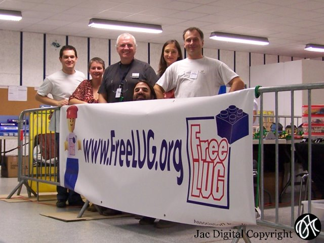

**Photo du groupe des participants devant la banderole FreeLUG**

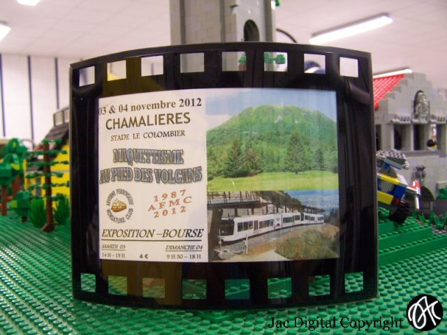

L’AFMC fêtait ses 25 ans. Nous avons eu en cadeau une belle plaque commémorative.

* * *

Après un petit tour par la [piscine de Chamalières](http://www.clermontcommunaute.net/index.php?option=com_content&view=article&id=564&Itemid=482), bel endroit que JAC vous conseille particulièrement mais assez pauvre en exposition LEGO, nous sommes arrivés sur le site de la salle omnisports du [Lycée Hôtelier de Chamalières](http://www.lyceedechamalieres.fr/) où se tenait l’exposition de modélisme ferroviaire attendue. Le montage a commencé vers 17h00 vendredi et c’est vers 13h00 le lendemain que tout était presque en place. Heureusement que nous sommes allés nous reposer dans la nuit.

[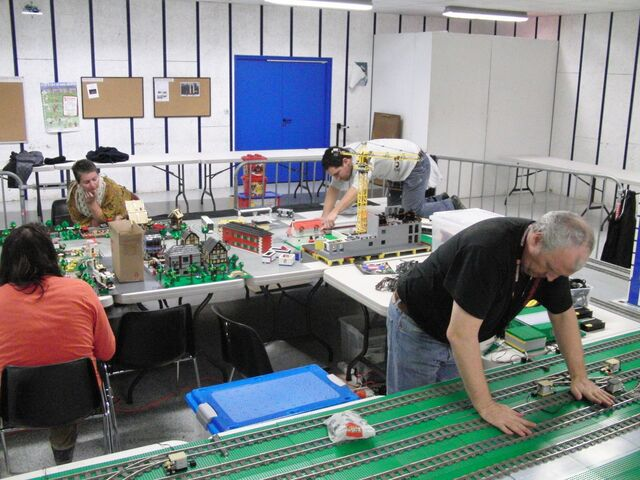](https://www.freelug.org/IMG/jpg/CIMG8351_1600x1200.jpg)

A l’inauguration du samedi midi, les trains tournent dès le premier passage alors que le décors continu d’être monté pour l’ouverture au public à 14h00 ; signe d’une certaine habitude des expositions de la part de notre équipe de choc renforcée.

[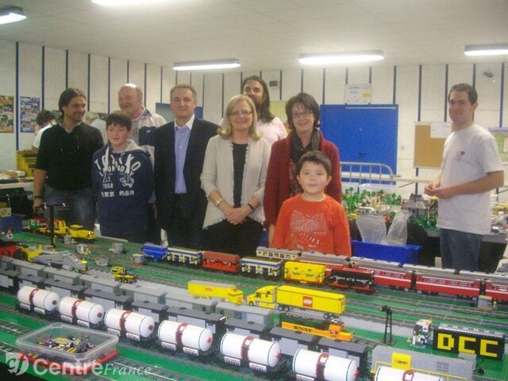](https://www.freelug.org/IMG/jpg/884061.jpg)

**(c) 2012 La Montagne - groupe Centre France**

[voir l’article sur leur site](http://www.lamontagne.fr/auvergne/actualite/departement/puy-de-dome/puy-de-dome-local/2012/11/04/les-25-ans-de-lafmc-marques-par-une-exposition-exceptionnelle-1320909.html)

Le réseau tenait sur une partie seulement du diorama, avec la volonté de ne pas envahir de rails toutes les tables, ce qui laisse finalement plus de place utilisable aux constructions de ville. D’où une zone ferroviaire qui se tient d’un côté et une belle ville urbanisée et de loisirs de l’autre. Ce choix s’est avéré un bon pari car les visiteurs appréciaient autant les vues plus fouillées de la ville que le passage des trains.

[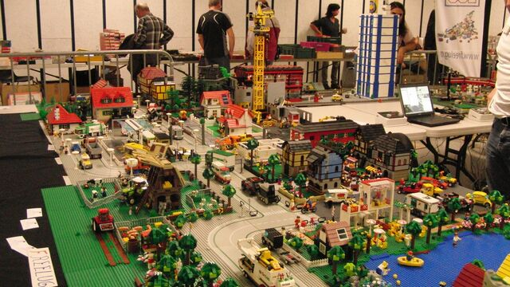](https://www.freelug.org/IMG/jpg/CIMG8415_1600x1200.jpg)

C’était un [réseau piloté en DCC](/articles/592/) avec de l’équipement standard, quoique rôdé, et le tout dissimulé [dans les briques](/articles/616/) et les [moteurs 9V modifiés](/articles/491/). Encore beaucoup de question de la part de nombreux visiteurs sur l’existence des rails 9V métalliques... "Ah non ma pauv’ Dame, ça ne se fait plus. Maintenant c’est tout en plastique et avec des piles" ; "Non cher Monsieur, les rails ne sont pas modifiés, ce sont les rails qui étaient vendus avant les rails plastiques". Des évidences pour nous les AFOLs et un étonnement systématique des spectateurs intéressés. Je vais finir par avoir l’impression d’exposer des pièces de musée, ce qui est un peu le cas.

[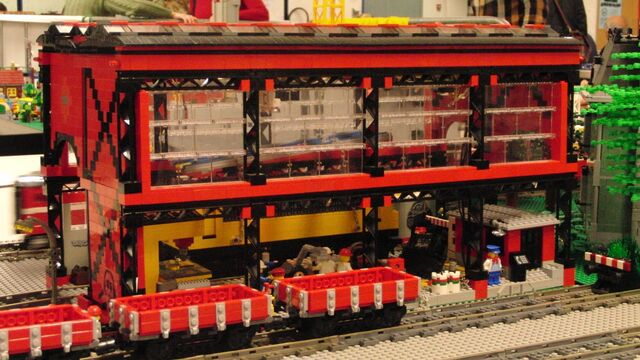](https://www.freelug.org/IMG/jpg/CIMG8449_1600x1200.jpg)

A propos de nostalgie, voici un visiteur ému déclarant avoir joué enfant avec [ce camion jaune](http://www.brickset.com/detail/?set=335-1) qu’il n’avait pas revu depuis au moins trente ans. Voyage dans le temps pendant quelques minutes avec ce Monsieur et retour précipité aux trains qui tournent et se percutent faute d’attention soutenue.

[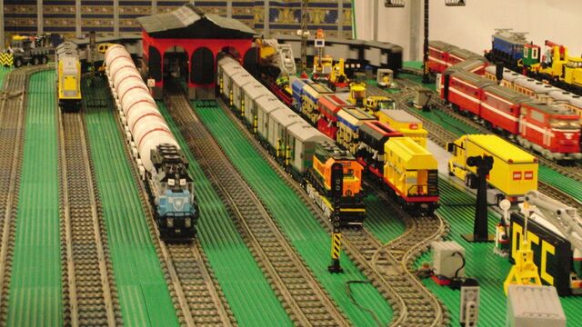](https://www.freelug.org/IMG/jpg/CIMG8423_1600x1200.jpg)

La journée du dimanche se passe en distribuant des friandises avec un train transporteur de vrac qui s’arrête devant les enfants médusés qui n’en reviennent pas d’avoir les bonbons sous le nez, de pouvoir se servir et par la même occasion de toucher au train. Beaucoup de tabous qui sautent et un peu d’air frais qui passe dans le monde du modélisme ferroviaire.

[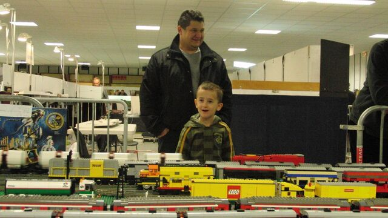](https://www.freelug.org/IMG/jpg/CIMG8411_1600x1200.jpg)

Enfin le démontage qui est plié (passez moi l’expression...) en une grosse heure, record de rangement battu grâce à la solidarité collective. Merci à tous les organisateurs, et particulièrement aux six AFOLs de cette exposition, pour ces moments d’amusement et de jeu LEGO ensemble.

_Philippe "frogleap"_

* * *

C’était une très bonne idée de séparer un peu les trains et la ville. Cela nous a permis de nous étendre sans contrainte, ni de style, ni d’époque et de placer les éléments un peu plus librement.

Bon, je n’ai pas pu être présent sur toute l’installation et malgré une erreur géographique dont j’entendrai parler souvent, nous avons pu présenter correctement le réseau prévu. Je l’ai trouvé magnifique d’ailleurs bravo à tous.

Faute de temps, j’ai présenté juste deux petits modules, une tour de 8 étages faute de pièce supplémentaire, bin si ça arrive...

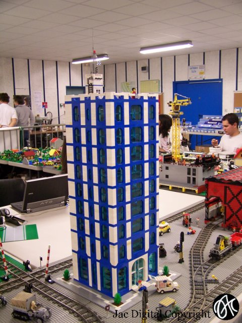

Une tour en ruine avec son temple, attaqué par des aliens.

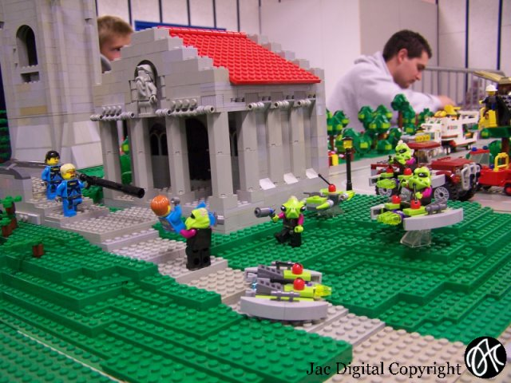

Mais cela ma permis de travailler correctement la présentation et de mettre la végétation que je souhaitais sur place.

Nous avons bien joué et discuté pendant cette exposition, jusqu’à la fin où, comme à notre habitude, nous nous sommes lâchés ! Les trains étaient envoyés à toute vitesse dans les virages, le temps d’en remonter un et un autre arrivait. Même certains partaient dans l’autre sens pour un choc frontal. J’entendais dans le public des exclamations, "Mais qu’est-ce qu’ils font ?" et je répondais "On range...". Même la grue et la tour en ruine se sont écroulées...

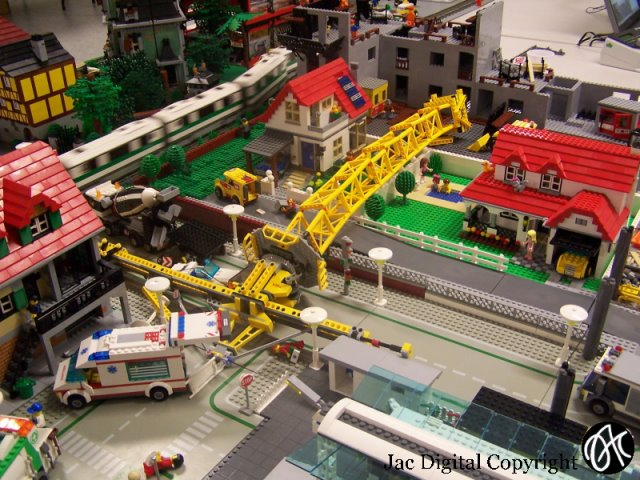

Un excellent Week-end passé entre AFOLs sur une jolie petite exposition. A bientôt à tous et merci pour votre participation.

_JAC_

* * *

On a entendu parler d’une légende lointaine où des constructeurs LEGO sont allés présenter un diorama près d’un centre nautique.

On s’est tous éventuellement bien amusés et avons rencontré pleins d’adorateurs de la brique.

On aurait pu distribuer pleins de bonbons aux visiteurs de tous âges.

On aurait pu profiter de la soirée couscous et du bon accueil des organisateurs et des modélistes de tout poil.

On aurait pu passer à la télé 3D et au journal papier.

Mais tout ça n’aurait pas été possible sans l’accueil de la famille "frogleap", le concours de PierroLego et le GPS de Jac.

_La famille chatpin31_

* * *

Aprés avoir enchainé les grosses expositions, Veneux-Les Sablons, Skaerbaek et Festi’Briques, je suis bien content de revenir au source des expositions LEGO, les salons de modélistes !

Après être passé à la piscine de Chamalières, haut lieu touristique de la région, j’ai enfin trouvé la salle en emmenant avec moi Jac trouvé sur le chemin...

Philippe ayant déjà installé les rails, et Eric en cours de finition sur sa partie, il y avait encore tout à faire ! Enfin sur ma partie.

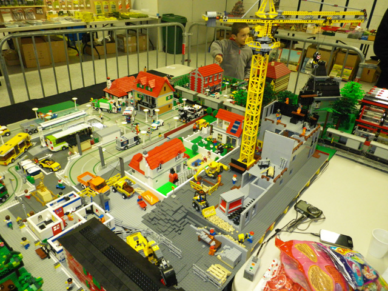

Justement, en ce qui me concernait, je suis venu avec un chantier d’un immeuble avec la belle grue, une gare routière et plusieurs villas.

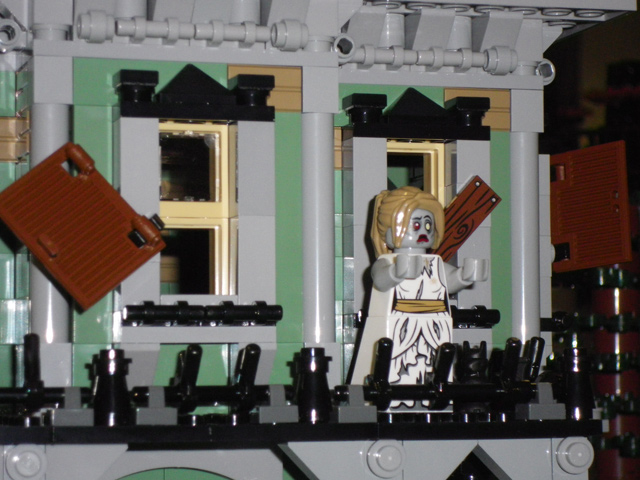

J’ai rajouté la maison hantée ainsi que les maisons à colombages de Xavier, invitées de dernières minutes

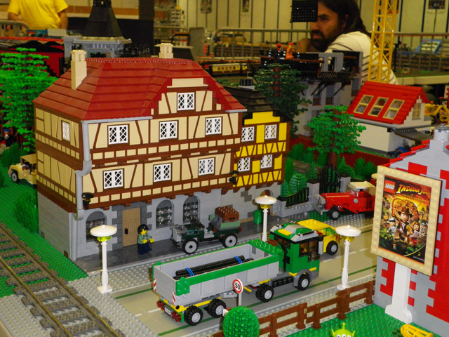

Merci à Philippe pour l’accueil. Sympathique exposition, bien agencé. A refaire !

 ;-)

_PierroLego_

* * *

## Galerie photos

**–** [Galerie photos de Jérôme "JAC"](http://photos.freelug.org/main.php/v/JAC/Exposition/2012/Chamaliere/)  
**–** [Galerie photos de PierroLego](http://photos.freelug.org/main.php/v/pierrel/exposition/2012/chamalieres/)  
**–** [Galerie photos de Philippe "frogleap"](http://photos.freelug.org/main.php/v/Frogleap/ExpositionsLego/Chamalieres2012/)
