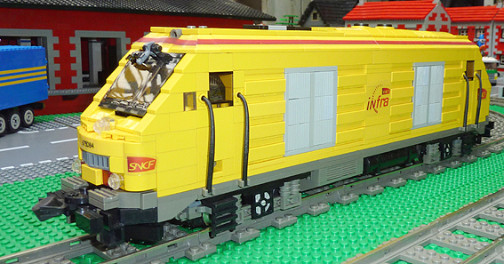

Un précedent article sur la construction d’une [BB 675084 Infra](/articles/1461/) vous annonçait que la notice de cette locomotive allait être publiée dans RailBricks.

Malheureusement, vu sa grande taille et malgré la grande qualité du travail de Didier Enjary pour la réaliser à partir de mon MLCad ’artisanal’, il n’a pas été possible de l’intégrer dans RailBrick.

Et donc, avec l’accord de Didier que je remercie, voici cette notice en exclusivité pour FreeLUG ;-).

Je pense qu’il y a matière à l’améliorer. Qui sera le premier ?

**Notice BB67508**

cdhd
